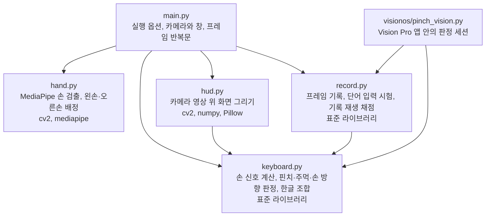
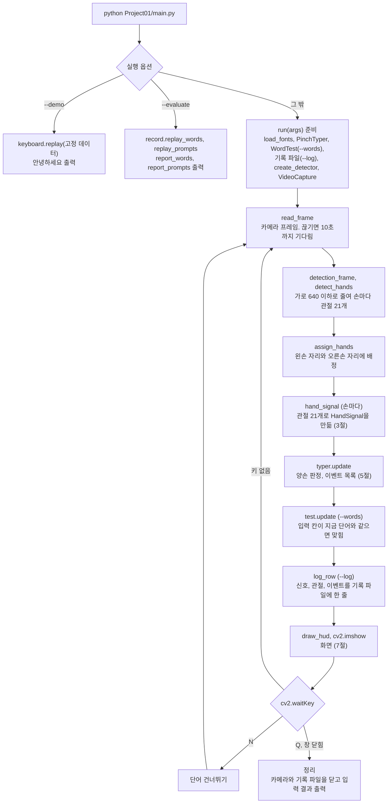
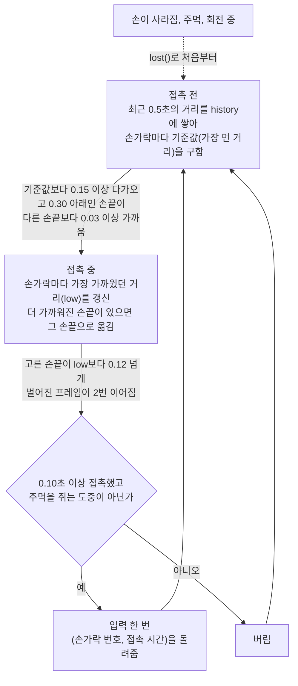
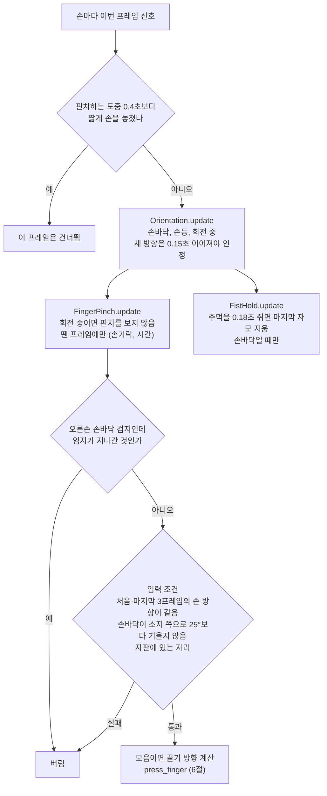
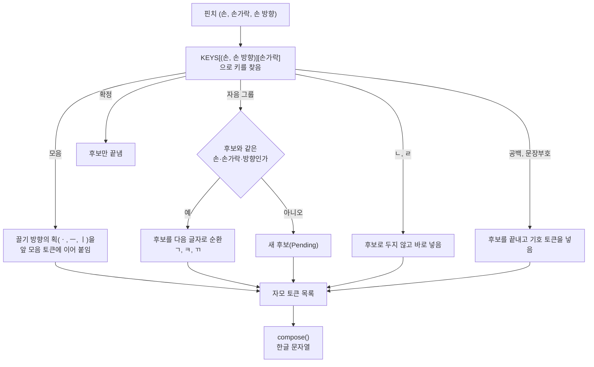
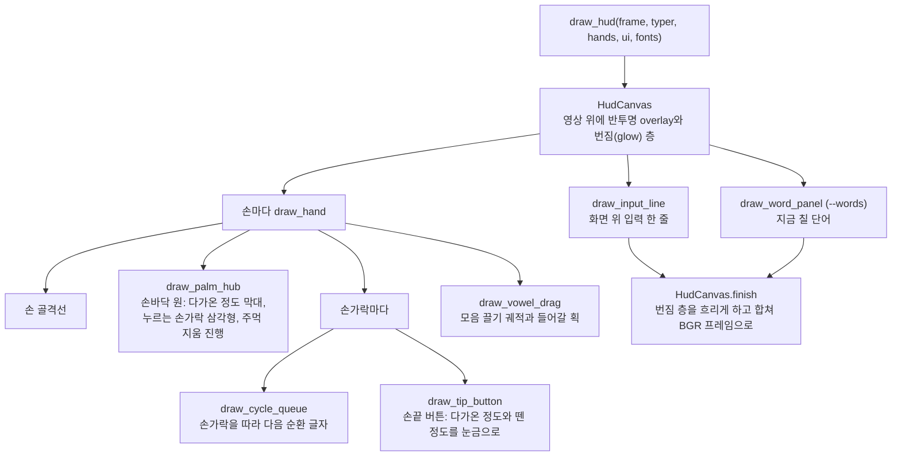
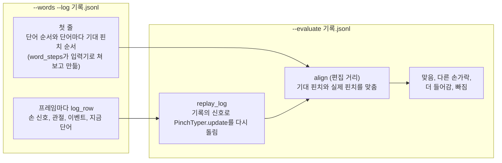
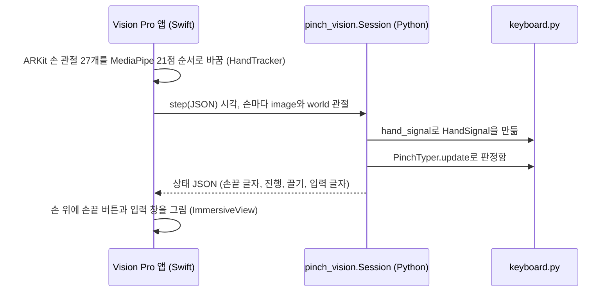

# PinchKeyboard 코드 설명

PinchKeyboard는 카메라로 양손을 찍어, 엄지로 다른 손끝을 집는 동작(핀치)을 천지인 자판의 키로 바꿔 한글을 입력한다. 아래 순서로 읽으면 코드 전체를 따라갈 수 있다.

1. 파일 관계(1절)와 실행 흐름(2절)으로 프로그램이 어떻게 도는지 본다.
2. 손 신호(3절), 핀치 판정(4절), 양손 판정(5절), 한글 조합(6절)에서 핵심 코드를 읽는다.
3. 화면(7절), 기록과 채점(8절), Vision Pro 앱(9절)은 필요할 때 읽는다.
4. 함수 하나가 무엇을 왜 어떻게 하는지는 11절 함수 설명에서, 외부 라이브러리 함수는 12절에서 찾는다.

## 1. 파일 관계



- `keyboard.py`와 `record.py`는 표준 라이브러리만 import한다. Vision Pro 앱 안의 Python에는 OpenCV와 MediaPipe가 없기 때문이다.
- `hand.py`와 `keyboard.py`는 서로 import하지 않는다. 카메라를 다루는 코드와 판정 코드가 섞이지 않는다.

## 2. 실행 흐름



왼손과 오른손은 MediaPipe 라벨을 따른다. MediaPipe Tasks(1.1.1에서 확인)는 영상에 보이는 그대로의 실제 손을 라벨로 내고, 카메라 앱은 영상을 좌우 반전하지 않으므로 라벨을 그대로 쓴다. 이 라벨이 틀리면 손 방향 부호가 뒤집혀 손바닥과 손등이 바뀐다. 두 손에 같은 라벨이 붙었을 때만 화면 왼쪽 손을 왼손으로 본다(`assign_hands`).

프레임 반복문의 실제 코드다(`main.run`).

```python
frame, gap = read_frame(capture)
if first_frame:
    fh, fw = frame.shape[:2]
    small = detection_frame(frame, DETECT_WIDTH).shape
    requested = "GStreamer 파이프라인" if args.jetson else f"요청 {size[0]}x{size[1]}"
    print(f"카메라 해상도 {fw}x{fh} ({requested}), 손 검출 입력 {small[1]}x{small[0]}", flush=True)
    # 640x480은 960x720으로 키우고, 큰 영상은 화면에 들어오게 줄여 처음 창 크기를 정함
    scale = min(max(960 / fw, 1.0), 1440 / fw, 900 / fh)
    cv2.resizeWindow(WINDOW, round(fw * scale), round(fh * scale))
    first_frame = False
if gap:
    typer.reset()  # 끊긴 동안의 손 상태로 입력하지 않음
now = time.monotonic()
# Continuity Camera가 멈추면 검은 프레임이 들어옴. 2초 넘게 이어지면 한 번만 경고함
if frame[::16, ::16].max() < 8:
    dark_since = dark_since or now
    if now - dark_since > 2.0 and not dark_warned:
        dark_warned = True
        message = "카메라 영상이 검습니다. iPhone을 잠근 채 거치했는지, 다른 앱이 카메라를 쓰는지 확인하세요."
        print(message + " (내장 카메라는 --camera 1)", flush=True)
else:
    dark_since, dark_warned = None, False
h, w = frame.shape[:2]

stamp = max(stamp + 1, int(now * 1000))  # MediaPipe VIDEO 모드는 시각(ms)이 엄격히 늘어나야 함
hands = assign_hands(detect_hands(detector, detection_frame(frame, DETECT_WIDTH), stamp))
# 손바닥 방향은 배정된 자리가 아니라 MediaPipe가 본 라벨로 계산해야 관절 배치와 맞음
signals = {role: hand_signal(hand.label, hand.landmarks, hand.world, w, h)
           for role, hand in hands.items()}
prompt = test.prompt(now) if test else None
if prompt is not None and new_word:
    # 새 단어에서는 직전 단어의 글자를 지우고 쉬는 동안 시작된 접촉을 버림
    typer.ime.clear()
    typer.pending, new_word = None, False
    for state in typer.hands.values():
        state.pinch.lost()
events = typer.update(signals, now)
if test:
    finished = test.update(now, typer.ime.text)
    events += finished
    if finished:
        last_result, new_word = finished[-1], True
if log:
    described = None if prompt is None else {"id": prompt[0], "word": prompt[1]}
    row = log_row(now, hands, signals, events, w, h, described, test is not None)
    log.write(json.dumps(row, ensure_ascii=False) + "\n")
if test and test.done:
    print(test.summary(), flush=True)
    test, ui["word"] = None, None
elif test:
    ui["word"] = word_view(test, test.prompt(now), last_result)

points = {role: [(p.x * w, p.y * h) for p in hand.landmarks] for role, hand in hands.items()}
cv2.imshow(WINDOW, draw_hud(frame, typer, points, ui, fonts))
code = cv2.waitKey(1) & 0xFF
```

## 3. 손 신호: 관절 21개에서 판정에 쓰는 숫자로

MediaPipe는 손마다 관절 21개를 두 가지 좌표로 준다. 영상 좌표(영상 폭·높이에 대한 0~1 비율)와 world 좌표(손 중심 기준 m 단위 3D)다. `hand_signal`은 이 관절로 판정에 쓰는 값만 계산해 `HandSignal`에 담는다. 판정 코드는 관절을 다시 보지 않고 이 값만 쓴다.

| 필드 | 뜻 | 계산에 쓰는 좌표 |
|---|---|---|
| `ratios` | 손가락마다 핀치 거리(엄지 끝에서 끝마디 선분까지의 거리 ÷ 손 크기) | world |
| `curled` | 손가락마다 굽었는지(PIP 관절 각도 130° 이하) | world |
| `flex` | 손가락마다 세 관절의 굽힘 합 | world |
| `pose` | `"open"`, `"closing"`, `"fist"` | 영상 |
| `facing` | 양수면 손바닥, 음수면 손등이 카메라를 향함 | 영상 |
| `roll` | 음수면 소지 쪽이 카메라에 가깝게 기울었음 | 영상 |
| `tips`, `size` | 화면의 엄지 끝·네 손끝 위치와 손 크기(모음 끌기) | 영상 |

관절 번호는 손목이 0이고 엄지 1~4, 검지 5~8, 중지 9~12, 약지 13~16, 소지 17~20이다. 손가락마다 뿌리(MCP), PIP, DIP, 손끝(TIP) 순서다.

핀치 거리는 판정의 기준이 되는 값이다. 손끝 점끼리 재면 끝마디 가운데가 닿아도 거리가 남으므로 끝마디 선분까지 재고, 손 크기로 나눠 사람과 카메라 거리에 따른 차이를 없앤다.

```python
def pinch_ratios(world):
    """손가락마다 엄지 끝에서 끝마디까지의 거리를 손 크기로 나눈 값을 구하는 함수"""
    # 손끝 점끼리 재면 끝마디 가운데가 닿아도 거리가 남으므로 끝마디 선분까지 잼
    # 손 크기로 나눠 사람과 카메라 거리에 따른 차이를 없앰
    scale = max(math.dist(xyz(world[WRIST]), xyz(world[MIDDLE_MCP])), 1e-6)
    thumb = xyz(world[THUMB_TIP])
    ratios = []
    for a, b in DISTAL_SEGMENTS:
        # 엄지 끝을 끝마디 선분 위로 수직 투영한 점까지 잼. 투영 비율 t는 선분 안(0~1)으로 자름
        start, end = xyz(world[a]), xyz(world[b])
        ab = [y - x for x, y in zip(start, end)]
        length = sum(v * v for v in ab)
        t = 0.0 if length < 1e-12 else max(0.0, min(1.0, sum((p - x) * v for p, x, v in zip(thumb, start, ab)) / length))
        ratios.append(math.dist(thumb, [x + t * v for x, v in zip(start, ab)]) / scale)
    return tuple(ratios)
```

손 방향은 손목에서 검지 뿌리와 소지 뿌리로 가는 두 벡터의 외적 부호로 정한다. 왼손은 오른손의 거울상이라 부호를 뒤집는다.

```python
def palm_facing(landmarks, label, width=1.0, height=1.0):
    """손바닥이 카메라를 향한 정도를 -1에서 1 사이 값으로 구하는 함수"""
    # 손목에서 검지 뿌리와 소지 뿌리로 가는 두 벡터의 외적임. 양수면 손바닥, 음수면 손등이 카메라를 향함
    # 왼손은 오른손의 거울상이라 부호가 반대이므로 뒤집음
    wrist = landmarks[WRIST]
    a = ((landmarks[INDEX_MCP].x - wrist.x) * width, (landmarks[INDEX_MCP].y - wrist.y) * height)
    b = ((landmarks[PINKY_MCP].x - wrist.x) * width, (landmarks[PINKY_MCP].y - wrist.y) * height)
    norm = math.hypot(*a) * math.hypot(*b)
    if norm < 1e-12:
        return 0.0
    value = -(a[0] * b[1] - a[1] * b[0]) / norm
    if label == "Left":
        value = -value
    return value
```

## 4. 핀치 판정 (`FingerPinch`, 손 하나)

쉬는 자세에서도 엄지는 검지 옆에 있어 거리가 0.11~0.28이고, 실제 핀치의 가장 가까운 거리(0.00~0.24)와 겹친다. 그래서 거리 하나로 판정하지 않고 "최근 0.5초 동안의 자기 값보다 0.15 이상 다가온 손끝"만 후보로 본다.



접촉 시작 판정이다(`FingerPinch._start_contact`). 방금 뗀 손가락은 덜 벌린 채 다시 핀치하므로 1초 안이면 0.08만 다가와도 후보에 넣는다.

```python
def _start_contact(self, signal, now):
    ratios = signal.ratios
    self.history = [(t, row) for t, row in self.history if now - t <= PINCH_WINDOW] + [(now, ratios)]
    earlier = [flex for t, flex in self.flexes if now - t <= FLEX_BASE]
    if signal.flex is not None:
        self.flexes = [(t, flex) for t, flex in self.flexes if now - t <= FLEX_BASE] + [(now, signal.flex)]
    base = tuple(max(row[j] for _, row in self.history) for j in range(4))
    candidates = self._candidates(base, ratios)
    if self.last_tap is not None and now - self.last_tap[1] <= REPRESS_WINDOW:
        again = self.last_tap[0]
        if again not in candidates and base[again] - ratios[again] >= REPRESS_DROP and ratios[again] <= PINCH_ENTER:
            candidates = sorted(candidates + [again], key=ratios.__getitem__)
    if not candidates:
        return
    best = candidates[0]
    if min(ratios[j] for j in range(4) if j != best) - ratios[best] < PINCH_MARGIN:
        return
    self.active, self.since, self.spoiled, self.opened = best, now, False, 0
    self.base, self.low = base, list(ratios)
    if signal.flex is not None:
        earlier = earlier or [signal.flex]
        self.flex_base = tuple(sum(f[j] for f in earlier) / len(earlier) for j in range(4))
        self.flex_top = list(signal.flex)
    self._check(signal)
```

접촉 중 판정과 떼기 판정이다(`FingerPinch._update_contact`).

```python
def _update_contact(self, signal, now):
    ratios = signal.ratios
    self.low = [min(a, b) for a, b in zip(self.low, ratios)]
    if self.flex_top is not None and signal.flex is not None:
        self.flex_top = [max(a, b) for a, b in zip(self.flex_top, signal.flex)]
    candidates = self._candidates(self.base, self.low)
    # 더 가까이 온 손끝으로 옮김. 떼는 중에는 엄지가 옆 손가락으로 미끄러진 것이므로 옮기지 않음
    if candidates and self.low[self.active] - self.low[candidates[0]] >= PINCH_MARGIN and self.opened == 0:
        self.active = candidates[0]
    # 얕게 다가왔다 벌어지는 손끝이면 지금 닿아 있는 더 가까운 손끝으로 옮김
    if ratios[self.active] > self.release_level() and self.low[self.active] > PINCH_SHALLOW:
        closer = [j for j in candidates if j != self.active and ratios[j] <= PINCH_ENTER
                  and ratios[self.active] - ratios[j] >= PINCH_MARGIN]
        if closer:
            self.active = min(closer, key=ratios.__getitem__)
    self._check(signal)
    if ratios[self.active] <= self.release_level():
        self.opened = 0
        return None
    self.opened += 1
    if self.opened < RELEASE_FRAMES:
        return None
    spoiled, short = self.spoiled, now - self.since < PINCH_MIN_CONTACT
    tap = self._emit(now)
    # 접촉을 끝냄. 다음 핀치가 뗀 뒤의 거리를 기준으로 삼도록 기준값 기록도 비움
    self.active = self.since = None
    self.history, self.flexes = [], []
    self.flex_base = self.flex_top = None
    self.spoiled, self.low, self.opened = False, [1.0] * 4, 0
    if spoiled or short:
        self.undo_tap()
        return None
    return tap
```

## 5. 양손 판정 (`PinchTyper.update`)

손마다 판정기 세 개(손 방향 `Orientation`, 핀치 `FingerPinch`, 주먹 `FistHold`)를 돌리고, 입력 조건을 지난 핀치만 키로 바꾼다.



```python
def update(self, signals, now):
    """한 프레임의 양손 신호를 판정하고 이번 프레임의 이벤트 목록을 돌려주는 메서드"""
    events, self.pinches = [], []  # 이벤트는 ("input", 글자), ("commit", None), ("delete", None) 세 가지임
    for label, hand in self.hands.items():
        hand.signal = signals.get(label)
        if hand.signal is None and hand.pinch.active is not None and hand.seen is not None \
                and now - hand.seen <= HAND_GAP:
            continue
        if hand.signal is not None:
            hand.seen = now
        hand.orientation.update(None if hand.signal is None else hand.signal.facing, now)
        signal, state = hand.signal, hand.orientation.state
        # 손등 핀치는 다른 손가락이 자연스럽게 굽으므로 SPOIL_CURLED를 쓰지 않음
        hand.pinch.spoil_curled = "back" not in (state, self.frame_face(signal, state))
        tap = hand.pinch.update(signal if state in FACES else None, now)
        if tap is not None and tap[0] == 0 and label == "Right" and state == "palm" and hand.pinch.index_sweep():
            hand.pinch.undo_tap()
            tap = None
        if signal is not None and (tap is not None or hand.pinch.active is not None):
            hand.held.append(signal)
        steady = hidden = False
        if tap is not None and state in FACES:
            # 접촉의 처음과 마지막 STEADY_FRAMES 프레임에서 손 방향 값의 중앙값이 모두 뗄 때의 방향이어야 함
            sign = 1 if state == "palm" else -1
            facings = [held.facing for held in hand.held]
            steady = bool(facings) and all(sign * statistics.median(part) >= FACING_THRESHOLD
                                           for part in (facings[:STEADY_FRAMES], facings[-STEADY_FRAMES:]))
            # 손바닥이 소지 쪽으로 OCCLUDED_ROLL보다 기운 접촉은 엄지가 가려졌으므로 버림
            hidden = state == "palm" and bool(hand.held) and \
                statistics.median(held.roll for held in hand.held) <= OCCLUDED_ROLL
        if steady and not hidden and KEYS[(label, state)][tap[0]] is not None:
            self.pinches.append((label, tap[0], state))
            drag = None
            if KEYS[(label, state)][tap[0]] == "VOWEL":
                # 뗄 때 엄지만 벌어지는 마지막 프레임은 끈 거리에서 뺌
                held = hand.held[:-RELEASE_FRAMES] if len(hand.held) > RELEASE_FRAMES else hand.held
                drag = self.drag_of_path(*self.pinch_path(held, tap[0]))
            events += self.press_finger(label, tap[0], state, drag)
        if tap is not None or hand.pinch.active is None:
            hand.held = []
        if signal is None:
            hand.fist.lost()
        elif hand.fist.update(signal.pose, now, relaxed=not FingerPinch.closed_pose(signal)) and state == "palm":
            events += self.make_fist()
    return events
```

## 6. 핀치에서 한글까지



| 손과 방향 | 검지 | 중지 | 약지 | 소지 |
|---|---|---|---|---|
| 왼손 손바닥 | ㅂㅍㅃ | ㄹ | ㅅㅎㅆ | ㅈㅊㅉ |
| 오른손 손바닥 | ㄱㅋㄲ | ㄴ | ㄷㅌㄸ | ㅇㅁ |
| 왼손 손등 | 모음 | 공백 | 확정 | . , ? ! 줄바꿈 |
| 오른손 손등 | 확정 또는 공백 | 없음 | 없음 | 없음 |

"안"을 칠 때의 토큰 변화를 예로 들면 다음과 같다.

| 핀치 | 토큰 | 화면 |
|---|---|---|
| 오른손 소지 | `[C ㅇ]` | ㅇ |
| 모음 버튼을 세로로 끌기(ㅣ) | `[C ㅇ][V i]` | 이 |
| 모음 버튼을 그대로 떼기(ㆍ) | `[C ㅇ][V i.]` | 아 (i와 .을 이어 붙이면 ㅏ) |
| 오른손 중지 | `[C ㅇ][V i.][C ㄴ]` | 안 (모음 뒤 자음은 받침) |

키를 입력기에 넣는 코드다(`PinchTyper._press`).

```python
def _press(self, hand, finger, face, drag):
    key = KEYS[(hand, face)][finger]
    if key is None:
        return []
    if key == "COMMIT_SPACE":
        key = "COMMIT" if self.pending is not None else "SPACE"
    if key == "VOWEL":
        atom = DRAG_STROKES[drag]
        self.pending = None
        tokens = self.ime.tokens
        # 앞 모음에 획을 이어 붙여 모음이 되면 붙이고(ㅣ에 ㆍ를 붙이면 ㅏ), 아니면 새 모음으로 넣음
        if tokens and tokens[-1].kind == "V" and tokens[-1].value + atom in VOWELS:
            tokens[-1].value += atom
        else:
            tokens.append(Token("V", atom))
        return [("input", VOWELS[atom])]
    if key == "COMMIT":
        self.pending = None
        return [("commit", None)]
    if key == "SPACE":
        self.pending = None
        self.ime.put_symbol(" ")
        return [("input", " ")]
    if not is_group_key(key):  # ㄴ·ㄹ은 후보로 두지 않고 바로 넣음
        self.pending = None
        self.ime.put_consonant(CONSONANTS[key])
        return [("input", CONSONANTS[key])]
    pending = self.pending
    if pending is not None and (pending.hand, pending.finger, pending.face) == (hand, finger, face):
        group = group_of(key)
        label = group[pending.count % len(group)]
        self._put(key, label, replace=pending.label)
        pending.count, pending.label = pending.count + 1, label
        return [("input", label)]
    label = group_of(key)[0]
    self._put(key, label)
    self.pending = Pending(key, hand, finger, face, 1, label)
    return [("input", label)]
```

토큰을 한글 음절로 조합하는 코드다(`compose`). 받침 뒤에 모음이 오면 받침을 다음 글자의 초성으로 옮긴다(각 + ㅏ = 가가).

```python
def compose(tokens):
    """자모 토큰을 한글 음절로 조합하는 함수"""
    output = []
    initial = medial = final = ""

    def flush():
        nonlocal initial, medial, final
        if initial and medial:  # 유니코드 음절 코드는 0xAC00 + (초성×21 + 중성)×28 + 종성임
            code = 0xAC00 + (INITIALS.index(initial) * 21 + MEDIALS.index(medial)) * 28
            output.append(chr(code + FINALS.index(final)))
        else:
            output.append(initial or medial)
        initial = medial = final = ""

    for token in tokens:
        value = token.value
        if token.kind == "C":
            if initial and medial and not final and value in FINALS:
                final = value
            elif initial and medial and final + value in FINAL_PAIRS:
                final = FINAL_PAIRS[final + value]
            else:
                flush()
                initial = value
        elif token.kind == "V":
            vowel = VOWELS[value]
            if vowel not in MEDIALS:  # 아직 조합 중인 아래아는 낱자로 보여 줌
                flush()
                output.append(vowel)
            elif initial and medial and final:  # 받침 뒤에 모음이 오면 받침을 다음 글자의 초성으로 옮김(각 + ㅏ = 가가)
                final, carried = SPLIT_FINALS.get(final, ("", final))
                flush()
                initial, medial = carried, vowel
            elif initial and not medial:
                medial = vowel
            else:
                flush()
                medial = vowel
        else:
            flush()
            output.append(value)
    flush()
    return "".join(output)
```

## 7. 화면 그리기 (`hud.draw_hud`)

화면은 판정하지 않고 `PinchTyper`의 상태를 읽어 그리기만 한다. 크기는 모두 640x480 기준 값에 화면 배율을 곱해 Jetson과 Mac에서 같은 비율로 보인다.



## 8. 기록과 채점 (`record.py`)

판정값을 고칠 때는 같은 기록을 지금 판정으로 다시 재생해 결과를 비교한다.



## 9. Vision Pro 앱 (`visionos/`)

시야 근처에 카메라를 고정할 수 없어 1인칭 시점 판정을 시험하려고 만든 앱이다. 판정은 Swift로 다시 쓰지 않고 앱 안의 Python이 `keyboard.py`, `record.py`를 그대로 돌린다.



빌드 단계 "Install Python"(`PinchKeyboard.xcodeproj`)이 `pinch_vision.py`, `keyboard.py`, `record.py`, 고정 데이터를 앱 번들에 복사한다.

## 10. 주요 데이터

`HandSignal` 필드는 3절 표에 있다.

**이벤트** (`PinchTyper.update`, `PinchTyper.press_finger`가 돌려줌)

| 이벤트 | 뜻 |
|---|---|
| `("input", 글자)` | 입력 칸에 글자가 들어가거나 후보가 다음 글자로 바뀜. 모음 획은 ㆍ, ㅡ, ㅣ, 공백은 `" "` |
| `("commit", None)` | 후보를 확정함(입력 칸 변화 없음) |
| `("delete", None)` | 주먹으로 마지막 자모를 지움 |
| `("collect", 번호, 단어, 결과)` | 단어 시험에서 단어 하나가 끝남. 결과는 `"done"` 또는 `"skip"` (`WordTest`가 돌려줌) |

**기록 파일 한 줄** (`record.log_row`, `--log`)

| 필드 | 뜻 |
|---|---|
| `t` | 프레임 시각(초) |
| `size` | 영상 크기 [가로, 세로]. Vision Pro 기록은 [1, 1] |
| `hands` | 손마다 `seen_as`(MediaPipe 라벨), `ratios`, `facing`, `roll`, `pose`, `curled`, `image`(영상 관절 21개), `world`(world 관절 21개) |
| `events` | 이번 프레임 이벤트 목록 |
| `prompt` | 단어 시험 기록에만 있음. 지금 단어 `{"id", "word"}`, 쉬는 중이면 null |

단어 시험 기록의 첫 줄은 `{"collect": {"kind": "words", "order": 단어 순서, "keys": 단어마다 기대 핀치 순서}}`다(`WordTest.config`).

**화면 상태 `ui`** (`main.run`이 만들고 `hud.draw_hud`가 프레임 사이에 이어 씀)

| 키 | 뜻 |
|---|---|
| `word` | 단어 안내 패널 내용(`main.word_view`) 또는 None |
| `spreads` | 손마다 손끝 버튼 펼침 상태(`spread_motion`) |
| `cycles` | 손가락마다 순환 애니메이션 상태(`cycle_motion`) |
| `echo` | 입력 표시의 (일련번호, 시작 시각)(`echo_view`) |

## 11. 함수 설명

함수마다 설명, 동작 방식, 사용한 이유와 목적, 입력 파라미터, 돌려주는 값, 호출 위치를 적었다. 클래스는 필드를 적었다.

### `main.py`

| import | 이유 |
|---|---|
| `argparse` | 실행 옵션(`--camera`, `--jetson`, `--log`, `--words`, `--demo`, `--evaluate`, `-v`)을 읽는다. |
| `json` | 고정 데이터(`fixtures/pinch-typer-keys.json`)를 읽고 기록 파일에 한 줄씩 쓴다. |
| `pathlib.Path` | 모델, 고정 데이터, 기록 폴더 경로를 `main.py` 위치 기준으로 만든다. |
| `sys` | `sys.platform`으로 macOS인지 확인해 카메라 해상도 기본값을 정한다. |
| `time` | 프레임 시각(`time.monotonic`)과 단어 시험 기록 파일 이름의 날짜(`time.strftime`)를 만든다. |
| `cv2` | 카메라 열기, 프레임 읽기, 창 띄우기, 키 입력. |
| `hand`, `hud`, `keyboard`, `record` | 프로젝트의 나머지 네 파일. `keyboard`에서는 `PinchTyper`, `hand_signal`, `replay`를 쓴다. |

모듈 상수: `MODEL`(손 검출 모델 경로), `DETECT_WIDTH`(손 검출 입력의 최대 가로 640), `pipeline`(Jetson USB 카메라 GStreamer 문자열, 규칙 14), `DEFAULT_RESOLUTION`과 `AUTO_RESOLUTION`(카메라 번호로 열 때 요청하는 해상도. macOS만 1280x720).

#### `read_frame(capture, wait)`

- 설명: 카메라 프레임 하나와 끊겼던 시간(초)을 돌려준다.
- 동작 방식: `capture.read()`가 성공하면 그 프레임과 0을 돌려준다. 실패하면 안내를 출력하고 50ms 간격으로 `wait`초까지 다시 읽는다. 다시 읽히면 프레임과 끊겼던 시간을, 끝내 읽히지 않으면 `RuntimeError`를 낸다.
- 사용한 이유와 목적: iPhone Continuity Camera는 기기를 움직이거나 잠금을 풀면 잠시 멈춘다. 바로 끝내지 않고 기다렸다가 이어 가게 하고, 끊겼던 시간을 알려 `run`이 그동안의 손 상태로 입력하지 않게 판정을 비우게 한다.
- 입력 파라미터:
  - `capture`: `cv2.VideoCapture` 객체.
  - `wait`: 프레임이 다시 들어오기를 기다리는 최대 시간(초). 기본값 10.0.
- 돌려주는 값: (프레임, 끊겼던 시간). 프레임은 BGR `numpy` 배열.
- 호출 위치: `run`

#### `word_view(test, prompt, last)`

- 설명: 단어 입력 시험 안내 패널에 보여 줄 제목, 설명, 색 종류를 만든다.
- 동작 방식: 지금 칠 단어(`prompt`)가 있으면 "「단어」 입력"과 진행 번호를 만든다. 쉬는 중이고 직전 결과(`last`)가 있으면 "완료" 또는 "건너뜀"과 그 단어를 만든다. 둘 다 없으면 None을 돌려준다.
- 사용한 이유와 목적: 화면 코드(`hud.draw_word_panel`)는 글자를 그리기만 하고, 시험 진행 상태를 문구로 바꾸는 일은 여기서 한다.
- 입력 파라미터:
  - `test`: `record.WordTest` 객체. 전체 단어 수를 읽는다.
  - `prompt`: 지금 칠 단어의 (번호, 단어). 쉬는 중이면 None.
  - `last`: 직전 결과 이벤트 `("collect", 번호, 단어, "done" 또는 "skip")`. 없으면 None.
- 돌려주는 값: `{"tone", "title", "detail"}` dict 또는 None. `tone`은 `"prompt"`, `"ok"`, `"skip"` 가운데 하나.
- 호출 위치: `run`

#### `run(args)`

- 설명: 카메라를 열고 프레임마다 손 검출, 판정, 기록, 화면, 단축키를 처리한다.
- 동작 방식: 글꼴, 입력기, 단어 시험, 기록 파일, 검출기, 카메라를 준비한 뒤 반복문을 돈다(2절 다이어그램). 첫 프레임에서 해상도를 출력하고 창 크기를 정한다. 검은 프레임이 2초 넘게 이어지면 한 번 경고한다. Q 키나 창 닫힘으로 반복문을 나오고, `finally`에서 카메라와 기록 파일을 닫고 입력 결과를 출력한다.
- 사용한 이유와 목적: 카메라 앱의 모든 단계를 한곳에서 순서대로 부르는 함수다. 판정과 화면은 다른 파일에 맡기고 여기서는 카메라, 창, 키, 기록 파일만 직접 다룬다.
- 입력 파라미터:
  - `args`: `argparse`가 읽은 실행 옵션. `camera`(카메라 번호), `jetson`(Jetson 카메라 사용 여부), `log`(기록 파일 경로 또는 None), `words`(단어 시험 여부)를 쓴다.
- 돌려주는 값: 없음.
- 호출 위치: `main`

#### `main()`

- 설명: 실행 옵션을 읽고 시연, 채점, 카메라 입력기 가운데 하나를 시작한다.
- 동작 방식: `--demo`면 고정 데이터 첫 시퀀스를 `replay`로 재생해 결과를 출력한다. `--evaluate`면 기록 파일마다 첫 줄 설정을 보고 단어 기록이면 `report_words`, 손가락 차례 기록이면 `report_prompts`를 출력한다. 그 밖에는 `run`을 부르고, 카메라·모델·글꼴 오류는 트레이스백 없이 문구만 출력한다.
- 사용한 이유와 목적: 실행 파일이 `main.py` 하나라(규칙 6) 세 가지 실행 방식을 여기서 나눈다.
- 입력 파라미터: 없음. 명령줄 인자는 `argparse`가 `sys.argv`에서 읽는다.
- 돌려주는 값: 없음.
- 호출 위치: 파일을 직접 실행할 때(`if __name__ == "__main__"`)

### `hand.py`

| import | 이유 |
|---|---|
| `typing.Any`, `typing.NamedTuple` | `Detection`을 필드 이름이 있는 튜플로 만든다. |
| `cv2` | BGR을 RGB로 바꾸고(`cvtColor`), 검출 입력을 줄인다(`resize`). |
| `mediapipe`, `mediapipe.tasks.python`, `mediapipe.tasks.python.vision` | 손 관절 검출기(`HandLandmarker`). 실습 `practice/hand_detection_fingers.py`와 같은 import다. |

#### `Detection`

- 설명: 손 하나의 검출 결과를 나타내는 클래스.
- 동작 방식: `NamedTuple`이라 `detection.label`처럼 필드 이름으로 읽는다.
- 사용한 이유와 목적: MediaPipe 결과는 라벨, 영상 관절, world 관절이 서로 다른 목록에 같은 순서로 들어 있다. 손 하나의 세 값을 한 객체로 묶어 배정과 신호 계산에 넘긴다.
- 필드:
  - `label`: 실제 왼손이면 `"Left"`, 오른손이면 `"Right"`.
  - `landmarks`: 영상 폭과 높이에 대한 비율 좌표 관절 21개(x, y, z 속성).
  - `world`: 손 중심을 원점으로 한 m 단위 3D 관절 21개.
- 호출 위치: `detect_hands`가 만들고 `main.run`, `record.log_row`가 읽음

#### `create_detector(model)`

- 설명: VIDEO 모드 손 검출기를 만든다.
- 동작 방식: 모델 파일이 없으면 경로를 알려 주는 `FileNotFoundError`를 낸다. 있으면 두 손까지, 검출·존재·추적 확신도 0.6 이상으로 `HandLandmarkerOptions`를 만들고 `HandLandmarker.create_from_options`로 검출기를 만든다.
- 사용한 이유와 목적: VIDEO 모드는 앞 프레임의 손 위치를 이어서 추적해 매 프레임 새로 찾는 IMAGE 모드보다 빠르고 관절 값이 덜 흔들린다.
- 입력 파라미터:
  - `model`: 손 검출 모델 파일 경로(`pathlib.Path`). `main.MODEL`.
- 돌려주는 값: `HandLandmarker` 객체. `with` 문으로 쓰고 닫는다.
- 호출 위치: `main.run`

#### `detect_hands(detector, frame, timestamp)`

- 설명: BGR 프레임에서 손을 찾아 `Detection` 목록을 돌려준다.
- 동작 방식: 프레임을 RGB로 바꿔 `mp.Image`로 감싸고 `detect_for_video`에 넣는다. 결과의 영상 관절, world 관절, 좌우 분류를 손마다 묶는다. 라벨은 가장 확신도가 높은 분류의 이름을 그대로 쓴다.
- 사용한 이유와 목적: MediaPipe 결과 형식을 판정 쪽이 쓰는 `Detection`으로 바꾸는 경계다. MediaPipe Tasks(1.1.1)는 영상에 보이는 그대로의 실제 손을 라벨로 내므로 라벨을 뒤집지 않는다.
- 입력 파라미터:
  - `detector`: `create_detector`가 만든 검출기.
  - `frame`: BGR `numpy` 배열.
  - `timestamp`: 프레임 시각(ms, 정수). VIDEO 모드는 이 값이 엄격히 늘어나야 한다.
- 돌려주는 값: `Detection` 목록(손이 없으면 빈 목록).
- 호출 위치: `main.run`

#### `detection_frame(frame, max_width)`

- 설명: 손 검출에 넣을 영상을 가로 `max_width` 이하로 줄인다.
- 동작 방식: 가로가 `max_width` 이하면 그대로 돌려주고, 넓으면 비율을 지켜 `cv2.resize`(`INTER_AREA`)로 줄인다.
- 사용한 이유와 목적: 관절은 0~1 비율 좌표라 줄인 영상에서 찾아도 원래 해상도 화면에 그대로 쓸 수 있다. 검출 입력을 640 이하로 두면 Mac 1280x720에서도 Jetson 640x480 시연과 검출 시간이 같아진다.
- 입력 파라미터:
  - `frame`: BGR `numpy` 배열.
  - `max_width`: 최대 가로 픽셀 수. `main.DETECT_WIDTH`(640).
- 돌려주는 값: 줄였거나 그대로인 BGR 배열.
- 호출 위치: `main.run`

#### `assign_hands(detections)`

- 설명: 검출한 손을 왼손 자리와 오른손 자리에 배정한다.
- 동작 방식: 두 손 이상이면 앞의 두 손만 본다. 라벨이 다르면 라벨대로 배정하고, 라벨이 같으면 관절 x 평균이 작은(화면 왼쪽) 손을 왼손 자리에 둔다. 한 손이면 그 라벨 자리에 둔다.
- 사용한 이유와 목적: 카메라가 손 맞은편에 있으면 화면 위치로 정한 좌우가 실제 손과 반대가 되므로 라벨을 먼저 따른다. 두 손이 같은 라벨로 잡히는 경우에만 화면 위치를 쓴다. 배정된 자리와 `Detection.label`이 다를 수 있고, 손 방향 계산은 원래 라벨을 쓴다.
- 입력 파라미터:
  - `detections`: `detect_hands`가 돌려준 `Detection` 목록.
- 돌려주는 값: `{"Left": Detection, "Right": Detection}`(보이는 손만).
- 호출 위치: `main.run`

### `keyboard.py`

| import | 이유 |
|---|---|
| `dataclasses.dataclass` | `HandSignal`, `Token`, `Pending`의 필드와 기본값을 선언만으로 만든다. |
| `math` | 관절 거리와 각도(`math.dist`, `math.hypot`, `math.acos`, `math.atan2`, `math.degrees`), 모음 끌기 거리. |
| `statistics` | 접촉 동안의 손 방향 값, 기울기, 손 크기의 중앙값(`statistics.median`). 한 프레임 튄 값에 흔들리지 않게 평균 대신 중앙값을 쓴다. |

모듈 상수는 네 묶음이다. 관절 번호(`WRIST`, `THUMB_TIP`, `FINGER_MCPS`, `FINGER_TIPS`, `DISTAL_SEGMENTS`, `HAND_CONNECTIONS`), 한글 조합 표(`CONSONANTS`, `VOWELS`, `INITIALS`, `MEDIALS`, `FINALS`, `FINAL_PAIRS`), 자판(`KEYS`, `PUNCTUATION`, `DRAG_STROKES` 등), 판정값(`PINCH_*`, `RELEASE_*`, `FIST_*`, `FACING_*`, `HAND_GAP` 등)이다. 판정값마다 근거는 코드 주석에 있다.

#### `xyz(point)`

- 설명: 관절 하나를 (x, y, z) 튜플로 바꾼다.
- 동작 방식: `x`, `y`를 읽고 `z`는 없으면 0으로 둔다.
- 사용한 이유와 목적: 거리와 각도 계산이 튜플을 받는다. z가 없는 2D 점(테스트용)도 같은 함수로 받는다.
- 입력 파라미터:
  - `point`: x, y(, z) 속성을 가진 관절 객체.
- 돌려주는 값: (x, y, z) 튜플.
- 호출 위치: `pinch_ratios`, `finger_flex`, `hand_signal`

#### `joint_angle(a, b, c)`

- 설명: 점 b에서 a와 c로 가는 두 벡터 사이의 각도(도)를 구한다.
- 동작 방식: 두 벡터의 내적을 길이의 곱으로 나눠 코사인을 구하고 -1~1로 자른 뒤 `math.acos`로 각도를 구한다. 벡터 길이가 0이면 180°(편 상태)로 본다.
- 사용한 이유와 목적: 손가락 관절이 얼마나 굽었는지 재는 기본 계산이다. 실습 `calculate_angle`과 같은 방법을 3D 튜플로 한다.
- 입력 파라미터:
  - `a`, `b`, `c`: (x, y, z) 튜플. `b`가 각도를 재는 관절이다.
- 돌려주는 값: 0~180 사이 각도(도).
- 호출 위치: `finger_flex`, `hand_signal`

#### `pose_from_image(landmarks, width, height)`

- 설명: 영상 좌표로 손 자세를 `"open"`, `"closing"`, `"fist"` 가운데 하나로 정한다.
- 동작 방식: 관절을 픽셀 좌표로 바꾸고(z는 폭으로 곱함) 네 손가락마다 PIP 관절 각도와 손끝이 뿌리에서 뻗은 거리(reach, 첫 마디 길이의 배수)를 잰다. 각도 150° 이상이고 reach 1.6 이상이면 편 손가락, 각도 135° 이하이고 reach 1.7 이하면 굽은 손가락으로 센다. 마디가 2픽셀보다 짧은 손가락은 건너뛴다. 셋 이상 굽고 펴진 것이 없으면 주먹, 셋 이상 펴지고 굽은 것이 없으면 편 손, 그 밖은 접는 중이다.
- 사용한 이유와 목적: 주먹 지움을 판정하고, 주먹인 동안 핀치를 보지 않기 위해 쓴다. 수업 practice 코드의 관절 각도 방식에 reach를 더해 카메라 쪽으로 굽힌 손가락도 가른다.
- 입력 파라미터:
  - `landmarks`: 영상 비율 좌표 관절 21개.
  - `width`, `height`: 영상 크기(픽셀). Vision Pro는 `IMAGE_SCALE`(1000)을 넘긴다.
- 돌려주는 값: `"open"`, `"closing"`, `"fist"`.
- 호출 위치: `hand_signal`

#### `finger_flex(world)`

- 설명: 손가락마다 세 관절의 굽힘 각도 합을 구한다.
- 동작 방식: 손가락마다 MCP(손목-MCP-PIP), PIP, DIP 세 관절의 (180° - 관절 각도)를 더한다. 0이면 다 편 상태다.
- 사용한 이유와 목적: 엄지 옆면이 검지를 함께 눌러 검지로 잡힌 접촉을 실제로 더 굽은 손가락으로 바꾸는 검지 겹침 규칙(`FingerPinch._index_overlap`)이 이 값의 증가량을 비교한다. 3D 좌표라 카메라 쪽으로 굽힌 손가락도 잡힌다.
- 입력 파라미터:
  - `world`: world 좌표 관절 21개.
- 돌려주는 값: 검지·중지·약지·소지 순서의 굽힘 합 4개(도).
- 호출 위치: `hand_signal`, `record.signal_from_log`

#### `palm_roll(landmarks, width, height)`

- 설명: 손의 긴 축을 기준으로 손이 기운 각도(도)를 구한다.
- 동작 방식: 소지 뿌리에서 검지 뿌리로 가는 벡터가 영상 평면과 이루는 각도를 `math.atan2(-dz, 평면 길이)`로 구한다. 엄지 쪽이 카메라에 가까우면 양수, 소지 쪽이 가까우면 음수다.
- 사용한 이유와 목적: 손바닥이 소지 쪽으로 25°보다 기울면 엄지가 가려 MediaPipe가 검지로 잘못 읽는다(8번 중 7번). 그 자세의 핀치를 버리는 데 쓴다.
- 입력 파라미터:
  - `landmarks`: 영상 비율 좌표 관절 21개.
  - `width`, `height`: 영상 크기(픽셀). 기본값 1.0.
- 돌려주는 값: 기운 각도(도).
- 호출 위치: `hand_signal`, `record.signal_from_log`

#### `palm_facing(landmarks, label, width, height)`

- 설명: 손바닥이 카메라를 향한 정도를 -1~1 값으로 구한다.
- 동작 방식: 손목에서 검지 뿌리, 손목에서 소지 뿌리로 가는 두 벡터의 2D 외적을 길이로 나눈다(사잇각의 sin). 왼손이면 부호를 뒤집는다. 두 벡터 길이가 0이면 0이다.
- 사용한 이유와 목적: 손바닥 자판과 손등 자판을 가르는 값이다. 외적은 영상 안에서 손을 돌려도 변하지 않고, 거울상(왼손)이면 부호만 바뀐다.
- 입력 파라미터:
  - `landmarks`: 영상 비율 좌표 관절 21개.
  - `label`: MediaPipe가 본 손(`"Left"` 또는 `"Right"`). 배정된 자리가 아니라 원래 라벨이어야 부호가 맞는다.
  - `width`, `height`: 영상 크기. 가로가 긴 영상의 비율을 반영한다. 기본값 1.0.
- 돌려주는 값: 양수면 손바닥, 음수면 손등이 카메라를 향한다.
- 호출 위치: `hand_signal`

#### `HandSignal`

- 설명: 판정에 쓰는 손 하나의 신호를 나타내는 클래스.
- 동작 방식: `dataclass`다. 필드는 3절 표와 같다.
- 사용한 이유와 목적: 판정 코드가 관절을 다시 보지 않고 이 값만 보게 해, 카메라 앱·기록 재생·Vision Pro가 같은 판정을 쓴다.
- 필드: `ratios`, `curled`, `pose`, `facing`, `roll`, `flex`, `tips`, `size`(3절 표). `flex`와 `tips`는 예전 기록을 재생할 때 None일 수 있다.
- 호출 위치: `hand_signal`, `record.signal_from_log`가 만들고 `PinchTyper.update`가 읽음

#### `pinch_ratios(world)`

- 설명: 손가락마다 엄지 끝에서 끝마디까지의 거리를 손 크기로 나눈 값을 구한다.
- 동작 방식: 손 크기는 손목에서 중지 뿌리까지의 거리다. 손가락마다 엄지 끝을 끝마디 선분(DIP에서 TIP) 위로 수직 투영하고, 투영 비율을 0~1로 자른 점까지의 거리를 손 크기로 나눈다(3절 코드).
- 사용한 이유와 목적: 핀치 판정의 기준값이다. 손끝 점끼리 재면 끝마디 가운데가 닿아도 거리가 남으므로 선분까지 잰다.
- 입력 파라미터:
  - `world`: world 좌표 관절 21개.
- 돌려주는 값: 검지·중지·약지·소지 순서의 거리 4개.
- 호출 위치: `hand_signal`

#### `image_tips(landmarks, width, height)`

- 설명: 화면 좌표의 엄지 끝과 네 손끝 위치, 손 크기를 구한다.
- 동작 방식: 엄지 끝과 네 손끝 관절에 영상 크기를 곱하고, 손목에서 중지 뿌리까지의 화면 거리를 손 크기로 잰다.
- 사용한 이유와 목적: 모음 끌기는 화면에서 핀치 지점이 얼마나 움직였는지로 정하므로 화면 좌표가 필요하다.
- 입력 파라미터:
  - `landmarks`: 영상 비율 좌표 관절 21개.
  - `width`, `height`: 영상 크기(픽셀). 기본값 1.0.
- 돌려주는 값: (엄지 끝·검지·중지·약지·소지 끝의 (x, y) 5개, 손 크기).
- 호출 위치: `hand_signal`, `record.signal_from_log`

#### `hand_signal(label, landmarks, world, width, height)`

- 설명: 한 손의 관절 좌표로 `HandSignal`을 만든다.
- 동작 방식: 거리·굽음·굽힘은 world 좌표로, 자세·방향·기울기·손끝 위치는 영상 좌표로 계산해 담는다. 굽음은 손가락마다 PIP 관절 각도가 130° 이하인지로 정한다.
- 사용한 이유와 목적: 관절 21개를 판정에 쓰는 값으로 바꾸는 한 곳이다.
- 입력 파라미터:
  - `label`: MediaPipe가 본 손(`Detection.label`).
  - `landmarks`: 영상 비율 좌표 관절 21개.
  - `world`: world 좌표 관절 21개.
  - `width`, `height`: 영상 크기(픽셀). Vision Pro는 1000, 1000.
- 돌려주는 값: `HandSignal`.
- 호출 위치: `main.run`, `visionos/pinch_vision.py`의 `Session.step`

#### `Token`

- 설명: 입력된 자모 하나를 나타내는 클래스.
- 동작 방식: `dataclass`다.
- 사용한 이유와 목적: 입력기는 완성된 글자가 아니라 자모 토큰 목록을 쌓고, 화면에 보일 때마다 조합한다. 그래야 받침 이동과 자모 단위 지움을 같은 규칙으로 처리한다.
- 필드:
  - `kind`: 자음 `"C"`, 모음 `"V"`, 공백·문장부호 `"B"`.
  - `value`: 자음 글자, 모음은 획 순서 문자열(예: `"i."`는 ㅏ), 기호 글자.
- 호출 위치: `CheonjiinIME.put_consonant`, `CheonjiinIME.put_symbol`, `PinchTyper._press`가 만듦

#### `compose(tokens)`

- 설명: 자모 토큰을 유니코드 한글 음절로 조합한다.
- 동작 방식: 토큰을 앞에서부터 읽으며 초성, 중성, 종성 자리를 채운다. 초성과 중성이 있으면 자음을 받침으로 붙이거나 겹받침으로 합친다. 받침 뒤에 모음이 오면 받침(겹받침이면 뒤 자음)을 다음 글자 초성으로 옮긴다. 자리가 맞지 않으면 안쪽 함수 `flush`가 조합 중인 글자를 음절 코드 `0xAC00 + (초성×21 + 중성)×28 + 종성`으로 내보낸다. 조합 중인 아래아(ㆍ, ㆍㆍ)는 낱자로 보여 준다(6절 코드).
- 사용한 이유와 목적: 천지인은 획을 이어 붙여 모음을 만들고 받침이 다음 모음에 따라 옮겨 가므로, 토큰이 바뀔 때마다 처음부터 다시 조합하는 것이 가장 단순하다.
- 입력 파라미터:
  - `tokens`: `Token` 목록.
- 돌려주는 값: 조합한 문자열.
- 호출 위치: `CheonjiinIME.text`, `CheonjiinIME.delete_char`

#### `CheonjiinIME`

- 설명: 입력된 자모를 쌓아 두고 조합한 한글 문자열을 돌려주는 클래스.
- 동작 방식: `tokens` 목록 하나만 가진다. 어느 자모를 넣을지는 `PinchTyper`가 정한다.
- 사용한 이유와 목적: 핀치 판정과 한글 조합을 나눠, 조합 규칙을 카메라 없이 시험한다.
- 필드:
  - `tokens`: 입력된 `Token` 목록.
- 호출 위치: `PinchTyper.__init__`

#### `CheonjiinIME.text()`

- 설명: 지금까지의 입력을 조합한 문자열을 돌려주는 속성.
- 동작 방식: `compose(self.tokens)`를 돌려준다(`@property`라 `ime.text`로 읽는다).
- 사용한 이유와 목적: 토큰을 바꾼 뒤 늘 최신 조합 결과를 읽게 한다.
- 입력 파라미터: 없음.
- 돌려주는 값: 조합한 문자열.
- 호출 위치: `main.run`, `hud.draw_input_line`, `record.word_steps`, `Session`

#### `CheonjiinIME.put_consonant(value, replace)`

- 설명: 자음을 넣는다.
- 동작 방식: `replace`가 있고 마지막 토큰 값이 `replace`와 같으면 그 토큰 값을 `value`로 바꾼다(순환). 아니면 새 자음 토큰을 붙인다.
- 사용한 이유와 목적: 같은 손가락을 다시 핀치하면 ㄱ이 ㅋ으로 바뀌어야 하므로 새 토큰을 붙이지 않고 마지막 토큰을 바꾼다.
- 입력 파라미터:
  - `value`: 넣을 자음 글자.
  - `replace`: 순환으로 바꿀 지금 후보 글자. 새 자음이면 None(기본값).
- 돌려주는 값: 없음.
- 호출 위치: `PinchTyper._press`(ㄴ·ㄹ), `PinchTyper._put`

#### `CheonjiinIME.put_symbol(value, replace)`

- 설명: 공백, 문장부호, 줄바꿈을 넣는다.
- 동작 방식: `replace`가 참이고 마지막 토큰이 기호 토큰이면 그 값을 바꾸고, 아니면 새 기호 토큰을 붙인다.
- 사용한 이유와 목적: 문장부호도 같은 손가락을 다시 핀치하면 . , ? ! 줄바꿈 순서로 순환한다.
- 입력 파라미터:
  - `value`: 넣을 기호 글자.
  - `replace`: 마지막 기호를 바꿀지. 기본값 False.
- 돌려주는 값: 없음.
- 호출 위치: `PinchTyper._press`(공백), `PinchTyper._put`(문장부호)

#### `CheonjiinIME.delete_char()`

- 설명: 화면에 보이는 마지막 자모 하나를 지운다.
- 동작 방식: 지금 문자열을 기억하고, 조합 결과가 달라질 때까지 뒤에서부터 토큰을 뺀다. 보이는 글자가 없으면 아무것도 하지 않는다.
- 사용한 이유와 목적: 주먹 지움은 키 입력 한 번이 아니라 보이는 자모 하나를 지워야 한다(감, 가, ㄱ 순서). 순환한 자음과 획을 이은 모음이 토큰 하나라 토큰 하나를 빼면 자모 하나가 지워진다.
- 입력 파라미터: 없음.
- 돌려주는 값: 없음.
- 호출 위치: `PinchTyper.make_fist`

#### `CheonjiinIME.clear()`

- 설명: 입력을 모두 지운다.
- 동작 방식: `tokens`를 빈 목록으로 바꾼다.
- 사용한 이유와 목적: 단어 시험에서 새 단어를 시작할 때와 Vision Pro 앱의 "지우기" 버튼에 쓴다.
- 입력 파라미터: 없음.
- 돌려주는 값: 없음.
- 호출 위치: `main.run`(새 단어), `Session._clear_input`, `Session.command`(clear)

#### `group_of(key)`

- 설명: 키가 순환하는 글자 목록을 돌려준다.
- 동작 방식: 문장부호 키면 `PUNCTUATION`, 아니면 `CONSONANTS[key]`를 돌려준다.
- 사용한 이유와 목적: 자음 그룹과 문장부호를 같은 순환 규칙으로 처리한다.
- 입력 파라미터:
  - `key`: 자판 키 이름(`"4"`, `"PUNCT"` 등).
- 돌려주는 값: 글자열 또는 글자 튜플.
- 호출 위치: `cycle_queue`, `PinchTyper._press`, `Session.state`

#### `is_group_key(key)`

- 설명: 같은 손가락을 다시 핀치했을 때 다음 글자로 순환하는 키인지 판별한다.
- 동작 방식: 문장부호 키이거나 자음 그룹 글자가 둘 이상이면 참이다.
- 사용한 이유와 목적: ㄴ과 ㄹ은 글자가 하나라 순환하지 않고 바로 넣어야 한다(안녕의 ㄴ, ㄴ).
- 입력 파라미터:
  - `key`: 자판 키 이름.
- 돌려주는 값: 참 또는 거짓.
- 호출 위치: `cycle_queue`, `PinchTyper._press`

#### `key_label(key)`

- 설명: 손끝에 보여 줄 키 이름을 돌려준다.
- 동작 방식: 문장부호 키는 `".,?!"`, 편집 키(공백, 확정, 모음)는 한글 이름, 자음 키는 그룹 글자를 돌려준다.
- 사용한 이유와 목적: 순환하지 않는 키의 손끝 라벨과 Vision Pro 앱의 자판 지도에 쓴다.
- 입력 파라미터:
  - `key`: 자판 키 이름.
- 돌려주는 값: 표시할 문자열.
- 호출 위치: `cycle_queue`, `Session.state`

#### `cycle_queue(typer, hand, finger)`

- 설명: 손끝에 보여 줄 글자 목록을 돌려준다.
- 동작 방식: 그 손의 지금 방향(회전 중이면 손바닥)에서 그 손가락의 키를 찾는다. 자판에 없는 자리면 빈 목록, 오른손 손등 검지면 후보 유무에 따라 "확정" 또는 "공백", 순환하지 않는 키면 이름 하나를 돌려준다. 순환 키는 그 손가락이 지금 순환 중이면 다음에 나올 글자부터, 아니면 첫 글자부터 3개를 돌려준다.
- 사용한 이유와 목적: 사용자가 핀치하기 전에 무엇이 들어갈지 손끝에서 보게 한다.
- 입력 파라미터:
  - `typer`: `PinchTyper`. 손 방향과 후보를 읽는다.
  - `hand`: `"Left"` 또는 `"Right"`.
  - `finger`: 0(검지)~3(소지).
- 돌려주는 값: 글자 목록(맨 앞이 지금 핀치하면 들어갈 글자).
- 호출 위치: `hud.draw_hand`, `Session.state`

#### `FistHold`

- 설명: 주먹을 0.18초 동안 쥐었는지 판정하는 클래스.
- 동작 방식: `armed`(손을 편 뒤 참), `since`(주먹을 쥐기 시작한 시각), `next_repeat`(반복 지움 시각), `progress`(화면에 그릴 진행 0~1), `relaxed_since`(주먹이 아닌 상태가 시작된 시각)를 가진다.
- 사용한 이유와 목적: 주먹을 쥔 채 나타난 손이나 잠깐 주먹처럼 보인 프레임으로 지우지 않게, 손을 편 뒤 일정 시간 쥔 경우만 센다.
- 필드: 위 다섯 개.
- 호출 위치: `HandState.__init__`

#### `FistHold.lost()`

- 설명: 손이 사라졌을 때 주먹 판정 상태를 지운다.
- 동작 방식: 다섯 필드를 처음 값으로 되돌린다. 다시 세려면 손을 펴야 한다.
- 사용한 이유와 목적: 사라진 순간의 자세로 지움이 나가지 않게 한다.
- 입력 파라미터: 없음.
- 돌려주는 값: 없음.
- 호출 위치: `FistHold.__init__`, `PinchTyper.update`(손 없음), `PinchTyper.reset`

#### `FistHold.update(pose, now, relaxed)`

- 설명: 프레임 하나를 판정하고, 주먹이 확정된 프레임에 참을 돌려준다.
- 동작 방식: 주먹이 아닌 상태가 0.15초 이어지면 다시 셀 준비를 한다. 편 손이면 준비하고 끝낸다. 이미 한 번 지운 뒤 계속 쥐고 있으면 0.5초마다 참을 돌려준다. 준비된 상태에서 주먹이 0.18초 이어지면 참을 돌려주고 반복 시각을 정한다. 중간에 주먹이 아니면 처음부터 잰다.
- 사용한 이유와 목적: 주먹을 연달아 쥘 때 손을 반쯤만 펴도 다음 주먹을 받게 하고(2026-10-24 기록), 계속 쥐면 연속으로 지운다.
- 입력 파라미터:
  - `pose`: `pose_from_image` 결과.
  - `now`: 지금 시각(초).
  - `relaxed`: 주먹이 아닌 상태인지(`FingerPinch.closed_pose`의 반대).
- 돌려주는 값: 이번 프레임에 지울지(참 또는 거짓).
- 호출 위치: `PinchTyper.update`

#### `Orientation`

- 설명: 손바닥(palm), 손등(back), 회전 중(turning) 가운데 지금 손 방향을 판정하는 클래스.
- 동작 방식: `state`(인정한 방향), `raw`(이번 프레임 값만으로 정한 방향), `since`(raw가 지금 값이 된 시각)를 가진다.
- 사용한 이유와 목적: 관절 값이 한 프레임 튀어(2026-10-22 로그: +0.6, -0.23, +0.6) 자판이 바뀌지 않게 새 방향은 0.15초 이어져야 인정한다.
- 필드: 위 세 개.
- 호출 위치: `HandState.__init__`

#### `Orientation.lost()`

- 설명: 손이 사라졌을 때 손 방향 상태를 지운다.
- 동작 방식: 세 필드를 None으로 되돌린다.
- 사용한 이유와 목적: 다시 나타난 손은 방향을 처음부터 인정받게 한다.
- 입력 파라미터: 없음.
- 돌려주는 값: 없음.
- 호출 위치: `Orientation.__init__`, `Orientation.update`, `PinchTyper.reset`

#### `Orientation.update(facing, now)`

- 설명: 프레임 하나의 손 방향 값으로 인정한 방향을 갱신한다.
- 동작 방식: 손이 없으면 상태를 지운다. 이미 인정한 방향은 값이 기준(0.25)의 절반으로 내려갈 때까지 유지한다. 그 밖에는 값이 0.25를 넘으면 손바닥, -0.25 아래면 손등, 사이면 회전 중으로 보고, 같은 방향이 0.15초 이어지면 인정한다. 처음 보이는 손은 인정 전까지 회전 중이다.
- 사용한 이유와 목적: 손바닥 자판과 손등 자판이 흔들리지 않게 한다.
- 입력 파라미터:
  - `facing`: `HandSignal.facing`. 손이 없으면 None.
  - `now`: 지금 시각(초).
- 돌려주는 값: 없음. 결과는 `state`에 남는다.
- 호출 위치: `PinchTyper.update`

#### `FingerPinch`

- 설명: 손 하나에서 엄지가 어느 손끝을 핀치했다 뗐는지 판정하는 클래스.
- 동작 방식: 4절 다이어그램의 세 단계를 필드로 기억한다. `history`(접촉 전 최근 거리), `flexes`(접촉 전 최근 굽힘), `active`(접촉 중인 손가락), `base`(접촉 시작 때 기준값), `low`(접촉 중 가장 가까웠던 거리), `opened`(벌어진 프레임 수), `last_tap`(직전 입력), `released`(방금 뗀 접촉 정보), `spoiled`(버릴 접촉인지), `closed`(이번 프레임이 주먹인지), `spoil_curled`(주먹 스침 규칙을 쓸지)다.
- 사용한 이유와 목적: 쉬는 자세의 거리와 실제 핀치 거리가 겹쳐 거리 하나로는 가를 수 없으므로, 손끝마다 최근 기준값보다 다가온 정도를 프레임에 걸쳐 본다.
- 필드: 위 목록.
- 호출 위치: `HandState.__init__`

#### `FingerPinch.lost()`

- 설명: 손이 사라졌거나 판정을 쉴 때 모든 상태를 지운다.
- 동작 방식: 필드를 처음 값으로 되돌린다. 다시 시작하면 기준값부터 새로 쌓는다.
- 사용한 이유와 목적: 사라지기 전의 접촉이 돌아온 뒤 입력으로 나가지 않게 한다.
- 입력 파라미터: 없음.
- 돌려주는 값: 없음.
- 호출 위치: `FingerPinch.__init__`, `FingerPinch.update`, `PinchTyper.reset`, `main.run`(새 단어), `record.replay_log`, `Session._clear_input`

#### `FingerPinch.closed_pose(signal)`

- 설명: 주먹 자세인지 판별한다.
- 동작 방식: 자세가 주먹이거나 네 손가락이 모두 굽었으면 참이다.
- 사용한 이유와 목적: 주먹을 쥐면 엄지가 손가락 위에 놓여 거리가 가까워지므로 그동안은 핀치를 보지 않는다. 소지를 핀치할 때는 검지가 펴져 있어 여기 들지 않는다.
- 입력 파라미터:
  - `signal`: `HandSignal`.
- 돌려주는 값: 참 또는 거짓.
- 호출 위치: `FingerPinch.update`, `PinchTyper.update`

#### `FingerPinch.release_level()`

- 설명: 고른 손끝을 이 거리보다 벌리면 뗀 것으로 보는 값을 돌려준다.
- 동작 방식: 가장 가까웠던 거리 + 0.12와 0.38 가운데 작은 값이다.
- 사용한 이유와 목적: 떼기 판정과 떼기 진행 표시가 같은 기준을 쓰게 한다.
- 입력 파라미터: 없음.
- 돌려주는 값: 거리 값.
- 호출 위치: `release_progress`, `_update_contact`

#### `FingerPinch.release_progress(ratios)`

- 설명: 고른 손끝을 뗀 정도를 0~1 값으로 돌려준다.
- 동작 방식: 접촉 중이 아니면 0이다. 지금 거리에서 가장 가까웠던 거리를 빼고 떼기 기준까지의 폭으로 나눠 0~1로 자른다.
- 사용한 이유와 목적: 누르는 동안 손끝 버튼의 파란 눈금으로 얼마나 떼면 입력되는지 보여 준다.
- 입력 파라미터:
  - `ratios`: 이번 프레임의 핀치 거리 4개.
- 돌려주는 값: 0~1.
- 호출 위치: `hud.draw_tip_button`, `Session.state`

#### `FingerPinch.progress(ratios)`

- 설명: 손가락마다 기준값보다 다가온 정도를 0~1 값으로 돌려준다.
- 동작 방식: 주먹이면 모두 0이다. 접촉 중이면 접촉 시작 때 기준값, 접촉 전이면 최근 최대 거리, 기록이 없으면 지금 값을 기준으로 삼아 (기준 - 지금) ÷ 0.15를 0~1로 자른다. 0.38보다 멀면 0이다.
- 사용한 이유와 목적: 손끝 버튼과 손바닥 원의 막대가 판정과 같은 기준으로 다가온 정도를 보여 준다.
- 입력 파라미터:
  - `ratios`: 이번 프레임의 핀치 거리 4개.
- 돌려주는 값: 손가락마다 0~1 값 4개.
- 호출 위치: `hud.draw_hand`, `Session.state`

#### `FingerPinch._candidates(base, values)`

- 설명: 핀치 후보 손가락을 가까운 순서로 고른다.
- 동작 방식: 기준값보다 0.15 이상 다가왔고 0.30 아래인 손가락을 거리순으로 정렬한다.
- 사용한 이유와 목적: 접촉 시작과 손끝 옮기기가 같은 후보 기준을 쓴다.
- 입력 파라미터:
  - `base`: 손가락마다 기준값 4개.
  - `values`: 비교할 거리 4개(지금 거리 또는 가장 가까웠던 거리).
- 돌려주는 값: 손가락 번호 목록.
- 호출 위치: `_start_contact`, `_update_contact`

#### `FingerPinch._index_overlap(finger)`

- 설명: 검지로 잡힌 접촉의 실제 손가락을 돌려준다.
- 동작 방식: 검지가 아니거나 굽힘 값이 없으면 그대로 돌려준다. 다른 손가락 가운데 가장 가까웠던 거리가 검지 + 0.05 안이고 접촉 동안 굽힘 증가가 검지보다 10° 이상 큰 손가락이 있으면, 그중 가장 가까웠던 손가락을 돌려준다.
- 사용한 이유와 목적: 엄지가 검지 옆에 있다가 중지·약지를 핀치하면 엄지 옆면이 검지를 눌러 검지 거리도 내려온다. 정답 접촉 90개에서 맞은 수가 78개에서 83개로 늘었다.
- 입력 파라미터:
  - `finger`: 판정된 손가락 번호.
- 돌려주는 값: 바꾼 손가락 번호.
- 호출 위치: `_emit`

#### `FingerPinch.index_sweep()`

- 설명: 방금 뗀 검지 접촉이 엄지가 검지 옆을 지나간 것인지 판별한다.
- 동작 방식: 방금 뗀 접촉이 없으면 거짓이다. 다른 손가락 입력을 뗀 뒤 0.25초 안에 시작했거나, 접촉 동안 검지 굽힘 증가가 5° 미만이면 참이다.
- 사용한 이유와 목적: 오른손 엄지는 다른 손가락으로 오가며 쉬던 자리인 검지 옆을 지나간다. 그 접촉을 입력하지 않는다.
- 입력 파라미터: 없음.
- 돌려주는 값: 참 또는 거짓.
- 호출 위치: `PinchTyper.update`(오른손 손바닥 검지만)

#### `FingerPinch.undo_tap()`

- 설명: 방금 낸 입력을 없던 것으로 한다.
- 동작 방식: 직전 입력 기록(`last_tap`)을 방금 뗀 접촉 전의 값으로 되돌린다.
- 사용한 이유와 목적: 버린 접촉이 "같은 손가락 다시 핀치" 규칙의 기준이 되지 않게 한다.
- 입력 파라미터: 없음.
- 돌려주는 값: 없음.
- 호출 위치: `_update_contact`, `PinchTyper.update`

#### `FingerPinch.update(signal, now)`

- 설명: 프레임 하나를 판정한다.
- 동작 방식: 신호가 없으면 상태를 지운다. 주먹이면 상태를 지우고 `closed`를 참으로 둔다. 접촉 전이면 `_start_contact`, 접촉 중이면 `_update_contact`를 부른다.
- 사용한 이유와 목적: 세 단계 판정의 입구다.
- 입력 파라미터:
  - `signal`: `HandSignal`. 손이 없거나 회전 중이면 None.
  - `now`: 지금 시각(초).
- 돌려주는 값: 손끝을 뗀 프레임에 (손가락 번호, 접촉 시간), 그 밖에는 None.
- 호출 위치: `PinchTyper.update`

#### `FingerPinch._start_contact(signal, now)`

- 설명: 접촉 전 기준값을 쌓고 접촉 시작을 판정한다.
- 동작 방식: 최근 0.5초의 거리와 0.3초의 굽힘만 남겨 쌓는다. 손가락마다 최근 최대 거리를 기준값으로 두고 후보를 고른다. 방금 뗀 손가락은 1초 안이면 0.08만 다가와도 후보에 넣는다. 가장 가까운 후보가 다른 손끝보다 0.03 이상 가까우면 접촉을 시작하고 기준값, 가장 가까운 거리, 접촉 직전 평균 굽힘을 기록한다(4절 코드).
- 사용한 이유와 목적: 쉬는 자세에서 원래 가까운 손끝은 다가오지 않았으므로 후보가 되지 않는다.
- 입력 파라미터:
  - `signal`: `HandSignal`.
  - `now`: 지금 시각(초).
- 돌려주는 값: 없음.
- 호출 위치: `FingerPinch.update`

#### `FingerPinch._update_contact(signal, now)`

- 설명: 접촉 중 손끝 옮기기와 떼기를 판정한다.
- 동작 방식: 손가락마다 가장 가까웠던 거리와 최대 굽힘을 갱신한다. 떼는 중이 아니고 더 가까워진 후보가 0.03 이상 가까우면 그 손끝으로 옮긴다. 0.20보다 얕게 다가왔다 벌어지는 손끝이면 지금 닿아 있는 더 가까운 손끝으로 옮긴다. 떼기 기준을 넘은 프레임이 2번 이어지면 입력을 만들고 접촉을 끝낸다. 0.10초보다 짧거나 주먹을 쥐는 도중이었으면 입력을 취소한다(4절 코드).
- 사용한 이유와 목적: 엄지가 목표 손가락으로 가는 길에 다른 손가락을 지나가도 목표 손가락으로 판정하고, 한 프레임 튄 값을 떼기로 보지 않는다.
- 입력 파라미터:
  - `signal`: `HandSignal`.
  - `now`: 지금 시각(초).
- 돌려주는 값: 뗀 프레임에 (손가락 번호, 접촉 시간), 그 밖에는 None.
- 호출 위치: `FingerPinch.update`

#### `FingerPinch._check(signal)`

- 설명: 주먹을 쥐는 도중인 접촉을 버릴 것으로 표시한다.
- 동작 방식: 핀치하는 손가락 말고 굽은 손가락이 3개 이상이고 `spoil_curled`가 참이면 `spoiled`를 참으로 둔다. 자세가 주먹인 경우도 표시하지만, 주먹이면 `update`가 먼저 판정을 끝내므로 이 조건은 실행되지 않는다.
- 사용한 이유와 목적: 주먹을 쥐는 동작에서 엄지가 손끝을 스친 것을 입력하지 않는다. 소지를 핀치하면 중지와 약지가 함께 굽으므로 기준이 2가 아니라 3이다. 손등에서는 다른 손가락이 자연스럽게 굽어 쓰지 않는다.
- 입력 파라미터:
  - `signal`: `HandSignal`.
- 돌려주는 값: 없음.
- 호출 위치: `_start_contact`, `_update_contact`

#### `FingerPinch._emit(now)`

- 설명: 입력 하나를 만들고 검지 지나감 판정에 쓸 정보를 남긴다.
- 동작 방식: 검지 겹침 규칙으로 손가락을 정하고, 접촉 동안 굽힘 증가를 계산해 시작 시각, 굽힘 증가, 그 전 입력과 함께 `released`에 남긴다. 직전 입력을 이번 입력으로 바꾼다.
- 사용한 이유와 목적: 뗀 직후 `index_sweep`과 `undo_tap`이 이 정보를 쓴다.
- 입력 파라미터:
  - `now`: 뗀 시각(초).
- 돌려주는 값: (손가락 번호, 접촉 시간).
- 호출 위치: `_update_contact`

#### `Pending`

- 설명: 아직 확정하지 않은 후보 글자를 나타내는 클래스.
- 동작 방식: `dataclass`다.
- 사용한 이유와 목적: 같은 손, 같은 손가락, 같은 방향으로 다시 핀치했는지 비교해 순환할지 새 글자를 넣을지 정한다.
- 필드:
  - `key`: 자판 키 이름.
  - `hand`, `finger`, `face`: 후보를 만든 손, 손가락, 손 방향.
  - `count`: 지금까지 핀치한 횟수. 다음 글자는 `group[count % len(group)]`.
  - `label`: 지금 입력 칸에 있는 글자.
- 호출 위치: `PinchTyper._press`가 만듦

#### `HandState`

- 설명: 손 하나의 판정기와 이번 접촉 동안 모은 신호를 묶은 클래스.
- 동작 방식: `pinch`(`FingerPinch`), `orientation`(`Orientation`), `fist`(`FistHold`), `signal`(이번 프레임 신호), `seen`(마지막으로 손이 보인 시각), `held`(이번 접촉 동안의 프레임별 신호)를 가진다.
- 사용한 이유와 목적: 왼손과 오른손이 서로 다른 판정 상태를 가져야 한다.
- 필드: 위 여섯 개.
- 호출 위치: `PinchTyper.__init__`

#### `PinchTyper`

- 설명: 양손 신호를 판정해 한글을 입력하는 클래스.
- 동작 방식: `ime`(`CheonjiinIME`), `hands`(손마다 `HandState`), `pending`(후보 글자), `pinches`(이번 프레임에 인정한 핀치), `echo`(마지막 입력의 일련번호, 손, 글자)를 가진다.
- 사용한 이유와 목적: 판정 전체의 입구다. 카메라 앱, 기록 재생, Vision Pro가 모두 이 클래스로 판정한다.
- 필드: 위 다섯 개.
- 호출 위치: `main.run`, `keyboard.replay`, `record.word_steps`, `record.replay_log`, `Session.__init__`

#### `PinchTyper.face(hand)`

- 설명: 그 손의 지금 방향을 돌려준다.
- 동작 방식: `Orientation.state`가 손바닥이나 손등이면 그 값을, 판정 전이거나 회전 중이면 None을 돌려준다.
- 사용한 이유와 목적: 손끝 라벨과 모음 끌기 표시가 어느 자판을 쓸지 정한다.
- 입력 파라미터:
  - `hand`: `"Left"` 또는 `"Right"`.
- 돌려주는 값: `"palm"`, `"back"` 또는 None.
- 호출 위치: `cycle_queue`, `drag_view`, `Session.state`

#### `PinchTyper.press_finger(hand, finger, face, drag)`

- 설명: 핀치 한 번을 자판의 키로 바꿔 입력한다.
- 동작 방식: `_press`로 입력하고, 입력이나 확정이 있었으면 `echo`의 일련번호를 하나 올리고 보여 줄 글자를 바꾼다. 공백과 줄바꿈은 "공백", "줄바꿈"으로 보여 준다.
- 사용한 이유와 목적: 프레임 판정과 고정 데이터 재생이 같은 키 처리를 쓰게 한다. 일련번호가 바뀌면 화면이 손바닥 가운데에 새 입력을 띄운다.
- 입력 파라미터:
  - `hand`: `"Left"` 또는 `"Right"`.
  - `finger`: 0(검지)~3(소지).
  - `face`: `"palm"` 또는 `"back"`. 기본값 `"palm"`.
  - `drag`: 모음을 끈 방향. None(끌지 않음, ㆍ), `"h"`(가로, ㅡ), `"v"`(세로, ㅣ). 기본값 None.
- 돌려주는 값: 이벤트 목록.
- 호출 위치: `PinchTyper.update`, `keyboard.replay`, `record.word_steps`

#### `PinchTyper._press(hand, finger, face, drag)`

- 설명: 키 종류에 따라 입력기에 자모나 기호를 넣는다.
- 동작 방식: 자판에서 키를 찾고, 오른손 손등 검지는 후보가 있으면 확정, 없으면 공백으로 바꾼다. 모음은 획을 앞 모음 토큰에 이어 붙인다. 확정은 후보만 끝내고, 공백은 기호 토큰을 넣는다. ㄴ·ㄹ은 바로 넣는다. 자음 그룹과 문장부호는 후보와 같은 손·손가락·방향이면 순환하고, 아니면 새 후보를 만든다(6절 코드).
- 사용한 이유와 목적: 자판 규칙(6절 표)을 한 곳에서 처리한다.
- 입력 파라미터:
  - `hand`, `finger`, `face`, `drag`: `press_finger`와 같다.
- 돌려주는 값: 이벤트 목록(`("input", 글자)` 또는 `("commit", None)`). 자판에 없는 자리면 빈 목록.
- 호출 위치: `press_finger`

#### `PinchTyper._put(key, value, replace)`

- 설명: 후보 글자를 자음이나 기호로 입력기에 넣는다.
- 동작 방식: 문장부호 키면 `put_symbol`, 자음 키면 `put_consonant`를 부른다.
- 사용한 이유와 목적: 자음 그룹과 문장부호의 순환을 같은 코드로 처리한다.
- 입력 파라미터:
  - `key`: 자판 키 이름.
  - `value`: 넣을 글자.
  - `replace`: 순환이면 지금 후보 글자, 새 후보면 None(기본값).
- 돌려주는 값: 없음.
- 호출 위치: `_press`

#### `PinchTyper.make_fist()`

- 설명: 주먹 지움을 처리한다.
- 동작 방식: 후보를 끝내고 `delete_char`로 마지막 자모를 지운다.
- 사용한 이유와 목적: 프레임 판정과 고정 데이터 재생이 같은 지움 처리를 쓰게 한다.
- 입력 파라미터: 없음.
- 돌려주는 값: `[("delete", None)]`.
- 호출 위치: `PinchTyper.update`, `keyboard.replay`

#### `PinchTyper.pinch_path(held, finger)`

- 설명: 접촉 동안의 핀치 지점 목록과 손 크기 중앙값을 돌려준다.
- 동작 방식: 손끝 좌표가 있는 프레임만 골라, 엄지 끝과 그 손끝의 가운데를 핀치 지점으로 모은다.
- 사용한 이유와 목적: 모음 끌기 방향을 정하고 화면에 끌기 궤적을 그리는 데 쓴다. 손끝 좌표가 없는 예전 기록은 건너뛴다.
- 입력 파라미터:
  - `held`: 이번 접촉 동안의 `HandSignal` 목록.
  - `finger`: 핀치한 손가락 번호.
- 돌려주는 값: (화면 좌표 (x, y) 목록, 손 크기 중앙값).
- 호출 위치: `PinchTyper.update`, `drag_view`

#### `PinchTyper.drag_of_path(points, size)`

- 설명: 핀치 지점의 이동으로 모음 끌기 방향을 정한다.
- 동작 방식: 첫 지점에서 가장 멀리 간 이동을 찾는다. 그 거리가 손 크기의 0.25배보다 작거나 손 크기를 모르면 None, 크면 가로 이동이 크면 `"h"`, 세로가 크면 `"v"`다.
- 사용한 이유와 목적: 모음 버튼 하나로 ㆍ, ㅡ, ㅣ 세 획을 입력한다.
- 입력 파라미터:
  - `points`: 핀치 지점 목록.
  - `size`: 손 크기(화면 픽셀).
- 돌려주는 값: None, `"h"`, `"v"`.
- 호출 위치: `PinchTyper.update`, `drag_view`

#### `PinchTyper.drag_view(hand)`

- 설명: 모음을 핀치하는 중인 손의 끌기 궤적과 방향을 돌려준다.
- 동작 방식: 그 손이 모음 버튼을 접촉 중이 아니거나 궤적이 없으면 None이다. 있으면 핀치 지점, 손 크기, 지금 떼면 들어갈 끌기, 끈 방향 각도(12시 0°에서 시계 방향)를 돌려준다.
- 사용한 이유와 목적: 화면이 끌기 기준 원과 지금 들어갈 획을 미리 보여 준다.
- 입력 파라미터:
  - `hand`: `"Left"` 또는 `"Right"`.
- 돌려주는 값: `{"finger", "points", "size", "drag", "pointer"}` dict 또는 None.
- 호출 위치: `hud.draw_hand`, `Session.state`

#### `PinchTyper.frame_face(signal, state)`

- 설명: 이번 프레임 값만으로 정한 손 방향을 돌려준다.
- 동작 방식: 인정된 방향이 있고 이번 값이 0.25를 넘으면 손바닥, -0.25 아래면 손등, 그 밖에는 인정된 방향을 돌려준다.
- 사용한 이유와 목적: 손을 뒤집자마자 핀치하면 `Orientation`은 아직 이전 방향이다. 손등 모음을 손바닥 규칙(주먹 스침)으로 버리지 않게 이 값도 함께 본다(2026-10-24 Vision Pro 기록에서 ㅣ 3개가 버려진 문제).
- 입력 파라미터:
  - `signal`: `HandSignal` 또는 None.
  - `state`: `Orientation.state`.
- 돌려주는 값: `"palm"`, `"back"`, `"turning"` 또는 None.
- 호출 위치: `PinchTyper.update`

#### `PinchTyper.reset()`

- 설명: 양손의 판정 상태를 모두 지운다.
- 동작 방식: 손마다 세 판정기의 `lost()`를 부르고 접촉 기록과 마지막으로 본 시각을 지운다. 후보도 끝낸다.
- 사용한 이유와 목적: 카메라가 끊겼다 돌아온 뒤 그동안의 손 상태로 입력하지 않게 한다.
- 입력 파라미터: 없음.
- 돌려주는 값: 없음.
- 호출 위치: `main.run`(카메라 끊김)

#### `PinchTyper.update(signals, now)`

- 설명: 한 프레임의 양손 신호를 판정하고 이번 프레임의 이벤트 목록을 돌려준다.
- 동작 방식: 5절 다이어그램과 코드. 손마다 손을 잠깐 놓친 경우 건너뛰기, 손 방향, 핀치, 검지 지나감, 입력 조건(손 방향 유지, 엄지 가림, 자판 자리), 모음 끌기, 키 입력, 주먹 지움 순서로 판정한다.
- 사용한 이유와 목적: 손 신호를 입력 이벤트로 바꾸는 판정 전체다.
- 입력 파라미터:
  - `signals`: `{"Left": HandSignal, "Right": HandSignal}`. 보이지 않는 손은 빠진다.
  - `now`: 지금 시각(초).
- 돌려주는 값: 이벤트 목록. `("input", 글자)`, `("commit", None)`, `("delete", None)`.
- 호출 위치: `main.run`, `record.replay_log`, `Session.step`

#### `replay(steps)`

- 설명: 핀치와 주먹 단계 목록을 차례로 입력하고 입력기를 돌려준다.
- 동작 방식: 새 `PinchTyper`에 `["tap", 손, 손가락, 방향?, 끌기?]`는 `press_finger`로, `["fist", 손]`은 `make_fist`로 넣는다. 방향을 생략하면 손바닥이다. 모르는 단계면 `ValueError`를 낸다.
- 사용한 이유와 목적: 카메라 없이 자판과 조합 규칙을 확인한다(`--demo`, 테스트, Vision Pro의 info 명령).
- 입력 파라미터:
  - `steps`: 단계 목록(`fixtures/pinch-typer-keys.json`의 `steps` 형식).
- 돌려주는 값: 입력을 마친 `PinchTyper`.
- 호출 위치: `main.main`(`--demo`), `Session.command`(demo, info), 테스트

### `hud.py`

| import | 이유 |
|---|---|
| `functools.lru_cache` | 같은 글꼴 크기, 글자 폭, 글자 이미지를 매 프레임 다시 만들지 않게 캐시한다. |
| `math` | 원 둘레의 점 위치(`math.sin`, `math.cos`, `math.radians`), 방향 각도(`math.atan2`, `math.degrees`), 거리(`math.dist`, `math.hypot`). |
| `pathlib.Path` | 한글 글꼴 파일이 있는지 확인한다. |
| `time` | 애니메이션 시각(`time.monotonic`). |
| `cv2`, `numpy` | Pillow 이미지와 OpenCV BGR 프레임 사이 변환. |
| `PIL.Image`, `PIL.ImageDraw`, `PIL.ImageFilter`, `PIL.ImageFont` | 한글 글자, 반투명 선과 면, 번짐 효과를 그린다. `cv2.putText`는 한글을 그리지 못한다. |
| `keyboard` | 관절 번호, 모음 끌기 기준, 손끝 라벨(`cycle_queue`). |

모듈 상수는 색(`WHITE`, `LINE`, `ACCENT` 등, (R, G, B, 불투명도)), 글꼴 후보 경로(`FONT_CANDIDATES`), 애니메이션 시간(`CYCLE_ANIM`, `ECHO_*`, `SPREAD_*`), 손끝 버튼과 손바닥 원 크기 비율(`TIP_*`, `DONUT_*`, `HUB_*`)이다. 크기는 640x480 기준 값이다.

#### `load_fonts()`

- 설명: 설치된 한글 글꼴을 작음·보통·큼 세 크기로 불러온다.
- 동작 방식: `FONT_CANDIDATES`(Ubuntu·Jetson Noto CJK, 나눔고딕, Windows 맑은 고딕, macOS Apple SD Gothic Neo)에서 처음 있는 파일을 골라 16, 21, 29 크기로 연다. 없으면 `FileNotFoundError`를 낸다.
- 사용한 이유와 목적: Mac과 Jetson에서 같은 코드로 한글 글꼴을 찾는다. 호출하는 곳은 `main.run` 하나지만, `main.py`가 Pillow와 글꼴 경로를 몰라도 되도록 `hud.py`에 둔다.
- 입력 파라미터: 없음.
- 돌려주는 값: `ImageFont` 3개 튜플.
- 호출 위치: `main.run`, 테스트

#### `hud_font(font, size)`

- 설명: 글꼴의 다른 크기 버전을 돌려준다.
- 동작 방식: `font.font_variant(size=size)`를 `lru_cache`로 캐시한다.
- 사용한 이유와 목적: 손 크기에 따라 손끝 글자 크기가 프레임마다 바뀐다. 같은 크기를 다시 만들지 않는다.
- 입력 파라미터:
  - `font`: `ImageFont`.
  - `size`: 픽셀 크기(정수).
- 돌려주는 값: `ImageFont`.
- 호출 위치: `HudCanvas.__init__`, `draw_palm_hub`, `draw_cycle_queue`, `draw_tip_button`, `draw_vowel_drag`

#### `hud_text_width(text, font)`

- 설명: 글자열을 그렸을 때의 폭(픽셀)을 돌려준다.
- 동작 방식: `font.getlength(text)`를 캐시한다.
- 사용한 이유와 목적: 패널 크기와 가운데 정렬에 자주 쓴다.
- 입력 파라미터:
  - `text`: 글자열.
  - `font`: `ImageFont`.
- 돌려주는 값: 폭(실수).
- 호출 위치: `ellipsize_left`, `draw_tip_button`, `draw_input_line`, `draw_word_panel`

#### `hud_text_sprite(text, font, fill, anchor, stroke_width, stroke_fill)`

- 설명: 글자 하나를 작은 RGBA 이미지로 그려 기준점까지의 위치와 함께 돌려준다.
- 동작 방식: `font.getbbox`로 글자 경계를 구하고 그 크기의 투명 이미지에 글자를 그린다. 결과를 캐시한다.
- 사용한 이유와 목적: 한 프레임에 글자를 수십 번 그린다. 같은 글자 이미지를 다시 그리지 않고 붙이기만 한다. 호출하는 곳은 하나지만 `lru_cache`로 캐시하려면 함수여야 해서 따로 둔다.
- 입력 파라미터:
  - `text`: 글자열.
  - `font`: `ImageFont`.
  - `fill`: 글자 색 (R, G, B, 불투명도).
  - `anchor`: Pillow 기준점(`"mm"` 가운데, `"la"` 왼쪽 위 등).
  - `stroke_width`: 외곽선 두께(픽셀). 0이면 없음.
  - `stroke_fill`: 외곽선 색 또는 None.
- 돌려주는 값: (이미지, 기준점에서 왼쪽 위까지 x, y).
- 호출 위치: `HudCanvas.write`

#### `ellipsize_left(text, font, available)`

- 설명: 폭을 넘는 글자열의 앞부분을 "…"로 줄인다.
- 동작 방식: 다 들어가면 그대로 돌려준다. 넘으면 남길 뒤쪽 글자 수를 이분 탐색해 "…"를 붙여도 폭 안에 드는 가장 긴 꼬리를 찾는다.
- 사용한 이유와 목적: 입력 줄은 방금 친 마지막 글자가 보여야 하므로 뒤를 남긴다.
- 입력 파라미터:
  - `text`: 글자열.
  - `font`: `ImageFont`.
  - `available`: 허용 폭(픽셀).
- 돌려주는 값: 줄인 글자열.
- 호출 위치: `draw_input_line`

#### `HudCanvas`

- 설명: BGR 프레임 위에 선 HUD를 그리는 클래스.
- 동작 방식: 생성할 때 프레임을 RGBA로 바꾼 `picture`, 그 위에 얹을 투명 `overlay`, 흐리게 번지게 할 `glow` 층과 각 층의 `ImageDraw`를 만든다. 화면 배율 `scale`(640x480 대비 가로·세로 중 작은 비율), 선 두께 `stroke`, 크기별 글꼴 `small`·`normal`·`large`를 계산한다. 각도는 12시가 0°이고 시계 방향으로 잰다.
- 사용한 이유와 목적: 반투명 선과 번짐을 영상에 바로 그리면 겹칠 때마다 색이 섞이므로, 층을 나눠 그리고 마지막에 한 번 합친다.
- 생성 파라미터:
  - `frame`: BGR `numpy` 배열.
  - `fonts`: `load_fonts`가 돌려준 글꼴 3개.
- 호출 위치: `draw_hud`

#### `HudCanvas.write(position, text, font, fill, anchor, stroke_width, stroke_fill, glow)`

- 설명: 글자를 위치에 기준점을 맞춰 놓는다.
- 동작 방식: `hud_text_sprite`로 글자 이미지를 받아 `overlay`에 붙인다. `glow`면 번짐 층에도 붙인다.
- 사용한 이유와 목적: 모든 글자를 같은 캐시와 기준점 규칙으로 그린다.
- 입력 파라미터:
  - `position`: 기준점 (x, y) 픽셀.
  - `text`, `font`, `fill`: 글자, 글꼴, 색.
  - `anchor`: Pillow 기준점. 기본값 `"la"`.
  - `stroke_width`, `stroke_fill`: 외곽선 두께와 색. 기본값 0, None.
  - `glow`: 번짐 층에도 그릴지. 기본값 False.
- 돌려주는 값: 없음.
- 호출 위치: `write`, `draw_palm_hub`

#### `HudCanvas.polar(center, radius, degrees)`

- 설명: 중심에서 각도와 반지름으로 점 위치를 구한다.
- 동작 방식: x = 중심 x + 반지름 × sin(각도), y = 중심 y - 반지름 × cos(각도). 12시가 0°다.
- 사용한 이유와 목적: 눈금, 삼각형, 손바닥 원의 막대를 원 둘레에 놓는다.
- 입력 파라미터:
  - `center`: 중심 (x, y).
  - `radius`: 반지름(픽셀).
  - `degrees`: 각도(도).
- 돌려주는 값: (x, y).
- 호출 위치: `ticks`, `pointer`, `draw_palm_hub`

#### `HudCanvas._line_width(width)`

- 설명: 선 두께 기본값을 정한다.
- 동작 방식: `width`가 없으면 화면 배율을 쓰고, 반올림해 1 이상으로 맞춘다.
- 사용한 이유와 목적: 해상도가 달라도 선 두께 비율을 같게 한다.
- 입력 파라미터:
  - `width`: 지정한 두께 또는 None.
- 돌려주는 값: 정수 두께.
- 호출 위치: `hairline_circle`, `ticks`, `dashed_circle`, `arc`, `panel`

#### `HudCanvas.hairline_circle(center, radius, color, width, fill, glow)`

- 설명: 어두운 테두리를 깐 가는 원을 그린다.
- 동작 방식: `fill`이 있으면 안쪽을 칠하고, 조금 큰 어두운 원(`HALO`)을 깐 뒤 색 원을 그린다. `glow`면 번짐 층에도 그린다.
- 사용한 이유와 목적: 밝은 영상 위에서도 가는 선이 보이게 한다.
- 입력 파라미터:
  - `center`, `radius`: 중심과 반지름.
  - `color`: 선 색.
  - `width`: 선 두께. 기본값 None(배율).
  - `fill`: 안쪽 색. 기본값 None.
  - `glow`: 번짐 여부. 기본값 False.
- 돌려주는 값: 없음.
- 호출 위치: `draw_cycle_queue`, `draw_vowel_drag`

#### `HudCanvas.ticks(center, radius, length, count, color, lit, lit_color, width, start, end, glow)`

- 설명: 원 둘레에 짧은 눈금을 그리고 앞에서부터 일부를 켠다.
- 동작 방식: `start`에서 `end`까지 `count`개의 눈금을 같은 간격으로 놓는다. 한 바퀴면 끝 눈금이 첫 눈금과 겹치지 않게 `count`등분, 호면 양 끝에 오게 `count - 1`등분한다. 앞에서 `lit`개는 `lit_color`로 그린다.
- 사용한 이유와 목적: 진행(다가온 정도, 뗀 정도, 주먹 지움)을 켜진 눈금 수로 보여 준다.
- 입력 파라미터:
  - `center`, `radius`: 중심과 눈금 안쪽 반지름.
  - `length`: 눈금 길이.
  - `count`: 눈금 수.
  - `color`: 꺼진 눈금 색.
  - `lit`: 켤 눈금 수. 기본값 0.
  - `lit_color`: 켠 눈금 색. 기본값 None(`color`).
  - `width`: 선 두께. 기본값 None.
  - `start`, `end`: 각도 범위(도). 기본값 0, 360.
  - `glow`: 켠 눈금을 번지게 할지. 기본값 False.
- 돌려주는 값: 없음.
- 호출 위치: `draw_palm_hub`, `draw_tip_button`, `draw_vowel_drag`

#### `HudCanvas.dashed_circle(center, radius, color, dashes, duty, width)`

- 설명: 파선 원을 그린다.
- 동작 방식: 원을 `dashes`칸으로 나누고 칸마다 앞 `duty` 비율만큼 호를 그린다.
- 사용한 이유와 목적: 모음 끌기 기준 원과 손바닥 원 가운데 보조선을 실선과 구분한다.
- 입력 파라미터:
  - `center`, `radius`, `color`: 중심, 반지름, 색.
  - `dashes`: 칸 수. 기본값 32.
  - `duty`: 칸 가운데 그리는 비율. 기본값 0.5.
  - `width`: 선 두께. 기본값 None.
- 돌려주는 값: 없음.
- 호출 위치: `draw_palm_hub`, `draw_vowel_drag`

#### `HudCanvas.pointer(center, radius, degrees, size, color, glow)`

- 설명: 원 바깥에서 한 방향을 가리키는 작은 삼각형을 그린다.
- 동작 방식: 꼭짓점은 반지름 + 크기 위치에, 밑변 두 점은 반지름 위 좌우에 두고 다각형을 칠한다.
- 사용한 이유와 목적: 손바닥 원에서 누르는 손가락, 모음 미리 보기에서 끈 방향을 가리킨다.
- 입력 파라미터:
  - `center`, `radius`: 원의 중심과 반지름.
  - `degrees`: 가리킬 방향(도).
  - `size`: 삼각형 크기(픽셀).
  - `color`: 색.
  - `glow`: 번짐 여부. 기본값 False.
- 돌려주는 값: 없음.
- 호출 위치: `draw_palm_hub`, `draw_vowel_drag`

#### `HudCanvas._box(center, radius)`

- 설명: 원의 경계 상자를 돌려준다.
- 동작 방식: (x - r, y - r, x + r, y + r).
- 사용한 이유와 목적: Pillow의 `arc`와 `ellipse`가 경계 상자를 받는다.
- 입력 파라미터:
  - `center`, `radius`: 중심과 반지름.
- 돌려주는 값: 네 값 튜플.
- 호출 위치: `arc`, `band`, `clear_circle`

#### `HudCanvas.arc(center, radius, start, end, color, width, glow)`

- 설명: 일부만 그린 원(호)을 그린다.
- 동작 방식: Pillow `arc`는 3시가 0°라 12시 기준 각도에서 90°를 빼서 넘긴다.
- 사용한 이유와 목적: 손바닥 원의 눈금자 호와 띠 경계를 그린다.
- 입력 파라미터:
  - `center`, `radius`: 중심과 반지름.
  - `start`, `end`: 시작과 끝 각도(도, 12시 기준).
  - `color`: 색.
  - `width`: 선 두께. 기본값 None.
  - `glow`: 번짐 여부. 기본값 False.
- 돌려주는 값: 없음.
- 호출 위치: `draw_palm_hub`

#### `HudCanvas.band(center, inner, outer, start, end, fill, glow)`

- 설명: 반지름 `inner`에서 `outer`까지의 두꺼운 호를 그린다.
- 동작 방식: 바깥 반지름의 호를 두께 (outer - inner)로 그린다.
- 사용한 이유와 목적: 손바닥 원 안쪽의 반투명 띠와 누르는 손가락 방향 강조를 그린다.
- 입력 파라미터:
  - `center`: 중심.
  - `inner`, `outer`: 안쪽과 바깥 반지름.
  - `start`, `end`: 각도 범위(도).
  - `fill`: 색.
  - `glow`: 번짐 여부. 기본값 False.
- 돌려주는 값: 없음.
- 호출 위치: `draw_palm_hub`

#### `HudCanvas.glow_line(points, color, width)`

- 설명: 어두운 테두리와 번짐을 더한 선을 그린다.
- 동작 방식: 어두운 굵은 선, 색 선을 차례로 그리고 번짐 층에 더 굵은 선을 그린다.
- 사용한 이유와 목적: 모음 끌기 궤적과 후보 밑줄을 강조한다.
- 입력 파라미터:
  - `points`: 점 목록.
  - `color`: 색.
  - `width`: 선 두께(픽셀).
- 돌려주는 값: 없음.
- 호출 위치: `draw_vowel_drag`, `draw_input_line`

#### `HudCanvas.clear_circle(center, radius)`

- 설명: 그동안 그린 HUD를 원 영역만큼 지운다.
- 동작 방식: `overlay`와 번짐 층의 그 원을 투명하게 칠한다.
- 사용한 이유와 목적: 손끝 버튼과 대기 글자 둘레를 비워, 앞서 그린 손바닥 원 요소가 버튼을 가리지 않게 한다.
- 입력 파라미터:
  - `center`, `radius`: 중심과 반지름.
- 돌려주는 값: 없음.
- 호출 위치: `draw_cycle_queue`, `draw_tip_button`

#### `HudCanvas.panel(bounds, active)`

- 설명: 어두운 면과 가는 테두리로 된 둥근 사각형 패널을 그린다.
- 동작 방식: 좌표를 정수로 반올림하고, 반지름(4 × 배율)을 짧은 변의 절반 이하로 제한해 `rounded_rectangle`을 그린다. `active`면 강조 색이다.
- 사용한 이유와 목적: 입력 줄과 단어 안내 패널을 그린다. Pillow 12.3은 좌표가 소수이고 폭이 반지름의 2배에 가까우면 `ValueError`를 낸다(무작위 2만 회 중 8%). 정수 좌표와 반지름 제한으로 막는다.
- 입력 파라미터:
  - `bounds`: (x1, y1, x2, y2) 픽셀.
  - `active`: 강조할지. 기본값 False.
- 돌려주는 값: 없음.
- 호출 위치: `draw_input_line`, `draw_word_panel`

#### `HudCanvas.finish()`

- 설명: 번짐 층과 overlay를 영상에 합쳐 BGR 프레임으로 돌려준다.
- 동작 방식: 번짐 층에 그린 것이 있으면 그 영역만 잘라 절반으로 줄이고 `GaussianBlur`를 건 뒤 다시 키워 영상에 더한다. 그다음 overlay를 합치고 RGB를 BGR로 바꾼다.
- 사용한 이유와 목적: 화면 전체를 흐리게 하지 않고 그린 영역만 처리해 시간을 줄인다.
- 입력 파라미터: 없음.
- 돌려주는 값: BGR `numpy` 배열.
- 호출 위치: `draw_hud`

#### `write(canvas, position, text, font, fill, anchor, outline)`

- 설명: 글자를 쓰고, `outline`이면 어두운 외곽선을 두른다.
- 동작 방식: 외곽선이면 두께를 `canvas.stroke`, 색을 `OUTLINE`으로 `HudCanvas.write`를 부른다.
- 사용한 이유와 목적: 밝은 영상 위 글자가 읽히게 외곽선을 쉽게 켠다.
- 입력 파라미터:
  - `canvas`: `HudCanvas`.
  - `position`, `text`, `font`, `fill`: 위치, 글자, 글꼴, 색.
  - `anchor`: 기준점. 기본값 `"la"`.
  - `outline`: 외곽선 여부. 기본값 False.
- 돌려주는 값: 없음.
- 호출 위치: `draw_cycle_queue`, `draw_tip_button`, `draw_vowel_drag`, `draw_input_line`, `draw_word_panel`

#### `faded(color, k)`

- 설명: 색의 불투명도에 비율을 곱한다.
- 동작 방식: 불투명도 × k를 반올림해 0~255로 자른다.
- 사용한 이유와 목적: 손끝 버튼이 접히는 동안 손바닥 원 요소를 함께 흐리게 한다.
- 입력 파라미터:
  - `color`: (R, G, B, 불투명도).
  - `k`: 0~1 비율.
- 돌려주는 값: 색 튜플.
- 호출 위치: `draw_palm_hub`

#### `with_alpha(color, alpha)`

- 설명: 색의 불투명도를 바꾼다.
- 동작 방식: RGB는 그대로 두고 불투명도를 `alpha`로 바꾼다.
- 사용한 이유와 목적: 애니메이션 진행에 따라 불투명도를 직접 정한다.
- 입력 파라미터:
  - `color`: (R, G, B, 불투명도).
  - `alpha`: 새 불투명도(0~255).
- 돌려주는 값: 색 튜플.
- 호출 위치: `draw_cycle_queue`, `draw_tip_button`

#### `bearing(center, point)`

- 설명: 중심에서 점으로 가는 방향 각도를 구한다.
- 동작 방식: `math.atan2(dx, -dy)`를 도로 바꿔 0~360으로 맞춘다. 12시가 0°다.
- 사용한 이유와 목적: 손바닥 원에서 손가락마다 막대를 놓을 방향을 정한다.
- 입력 파라미터:
  - `center`: 중심 (x, y).
  - `point`: 점 (x, y).
- 돌려주는 값: 각도(도).
- 호출 위치: `draw_palm_hub`

#### `toward(palm, point, spread)`

- 설명: 손바닥 가운데와 제자리 사이의 위치를 구한다.
- 동작 방식: `palm + (point - palm) × spread`.
- 사용한 이유와 목적: 주먹을 쥐면 손끝 버튼이 손바닥 가운데로 모이고 펴면 제자리로 펼쳐지는 애니메이션에 쓴다.
- 입력 파라미터:
  - `palm`: 손바닥 가운데 (x, y).
  - `point`: 제자리 (x, y).
  - `spread`: 0이면 손바닥 가운데, 1이면 제자리.
- 돌려주는 값: (x, y).
- 호출 위치: `draw_hand`, `draw_cycle_queue`

#### `finger_path_point(points, finger, start, fraction)`

- 설명: 손끝 버튼 자리에서 손가락 관절을 따라 PIP까지 가는 경로 위의 점을 구한다.
- 동작 방식: 경로를 손끝 버튼 자리, TIP, DIP, PIP 네 점으로 잡고, 전체 길이의 `fraction` 비율만큼 간 점을 구간별 선형 보간으로 구한다.
- 사용한 이유와 목적: 순환 대기 글자를 손가락을 따라 놓는다. 끝을 PIP로 두어 손바닥 원과 겹치지 않게 한다.
- 입력 파라미터:
  - `points`: 손 관절 21개의 픽셀 좌표.
  - `finger`: 0(검지)~3(소지).
  - `start`: 손끝 버튼 자리 (x, y).
  - `fraction`: 0~1 경로 비율.
- 돌려주는 값: (x, y).
- 호출 위치: `draw_cycle_queue`, 테스트

#### `tip_home(points, finger, diameter)`

- 설명: 손끝 바로 바깥의 버튼 자리와 끝마디 방향 단위 벡터를 구한다.
- 동작 방식: DIP에서 TIP으로 가는 방향으로 손끝에서 지름 × 0.85만큼 나간 점을 버튼 자리로 한다.
- 사용한 이유와 목적: 손끝 버튼이 손끝을 가리지 않고 손가락 방향을 따라 놓이게 한다.
- 입력 파라미터:
  - `points`: 손 관절 21개의 픽셀 좌표.
  - `finger`: 0~3.
  - `diameter`: 버튼 지름(픽셀).
- 돌려주는 값: ((x, y), (방향 x, 방향 y)).
- 호출 위치: `draw_hand`

#### `spread_motion(spreads, hand, closed, now)`

- 설명: 손끝 버튼이 펼쳐진 정도(0~1)를 구한다.
- 동작 방식: 손마다 (진행, 직전 시각, 마지막으로 주먹이던 시각)을 `spreads`에 남긴다. 주먹이거나 편 지 0.15초가 안 됐으면 0.15초에 걸쳐 접고, 그 밖에는 0.35초에 걸쳐 펼친다. 결과에 ease-out(1 - (1 - v)³)을 건다.
- 사용한 이유와 목적: 주먹 판정이 프레임마다 흔들려도 버튼이 들썩이지 않게 펼치기 전에 기다린다.
- 입력 파라미터:
  - `spreads`: 손마다 진행 상태를 담는 dict(`ui["spreads"]`).
  - `hand`: `"Left"` 또는 `"Right"`.
  - `closed`: 이번 프레임이 주먹 자세인지(`FingerPinch.closed`).
  - `now`: 지금 시각(초).
- 돌려주는 값: 0~1.
- 호출 위치: `draw_hand`

#### `cycle_motion(cycles, slot, queue, now)`

- 설명: 순환 애니메이션 진행과 직전 대기열을 구한다.
- 동작 방식: 대기열이 바뀌었고 직전 대기열의 두 번째부터가 지금 대기열의 앞부분과 같으면(한 칸 돎) 그 시각부터 0.25초 동안 진행을 돌려준다. 다른 변화는 애니메이션 없이 바로 바꾼다.
- 사용한 이유와 목적: 같은 손가락을 다시 핀치했을 때 다음 글자가 손끝으로 올라오는 모습을 보여 준다.
- 입력 파라미터:
  - `cycles`: 손가락마다 (대기열, 바뀐 시각, 직전 대기열)을 담는 dict(`ui["cycles"]`).
  - `slot`: (손, 손가락).
  - `queue`: 지금 대기열(튜플).
  - `now`: 지금 시각(초).
- 돌려주는 값: (ease-out 진행 0~1, 직전 대기열 또는 None).
- 호출 위치: `draw_cycle_queue`

#### `echo_look(age)`

- 설명: 입력 표시가 나온 지 `age`초일 때의 불투명도와 배율을 구한다.
- 동작 방식: 0.08초까지 나타나며 0.85배에서 1배로 커지고, 0.25초까지 머물고, 0.6초까지 커지며 사라진다. 범위 밖이면 None이다.
- 사용한 이유와 목적: 손바닥 가운데에 방금 입력한 글자를 잠깐 띄운다.
- 입력 파라미터:
  - `age`: 표시가 시작된 뒤 지난 시간(초).
- 돌려주는 값: (불투명도 0~1, 배율) 또는 None.
- 호출 위치: `echo_view`

#### `echo_view(ui, typer, now)`

- 설명: 손바닥 가운데에 띄울 입력 표시의 손, 글자, 불투명도, 배율을 구한다.
- 동작 방식: `typer.echo`의 일련번호가 바뀌면 화면 시각으로 표시 시작을 기록하고, 지난 시간으로 `echo_look`을 부른다.
- 사용한 이유와 목적: 판정 시각이 아니라 화면이 처음 본 시각부터 재야 기록 재생 등에서도 표시가 제대로 보인다.
- 입력 파라미터:
  - `ui`: 화면 상태 dict. `ui["echo"]`에 (일련번호, 시작 시각)을 남긴다.
  - `typer`: `PinchTyper`.
  - `now`: 지금 시각(초).
- 돌려주는 값: (손, 글자, 불투명도, 배율) 또는 None.
- 호출 위치: `draw_hand`

#### `draw_palm_hub(canvas, points, state, progresses, paths, spread, font, echo)`

- 설명: 손바닥 가운데 원형 표시를 그린다.
- 동작 방식: 손목과 네 손가락 뿌리의 평균을 중심으로, 손 크기 비율로 반지름을 정한다. 바깥 막대 링은 주먹 지움 진행만큼 빨갛게 켠다. 버튼이 펼쳐져 있으면 눈금자 호, 반투명 띠, 손가락마다 다가온 정도 막대 3개, 누르는 손가락(없으면 0.2 넘게 다가온 손가락)을 가리키는 삼각형을 그린다. 가운데에는 주먹 진행 중이면 "지움", 입력 직후면 그 글자, 평소에는 안내 문구를 쓴다.
- 사용한 이유와 목적: 어느 손가락이 얼마나 다가왔는지, 주먹 지움이 얼마나 진행됐는지를 손 위에서 한눈에 보여 준다.
- 입력 파라미터:
  - `canvas`: `HudCanvas`.
  - `points`: 손 관절 21개의 픽셀 좌표.
  - `state`: 그 손의 `HandState`.
  - `progresses`: 손가락마다 다가온 정도 4개(`FingerPinch.progress`).
  - `paths`: 손가락마다 MCP에서 손끝 버튼까지의 점 목록. 손가락 방향 각도에 쓴다.
  - `spread`: 손끝 버튼 펼침 정도(0~1).
  - `font`: 가운데 문구 글꼴.
  - `echo`: (글자, 불투명도, 배율) 또는 None(기본값).
- 돌려주는 값: 없음.
- 호출 위치: `draw_hand`

#### `draw_cycle_queue(canvas, ui, key, points, finger, queue, home, direction, diameter, palm, spread, fonts, now)`

- 설명: 손가락을 따라 순환 대기 글자를 그리고 손끝 버튼의 지금 중심을 돌려준다.
- 동작 방식: 대기 글자를 PIP 쪽부터 손끝 쪽으로 `finger_path_point` 위에 놓는다. 순환 애니메이션 중이면 글자들이 한 칸씩 올라오고, 방금 입력된 글자는 손끝에서 조금 올라가며 사라지고, 마지막 자리는 손바닥 쪽에서 나타난다.
- 사용한 이유와 목적: 같은 손가락을 다시 핀치하면 무엇이 나올지 미리 보여 준다.
- 입력 파라미터:
  - `canvas`: `HudCanvas`.
  - `ui`: 화면 상태 dict(`ui["cycles"]`).
  - `key`: (손, 손가락). 애니메이션 상태의 키.
  - `points`: 손 관절 21개의 픽셀 좌표.
  - `finger`: 0~3.
  - `queue`: `cycle_queue` 결과.
  - `home`, `direction`: `tip_home` 결과.
  - `diameter`: 손끝 버튼 지름.
  - `palm`: 손바닥 가운데 (x, y).
  - `spread`: 펼침 정도.
  - `fonts`: 글꼴 3개.
  - `now`: 지금 시각(초).
- 돌려주는 값: 손끝 버튼의 지금 중심 (x, y).
- 호출 위치: `draw_hand`

#### `draw_tip_button(canvas, pinch, finger, text, center, diameter, spread, progress, ratios, fonts)`

- 설명: 손끝 버튼을 그린다.
- 동작 방식: 짧은 직선 30개를 원형으로 늘어놓는다. 누르는 중이면 안쪽을 파랗게 칠하고 뗀 정도만큼 밝은 파랑 직선을 켠다. 그 밖에는 다가온 정도만큼 흰 직선을 켠다. 한 글자 라벨은 지름에 비례한 글꼴로, 여러 글자 라벨은 고정 크기로 쓰고 버튼을 라벨 폭만큼 넓힌다.
- 사용한 이유와 목적: 손끝마다 들어갈 글자와 핀치 진행을 보여 준다.
- 입력 파라미터:
  - `canvas`: `HudCanvas`.
  - `pinch`: 그 손의 `FingerPinch`.
  - `finger`: 0~3.
  - `text`: 버튼 라벨.
  - `center`: 버튼 중심 (x, y).
  - `diameter`: 지름.
  - `spread`: 펼침 정도.
  - `progress`: 그 손가락의 다가온 정도(0~1).
  - `ratios`: 이번 프레임 핀치 거리 4개 또는 None.
  - `fonts`: 글꼴 3개.
- 돌려주는 값: 없음.
- 호출 위치: `draw_hand`

#### `draw_vowel_drag(canvas, drag, points, diameter, fonts)`

- 설명: 모음 끌기의 지나온 길, 기준 원, 지금 떼면 들어갈 획을 그린다.
- 동작 방식: 핀치 시작 지점 둘레에 반지름(손 크기 × 0.25)의 파선 기준 원을 그리고, 지나온 길과 지금 지점을 그린다. 손목에서 중지 뿌리 방향으로 버튼 줄 바깥에 획 미리 보기 원을 두고, 기준을 넘었으면 파랗게 하고 끈 방향 삼각형을 그린다.
- 사용한 이유와 목적: 손을 얼마나 끌어야 ㅡ나 ㅣ가 되는지 판정과 같은 기준으로 보여 준다.
- 입력 파라미터:
  - `canvas`: `HudCanvas`.
  - `drag`: `PinchTyper.drag_view` 결과.
  - `points`: 손 관절 21개의 픽셀 좌표.
  - `diameter`: 손끝 버튼 지름.
  - `fonts`: 글꼴 3개.
- 돌려주는 값: 없음.
- 호출 위치: `draw_hand`

#### `draw_hand(canvas, typer, label, points, ui, fonts, now)`

- 설명: 손 하나의 골격선, 손바닥 원형 표시, 손끝 버튼, 모음 끌기를 그린다.
- 동작 방식: 골격선을 긋고, 이웃한 손끝 사이 가장 좁은 간격 × 0.8을 16~36픽셀(640x480 기준)로 잘라 버튼 지름을 정한다. 펼침 정도와 입력 표시를 구해 손바닥 원을 그리고, 손가락마다 대기 글자와 버튼을 그린다. 엄지 끝 점과 모음 끌기를 그린다.
- 사용한 이유와 목적: 손 위 요소를 그리는 순서를 한 곳에서 정한다(7절 다이어그램).
- 입력 파라미터:
  - `canvas`: `HudCanvas`.
  - `typer`: `PinchTyper`.
  - `label`: `"Left"` 또는 `"Right"`.
  - `points`: 손 관절 21개의 픽셀 좌표.
  - `ui`: 화면 상태 dict.
  - `fonts`: 글꼴 3개.
  - `now`: 지금 시각(초).
- 돌려주는 값: 없음.
- 호출 위치: `draw_hud`

#### `draw_input_line(canvas, typer, now)`

- 설명: 화면 위에 입력 한 줄을 그리고 패널 아래 y를 돌려준다.
- 동작 방식: 입력의 마지막 줄을 폭에 맞게 줄여 가운데에 쓴다. 입력이 없으면 안내 문구를 쓴다. 패널 아래쪽에 눈금을 긋고, 자음 후보가 있으면 마지막 글자 아래에 파랑 밑줄을, 그 밖에는 0.5초 간격으로 깜빡이는 커서를 그린다.
- 사용한 이유와 목적: 지금까지 친 글과 아직 확정되지 않은 글자를 보여 준다.
- 입력 파라미터:
  - `canvas`: `HudCanvas`.
  - `typer`: `PinchTyper`.
  - `now`: 지금 시각(초). 커서 깜빡임에 쓴다.
- 돌려주는 값: 패널 아래 y(픽셀).
- 호출 위치: `draw_hud`

#### `draw_word_panel(canvas, word, top)`

- 설명: 단어 입력 시험의 안내 패널을 그린다.
- 동작 방식: 제목과 설명 폭에 맞춘 패널을 그리고, 맞혔으면 강조 패널과 초록 글자, 건너뛰었으면 회색 글자로 쓴다.
- 사용한 이유와 목적: 지금 칠 단어와 직전 결과를 보여 준다.
- 입력 파라미터:
  - `canvas`: `HudCanvas`.
  - `word`: `main.word_view` 결과 dict.
  - `top`: 패널 위 y(픽셀).
- 돌려주는 값: 없음.
- 호출 위치: `draw_hud`

#### `draw_hud(frame, typer, hands, ui, fonts)`

- 설명: 한 프레임의 화면을 그려 BGR 프레임으로 돌려준다.
- 동작 방식: 캔버스를 만들고, 사라진 손의 펼침 상태를 지운 뒤 손마다 `draw_hand`를 부른다. 입력 줄과(단어 시험이면) 단어 패널을 그리고 `finish`로 합친다.
- 사용한 이유와 목적: 화면 그리기의 입구다. 판정하지 않고 상태를 읽어 그리기만 한다.
- 입력 파라미터:
  - `frame`: BGR `numpy` 배열.
  - `typer`: `PinchTyper`.
  - `hands`: 손마다 관절 21개의 픽셀 좌표 `{"Left": [...], "Right": [...]}`.
  - `ui`: 애니메이션 상태와 단어 안내를 프레임 사이에 이어 담는 dict.
  - `fonts`: 글꼴 3개.
- 돌려주는 값: BGR `numpy` 배열.
- 호출 위치: `main.run`

### `record.py`

| import | 이유 |
|---|---|
| `json` | 기록 파일을 한 줄씩 읽는다. |
| `random` | 단어 입력 시험의 단어 순서를 섞는다. |
| `types.SimpleNamespace` | 기록에 남긴 좌표 목록을 x, y, z 속성이 있는 관절 객체로 되돌린다. `keyboard.py`의 함수가 MediaPipe 관절처럼 `.x`, `.y`, `.z`로 읽기 때문이다. |
| `keyboard` | 신호 계산 함수, 한글 조합 표, 자판, 입력기. |

모듈 상수: `REST`(단어를 맞힌 뒤 쉬는 0.6초), `SHORT_WORDS`(시험 단어 60개), `VOWEL_STROKES`·`STROKE_DRAGS`(모음을 치는 획과 끌기 방향), `VOWEL`·`COMMIT`(모음 버튼과 확정 키 자리), `GROUP_PLACES`(자음 그룹 키가 놓인 손과 손가락), `EVAL_MIN_FRAMES`, `EDIT_NAMES`, `HAND_NAMES`, `FACE_NAMES`(채점 출력용 이름).

#### `log_row(now, hands, signals, events, w, h, prompt, words)`

- 설명: 프레임 하나의 손 신호, 관절, 이벤트를 기록 한 줄(dict)로 만든다.
- 동작 방식: 시각, 영상 크기, 손마다 MediaPipe 라벨·핀치 거리·손 방향·기울기·자세·굽음·영상 관절(소수 4자리)·world 관절(5자리), 이벤트를 담는다. 단어 시험이면 지금 단어를 `prompt`로 넣는다. 안쪽 함수 `points`가 좌표를 반올림한다.
- 사용한 이유와 목적: 판정을 고친 뒤 같은 기록을 지금 판정으로 다시 재생해 비교하려고 신호뿐 아니라 관절까지 남긴다. 반올림은 파일 크기를 줄이려는 것이다.
- 입력 파라미터:
  - `now`: 프레임 시각(초).
  - `hands`: `{"Left": Detection, "Right": Detection}`.
  - `signals`: `{"Left": HandSignal, "Right": HandSignal}`.
  - `events`: 이번 프레임 이벤트 목록.
  - `w`, `h`: 영상 크기(픽셀).
  - `prompt`: 지금 단어 `{"id", "word"}` 또는 None(기본값).
  - `words`: 단어 시험 기록인지. 참이면 `prompt` 필드를 둔다. 기본값 False.
- 돌려주는 값: JSON으로 쓸 dict.
- 호출 위치: `main.run`

#### `signal_from_log(entry, size)`

- 설명: 기록 한 줄의 손 하나를 `HandSignal`로 되돌린다.
- 동작 방식: 기록의 핀치 거리, 굽음, 자세, 손 방향을 그대로 쓴다. 영상 관절이 있으면 손끝 좌표와 손 크기를 계산하고, 기울기가 없는 예전 기록이면 기울기도 계산한다. world 관절이 있으면 굽힘을 계산한다.
- 사용한 이유와 목적: 기록을 재생할 때 카메라 앱과 같은 신호를 만든다. 예전 기록에는 일부 값이 없어 있는 것만 계산한다.
- 입력 파라미터:
  - `entry`: 기록 한 줄의 `hands[손]` dict.
  - `size`: 영상 크기 (가로, 세로). 기본값 (1.0, 1.0).
- 돌려주는 값: `HandSignal`.
- 호출 위치: `replay_log`

#### `read_config(path)`

- 설명: 기록 첫 줄에 남긴 시험 설정을 읽는다.
- 동작 방식: 첫 줄을 JSON으로 읽어 `collect` 필드를 돌려준다. 빈 파일이면 빈 설정으로 본다.
- 사용한 이유와 목적: 정답이 있는 기록인지, 단어 기록인지 손가락 차례 기록인지 가른다.
- 입력 파라미터:
  - `path`: 기록 파일 경로.
- 돌려주는 값: 설정 dict(`kind`, `order`, `keys` 등) 또는 None.
- 호출 위치: `main.main`, `replay_words`

#### `jamo_of(syllable)`

- 설명: 한글 음절 하나를 치는 순서의 자모 목록으로 나눈다.
- 동작 방식: 음절 코드에서 0xAC00을 빼고 21 × 28로 나눠 초성, 중성, 종성 번호를 구한다. 겹받침은 두 자음으로 나눈다. 완성형 한글 범위 밖이면 `ValueError`를 낸다.
- 사용한 이유와 목적: 단어마다 기대 핀치 순서를 만드는 첫 단계다.
- 입력 파라미터:
  - `syllable`: 한글 음절 한 글자.
- 돌려주는 값: [초성, 중성, 종성...] 목록.
- 호출 위치: `word_steps`

#### `word_steps(word)`

- 설명: 단어를 치는 기대 핀치 단계 목록을 만든다.
- 동작 방식: 글자마다 자모로 나눈다. 모음은 획마다 모음 버튼을 끌기 방향과 함께, 자음은 그룹 키 손가락을 그룹 안 순서만큼 핀치한다. 같은 손가락의 후보가 남아 있으면 순환하지 않게 먼저 확정을 넣는다. 안쪽 함수 `press`가 실제 입력기에 넣으면서 단계를 남기고, 마지막에 결과가 단어와 같은지 확인한다.
- 사용한 이유와 목적: 채점의 정답(기대 핀치 순서)이다. 실제 입력기로 쳐 보고 만들므로 자판 규칙과 어긋나지 않는다.
- 입력 파라미터:
  - `word`: 단어(공백 포함 가능).
- 돌려주는 값: `["tap", 손, 손가락, 방향, 끌기]` 목록.
- 호출 위치: `WordTest.__init__`, 테스트

#### `WordTest`

- 설명: 짧은 단어를 무작위 순서로 하나씩 내고 맞힘과 건너뜀을 세는 클래스.
- 동작 방식: `order`(섞은 단어 순서), `keys`(단어마다 기대 핀치 순서), `index`(지금 단어 번호), `resting_until`(쉬는 시간이 끝나는 시각), `results`(단어 번호마다 결과)를 가진다.
- 사용한 이유와 목적: 정해진 단어를 치게 해 오입력을 셀 수 있는 기록을 만든다.
- 필드: 위 다섯 개.
- 호출 위치: `main.run`(`--words`), `Session.set_mode`

#### `WordTest.done()`

- 설명: 모든 단어를 끝냈는지 돌려주는 속성.
- 동작 방식: 지금 번호가 단어 수 이상이면 참이다.
- 사용한 이유와 목적: 시험을 닫을 때를 안다.
- 입력 파라미터: 없음.
- 돌려주는 값: 참 또는 거짓.
- 호출 위치: `main.run`, `WordTest.prompt`

#### `WordTest.prompt(now)`

- 설명: 지금 낼 단어의 (번호, 단어)를 돌려준다.
- 동작 방식: 끝났거나 쉬는 중이면 None, 쉬는 시간이 지났으면 쉬는 상태를 풀고 지금 단어를 돌려준다.
- 사용한 이유와 목적: 단어를 맞힌 직후 떼는 동작이 다음 단어에 섞이지 않게 0.6초 쉰다.
- 입력 파라미터:
  - `now`: 지금 시각(초).
- 돌려주는 값: (번호, 단어) 또는 None.
- 호출 위치: `main.run`, `update`, `skip`, `Session.step`, `Session.word_state`

#### `WordTest.update(now, text)`

- 설명: 입력 칸이 지금 단어와 같아졌으면 맞힘으로 넘긴다.
- 동작 방식: 지금 단어가 있고 입력 문자열과 같으면 `_finish("done")`을 부른다.
- 사용한 이유와 목적: 맞힘 판정을 입력 칸 문자열로 한다.
- 입력 파라미터:
  - `now`: 지금 시각(초).
  - `text`: 입력 칸 문자열.
- 돌려주는 값: `[("collect", 번호, 단어, "done")]` 또는 빈 목록.
- 호출 위치: `main.run`, `Session.step`

#### `WordTest.skip(now)`

- 설명: 지금 단어를 건너뛴다.
- 동작 방식: 쉬는 중이면 아무것도 하지 않고, 아니면 `_finish("skip")`을 부른다.
- 사용한 이유와 목적: 칠 수 없는 단어가 나와도 시험을 이어 간다(N 키, Vision Pro "건너뛰기").
- 입력 파라미터:
  - `now`: 지금 시각(초).
- 돌려주는 값: 결과 이벤트 목록.
- 호출 위치: `main.run`(N 키), `Session.command`(skip)

#### `WordTest._finish(result, now)`

- 설명: 지금 단어의 결과를 남기고 다음 단어로 넘긴다.
- 동작 방식: 결과를 `results`에 남기고 번호를 올리고 0.6초 쉬게 한다.
- 사용한 이유와 목적: 맞힘과 건너뜀이 같은 처리를 쓴다.
- 입력 파라미터:
  - `result`: `"done"` 또는 `"skip"`.
  - `now`: 지금 시각(초).
- 돌려주는 값: `[("collect", 번호, 단어, 결과)]`.
- 호출 위치: `update`, `skip`

#### `WordTest.summary()`

- 설명: 맞힘과 건너뜀 수를 한 줄로 요약한다.
- 동작 방식: `results`에서 결과마다 수를 센다.
- 사용한 이유와 목적: 시험이 끝나거나 중간에 종료할 때 터미널에 출력한다.
- 입력 파라미터: 없음.
- 돌려주는 값: 요약 문자열.
- 호출 위치: `main.run`

#### `WordTest.config()`

- 설명: 기록 첫 줄에 남길 단어 순서와 단어마다의 기대 핀치 순서를 만든다.
- 동작 방식: `{"collect": {"reps": 1, "kind": "words", "order", "keys"}}`를 만든다.
- 사용한 이유와 목적: 채점(`replay_words`)이 정답을 기록 파일 하나에서 읽게 한다.
- 입력 파라미터: 없음.
- 돌려주는 값: dict.
- 호출 위치: `main.run`, `Session.start_log`

#### `key_name(key)`

- 설명: (손, 손가락, 방향) 키를 "오른손 손등 검지" 같은 이름으로 바꾼다.
- 동작 방식: 손, 방향, 손가락 이름 표를 이어 붙인다.
- 사용한 이유와 목적: 채점 출력을 사람이 읽게 한다.
- 입력 파라미터:
  - `key`: (손, 손가락 번호, 방향).
- 돌려주는 값: 이름 문자열.
- 호출 위치: `report_words`, `report_prompts`

#### `replay_log(path, collect)`

- 설명: 기록을 지금 판정으로 다시 재생하며 프레임마다 `collect`를 부른다.
- 동작 방식: 한 줄씩 읽어 손 신호가 없는 줄(결과 이벤트만 있는 줄)은 그대로 넘긴다. 새 단어(차례)가 시작되면 앱과 같게 직전 접촉을 버린다. 기록의 신호로 `PinchTyper.update`를 돌리고 `collect(typer, prompt, row)`를 부른다.
- 사용한 이유와 목적: 단어 기록과 손가락 차례 기록이 같은 재생 코드를 쓴다.
- 입력 파라미터:
  - `path`: 기록 파일 경로.
  - `collect`: 프레임마다 부를 함수. `(typer, prompt, row)`를 받는다.
- 돌려주는 값: 없음.
- 호출 위치: `replay_words`, `replay_prompts`

#### `replay_words(path)`

- 설명: 단어 기록을 재생해 단어마다 기대 키, 실제 키, 편집 키 수, 기록 당시 결과를 모은다.
- 동작 방식: 첫 줄에서 기대 키를 읽고, 안쪽 함수 `collect`가 프레임마다 인정된 핀치를 그 단어의 실제 키에 붙인다. 공백·확정·문장부호는 사용자가 고치거나 끝맺은 키라 따로 센다.
- 사용한 이유와 목적: 판정을 고친 뒤 같은 기록에서 오입력이 줄었는지 확인한다.
- 입력 파라미터:
  - `path`: 단어 기록 파일 경로.
- 돌려주는 값: `{단어 번호: {"word", "expected", "taps", "edits", "live"}}`.
- 호출 위치: `main.main`(`--evaluate`)

#### `replay_prompts(path)`

- 설명: 손가락 차례 기록을 재생해 차례마다 안내한 손가락과 실제 입력을 모은다.
- 동작 방식: 안쪽 함수 `collect`가 차례마다 안내한 손이 보인 프레임 수와 그 손·방향의 핀치를 모은다. 2026-10-23 전 기록은 방향이 없어 손바닥으로 본다.
- 사용한 이유와 목적: 예전 정답 기록 도구로 남긴 `collect-*.jsonl`도 채점한다.
- 입력 파라미터:
  - `path`: 손가락 차례 기록 파일 경로.
- 돌려주는 값: `{차례 번호: {"hand", "finger", "face", "frames", "taps", "live"}}`.
- 호출 위치: `main.main`(`--evaluate`)

#### `align(expected, actual)`

- 설명: 기대 키와 실제 키를 편집 거리로 맞춰 맞음, 다른 키, 더 들어감, 빠짐으로 나눈다.
- 동작 방식: 편집 거리 표를 채운 뒤 끝에서 처음으로 거슬러 가며 칸마다 맞음 또는 다른 키(대각선), 더 들어감(왼쪽), 빠짐(위쪽) 가운데 어느 연산으로 왔는지 고른다.
- 사용한 이유와 목적: 사용자가 중간에 고쳐 치면 기대 순서와 실제 순서의 길이가 달라지므로, 위치별 비교 대신 편집 거리로 맞춘다.
- 입력 파라미터:
  - `expected`: 기대 키 목록.
  - `actual`: 실제 키 목록.
- 돌려주는 값: `(종류, 기대 키, 실제 키)` 목록. 종류는 `"match"`, `"sub"`, `"extra"`, `"miss"`.
- 호출 위치: `report_words`

#### `report_words(items, verbose)`

- 설명: 단어 기록의 키 단위 채점 결과를 글로 만든다.
- 동작 방식: 끝난 단어만 골라 단어마다 `align`으로 종류별 수를 세고 합친다. `verbose`면 단어마다 한 줄과 더 들어간 키 이름을 붙인다.
- 사용한 이유와 목적: 판정 변경 전후를 숫자로 비교한다.
- 입력 파라미터:
  - `items`: `replay_words` 결과.
  - `verbose`: 단어마다 결과를 보일지. 기본값 False.
- 돌려주는 값: 여러 줄 문자열.
- 호출 위치: `main.main`

#### `report_prompts(prompts, verbose)`

- 설명: 손가락 차례 기록의 첫 입력 정확도와 전체 입력 결과를 글로 만든다.
- 동작 방식: 안내한 손이 15프레임 이상 보인 차례만 골라 첫 입력이 맞은 수, 모든 입력의 맞음·틀림, 입력 없음을 센다.
- 사용한 이유와 목적: 손이 잠깐만 보인 차례는 판정을 평가할 수 없어 뺀다.
- 입력 파라미터:
  - `prompts`: `replay_prompts` 결과.
  - `verbose`: 차례마다 결과를 보일지. 기본값 False.
- 돌려주는 값: 여러 줄 문자열.
- 호출 위치: `main.main`

### `visionos/pinch_vision.py`

Vision Pro 앱의 Swift 코드(`visionos/PinchKeyboard/`)가 프레임마다 JSON으로 부르고, 결과를 JSON으로 받는다. 빌드 단계 "Install Python"(`PinchKeyboard.xcodeproj/project.pbxproj`)이 이 파일과 `keyboard.py`, `record.py`, `fixtures/pinch-typer-keys.json`을 앱 번들 `app/`에 복사한다.

| import | 이유 |
|---|---|
| `json` | Swift와 주고받는 상태를 JSON 문자열로 바꾸고, 기록 파일을 한 줄씩 쓴다. |
| `pathlib.Path` | 기록 폴더와 판정 파일 위치. |
| `sys` | 판정 파일이 있는 폴더를 import 경로에 넣는다(`sys.path.insert`). 기기에서는 같은 폴더, Mac에서는 한 단계 위(`Project01/`)다. 내장 Python 버전도 `sys.version`으로 알린다. |
| `time` | 기록 파일 이름의 날짜. |
| `types.SimpleNamespace` | Swift가 넘긴 [x, y, z] 목록을 `keyboard.py` 함수가 읽는 관절 객체로 바꾼다. |
| `keyboard`, `record` | 카메라 앱과 같은 판정, 조합, 단어 입력 시험. |

모듈 상수: `IMAGE_SCALE`(영상 좌표 m를 1mm = 1픽셀로 다루는 배율 1000. 자세 판정의 2픽셀 기준 때문에 m 그대로면 주먹이 판정되지 않았음), `LOG_KEEP`(남겨 둘 기록 파일 20개).

#### `Session`

- 설명: 앱이 실행되는 동안 하나만 두는 판정 세션 클래스.
- 동작 방식: `typer`(`PinchTyper`), `log_dir`·`log`·`log_path`(기록), `signals`(이번 프레임 신호), `now`(마지막 프레임 시각), `collector`(단어 입력이면 `WordTest`), `clear_next`, `last_result`, `shown_at`, `durations`, `solved`(단어 입력 진행)를 가진다.
- 사용한 이유와 목적: Swift는 프레임마다 함수만 부르므로 판정 상태를 Python 쪽 객체 하나에 둔다.
- 생성 파라미터:
  - `log_dir`: 기록 폴더(앱 Documents). 없으면 기록하지 않는다. 기본값 None.
- 호출 위치: `visionos/PinchKeyboard/PythonHost.c`(앱 시작 때 만듦), 테스트

#### `Session.step(payload)`

- 설명: 프레임 하나를 판정하고 화면 상태를 JSON으로 돌려준다.
- 동작 방식: JSON을 읽어 보이는 손마다 영상·world 관절을 관절 객체로 바꾸고 `hand_signal`(배율 1000)로 신호를 만든다. 단어 입력이면 새 단어에서 입력 칸을 비우고 처음 안내한 시각을 남긴다. `PinchTyper.update`로 판정하고, 단어를 맞혔는지 확인하고, 기록 중이면 한 줄 쓴다.
- 사용한 이유와 목적: 카메라 앱의 `main.run` 반복문 한 번과 같은 일을 Swift가 넘긴 관절로 한다.
- 입력 파라미터:
  - `payload`: JSON 문자열 `{"t": 초, "hands": {손: {"image": 관절 21개, "world": 관절 21개}}}`.
- 돌려주는 값: `state()`를 JSON으로 바꾼 문자열.
- 호출 위치: Swift(`PythonEngine.swift`)

#### `Session._clear_input()`

- 설명: 입력 칸과 후보, 진행 중인 접촉을 모두 비운다.
- 동작 방식: 입력기를 지우고 후보를 끝내고 손마다 핀치 판정과 접촉 기록을 지운다.
- 사용한 이유와 목적: 새 단어나 모드 전환 때 직전 입력이 섞이지 않게 한다.
- 입력 파라미터: 없음.
- 돌려주는 값: 없음.
- 호출 위치: `step`, `command`(next), `set_mode`

#### `Session._finished(event, now)`

- 설명: 단어 하나가 끝났을 때 결과를 반영한다.
- 동작 방식: 맞힌 단어는 걸린 시간을 남기고 "다음 단어"를 기다리게 한다. 건너뛴 단어는 쉬는 시간 뒤 다음 단어에서 입력 칸을 비우게 한다.
- 사용한 이유와 목적: 앱은 맞히면 저절로 넘어가지 않고 창을 초록으로 해 사용자가 결과를 보게 한다.
- 입력 파라미터:
  - `event`: `("collect", 번호, 단어, "done" 또는 "skip")`.
  - `now`: 지금 시각(초).
- 돌려주는 값: 없음.
- 호출 위치: `step`, `command`(skip)

#### `Session.set_mode(mode)`

- 설명: 자유 입력과 단어 입력을 바꾸고 입력 칸과 단어 진행을 처음부터 시작한다.
- 동작 방식: 단어 입력이면 새 `WordTest`를 만들고 진행 기록을 지운다. 기록 중이면 새 기록 파일을 연다. 모르는 모드면 `ValueError`를 낸다.
- 사용한 이유와 목적: 단어 입력 기록은 첫 줄이 단어 순서라 모드마다 기록 파일을 나눠야 한다.
- 입력 파라미터:
  - `mode`: `"free"` 또는 `"words"`.
- 돌려주는 값: 없음.
- 호출 위치: `command`(mode)

#### `Session.word_state()`

- 설명: 단어 입력의 진행 상태를 만든다.
- 동작 방식: 자유 입력이면 None이다. 맞힌 단어나 지금 단어를 목표로, 입력 칸 앞에서부터 맞은 글자 수, 직전 결과, 맞힘·건너뜀 수, 평균 시간을 담는다.
- 사용한 이유와 목적: 앱 창이 지금 단어와 진행을 보여 준다.
- 입력 파라미터: 없음.
- 돌려주는 값: dict 또는 None.
- 호출 위치: `state`

#### `Session.state(events, notice)`

- 설명: 화면에 필요한 상태를 만든다.
- 동작 방식: 손마다 방향, 엄지 가림, 판정 준비 여부, 주먹 진행, 주먹 자세, 모음 끌기(핀치 중인 손가락, 프레임 수, 기준 거리 m, 들어갈 획, 기준 통과, 방향), 자판 지도, 손가락마다 대기열·누름·다가옴·떼기 진행을 담는다. 입력 글자, 후보, 순환 그룹, 입력 표시, 모드, 단어 상태, 기록 경로, 안내 문구를 더한다.
- 사용한 이유와 목적: 카메라 앱의 `hud.draw_hud`가 그리는 것과 같은 정보를 Swift에 넘긴다. Swift가 필드를 정해진 구조로 읽으므로 필드를 바꾸지 않는다.
- 입력 파라미터:
  - `events`: 이번 프레임 이벤트. 기본값 빈 튜플.
  - `notice`: 앱에 띄울 안내 문구. 기본값 None.
- 돌려주는 값: dict.
- 호출 위치: `step`, `command`

#### `Session.command(payload)`

- 설명: 앱의 버튼과 모드 명령을 처리하고 화면 상태를 JSON으로 돌려준다.
- 동작 방식: `clear`(입력 칸 비우기), `mode`(모드 전환), `next`(맞힌 뒤 쉬는 시간 없이 다음 단어), `skip`(지금 단어 건너뛰기. 맞힌 뒤면 next와 같음), `log_start`·`log_stop`(기록), `demo`(고정 데이터 재생), `info`(내장 Python 버전과 고정 데이터 재생 결과)를 처리한다. 모르는 명령이면 `ValueError`를 낸다.
- 사용한 이유와 목적: 앱의 버튼 하나가 명령 하나다.
- 입력 파라미터:
  - `payload`: JSON 문자열 `{"cmd": 명령, "mode": 모드(mode 명령일 때)}`.
- 돌려주는 값: `state(notice=...)`를 JSON으로 바꾼 문자열.
- 호출 위치: Swift(`PythonEngine.swift`)

#### `Session.start_log()`

- 설명: 새 기록 파일을 열고 화면 안내 문구를 돌려준다.
- 동작 방식: 기록 폴더가 없으면 안내만 돌려준다. 열린 기록을 닫고, 오래된 기록을 새 파일까지 20개만 남기고 지운 뒤 날짜 이름으로 새 파일을 연다. 단어 입력이면 첫 줄에 단어 순서를 쓴다.
- 사용한 이유와 목적: 앱은 손 입력을 할 때 늘 기록하고(2026-10-23 사용자 지시), 기록은 1분에 약 8MB라 개수를 제한한다.
- 입력 파라미터: 없음.
- 돌려주는 값: 안내 문구.
- 호출 위치: `command`(log_start), `set_mode`

#### `Session.stop_log()`

- 설명: 기록 파일을 닫고 화면 안내 문구를 돌려준다.
- 동작 방식: 기록 중이 아니면 None, 기록 중이면 파일을 닫고 이름을 알린다.
- 사용한 이유와 목적: 손 입력을 끝낼 때 기록을 마무리한다.
- 입력 파라미터: 없음.
- 돌려주는 값: 안내 문구 또는 None.
- 호출 위치: `command`(log_stop), `start_log`

#### `Session._write(now, hands, events, prompt)`

- 설명: 프레임 하나를 `record.log_row`와 같은 필드로 기록한다.
- 동작 방식: 시각, 크기 [1, 1], `"source": "visionos"`, 손마다 신호와 관절(소수 5자리, 안쪽 함수 `rounded`), 이벤트를 쓰고, 단어 입력이면 지금 단어를 넣는다.
- 사용한 이유와 목적: 같은 형식이라 `main.py --evaluate`가 Vision Pro 기록도 그대로 채점한다.
- 입력 파라미터:
  - `now`: 프레임 시각(초).
  - `hands`: Swift가 넘긴 손마다 관절 dict.
  - `events`: 이번 프레임 이벤트.
  - `prompt`: 지금 단어 `{"id", "word"}` 또는 None(기본값).
- 돌려주는 값: 없음.
- 호출 위치: `step`

## 12. 외부 라이브러리 함수

프로젝트가 호출하는 외부 함수와 메서드다. 파이썬 내장 함수(`min`, `max`, `sorted`, `open` 등)는 뺐다.

### OpenCV (`cv2`)

| 함수 | 설명 | 동작 방식 | 쓴 이유와 목적 | 쓰는 인자 | 쓴 곳 |
|---|---|---|---|---|---|
| `cv2.VideoCapture` | 카메라를 연다 | 숫자를 주면 그 번호의 카메라를, 문자열과 `cv2.CAP_GSTREAMER`를 주면 GStreamer 파이프라인을 연다 | Mac은 카메라 번호, Jetson은 실습과 같은 `pipeline` 문자열로 연다 | 카메라 번호 또는 (`pipeline`, `cv2.CAP_GSTREAMER`) | `main.run` |
| `capture.isOpened` | 카메라가 열렸는지 돌려준다 | 장치를 열지 못했으면 거짓 | 장치가 없거나 다른 앱이 쓰는 중이면 문구를 내고 끝낸다 | 없음 | `main.run` |
| `capture.set` | 카메라 속성을 요청한다 | `CAP_PROP_FRAME_WIDTH`, `CAP_PROP_FRAME_HEIGHT`로 해상도를 요청한다. 지원하지 않으면 가까운 값이 들어온다 | macOS 1280x720, 그 밖 640x480을 요청한다 | 속성 번호, 값 | `main.run` |
| `capture.read` | 프레임 하나를 읽는다 | (성공 여부, BGR 배열)을 돌려준다 | 프레임 반복문의 입력 | 없음 | `main.read_frame` |
| `capture.release` | 카메라를 닫는다 | 장치를 놓는다 | 끝날 때 다른 앱이 카메라를 쓸 수 있게 한다 | 없음 | `main.run` |
| `cv2.cvtColor` | 색공간을 바꾼다 | `COLOR_BGR2RGB`는 채널 순서를 바꾸고, `COLOR_RGB2BGR`는 되돌린다 | MediaPipe와 Pillow는 RGB, OpenCV는 BGR을 쓴다 | 영상, 변환 코드 | `hand.detect_hands`, `HudCanvas.__init__`, `HudCanvas.finish` |
| `cv2.resize` | 영상 크기를 바꾼다 | 지정 크기로 다시 표본화한다. `INTER_AREA`는 줄일 때 화소 평균을 쓴다 | 손 검출 입력을 가로 640 이하로 줄인다 | 영상, (가로, 세로), `interpolation` | `hand.detection_frame` |
| `cv2.namedWindow` | 창을 만든다 | `WINDOW_NORMAL`이면 창 크기를 바꿀 수 있다 | 첫 프레임에서 창 크기를 영상에 맞춘다 | 창 이름, 플래그 | `main.run` |
| `cv2.resizeWindow` | 창 크기를 바꾼다 | 픽셀 크기로 창을 바꾼다 | 640x480은 960x720으로 키우고 큰 영상은 화면에 들어오게 줄인다 | 창 이름, 가로, 세로 | `main.run` |
| `cv2.imshow` | 창에 영상을 띄운다 | 배열을 창에 그린다 | 화면 출력 | 창 이름, BGR 배열 | `main.run` |
| `cv2.waitKey` | 키 입력을 기다린다 | 지정 ms 동안 창 이벤트를 처리하고 눌린 키 코드를 돌려준다. 없으면 -1 | Q와 N 단축키. 프레임이 끊겼을 때는 50ms씩 기다리며 창이 멈추지 않게 한다 | 대기 시간(ms) | `main.run`, `main.read_frame` |
| `cv2.getWindowProperty` | 창 속성을 읽는다 | `WND_PROP_VISIBLE`이 0이면 창이 닫혔다. 일부 GTK·Wayland 환경은 `cv2.error`를 낸다 | 창 닫힘 버튼으로도 끝낸다 | 창 이름, 속성 번호 | `main.run` |
| `cv2.destroyAllWindows` | 창을 모두 닫는다 | OpenCV 창을 닫는다 | 끝날 때 정리 | 없음 | `main.run` |

### MediaPipe (`mediapipe`)

| 함수 | 설명 | 동작 방식 | 쓴 이유와 목적 | 쓰는 인자 | 쓴 곳 |
|---|---|---|---|---|---|
| `mediapipe.tasks.python.BaseOptions` | 모델 파일 옵션을 만든다 | 모델 경로를 담는다 | 검출기 옵션의 일부 | `model_asset_path` | `hand.create_detector` |
| `vision.HandLandmarkerOptions` | 손 검출 옵션을 만든다 | 실행 모드, 손 수, 확신도 기준을 담는다 | VIDEO 모드, 두 손, 확신도 0.6 | `base_options`, `running_mode`, `num_hands`, `min_hand_detection_confidence`, `min_hand_presence_confidence`, `min_tracking_confidence` | `hand.create_detector` |
| `vision.HandLandmarker.create_from_options` | 손 검출기를 만든다 | 옵션으로 모델을 불러온다 | 프로그램 동안 하나를 만들어 쓴다 | 옵션 | `hand.create_detector` |
| `mediapipe.Image` | MediaPipe 입력 영상을 만든다 | numpy RGB 배열을 감싼다 | 검출기가 받는 형식 | `image_format=mp.ImageFormat.SRGB`, `data` | `hand.detect_hands` |
| `detector.detect_for_video` | VIDEO 모드로 손을 찾는다 | 앞 프레임의 손을 이어서 추적하고, 손마다 영상 관절, world 관절, 좌우 분류를 돌려준다 | IMAGE 모드(`detect`)보다 빠르고 덜 흔들린다. 시각은 엄격히 늘어나야 한다 | 영상, 시각(ms) | `hand.detect_hands` |

### Pillow (`PIL`)

| 함수 | 설명 | 동작 방식 | 쓴 이유와 목적 | 쓰는 인자 | 쓴 곳 |
|---|---|---|---|---|---|
| `PIL.ImageFont.truetype` | 글꼴 파일을 연다 | TTF·TTC 글꼴을 지정 크기로 연다 | 한글을 그린다 | 경로, 크기 | `hud.load_fonts` |
| `font.font_variant` | 같은 글꼴의 다른 크기를 만든다 | 크기만 바꾼 글꼴 객체를 돌려준다 | 손 크기에 맞춰 글자 크기를 바꾼다 | `size` | `hud.hud_font` |
| `font.getlength` | 글자열 폭을 잰다 | 그렸을 때의 가로 픽셀 | 패널 크기와 정렬 | 글자열 | `hud.hud_text_width` |
| `font.getbbox` | 글자 경계 상자를 구한다 | 기준점과 외곽선을 반영한 경계 | 글자 이미지 크기를 정한다 | 글자열, `anchor`, `stroke_width` | `hud.hud_text_sprite` |
| `PIL.Image.new` | 빈 이미지를 만든다 | 지정 모드·크기의 투명 이미지 | overlay, 번짐 층, 글자 이미지 | 모드(`"RGBA"`), 크기 | `hud.hud_text_sprite`, `HudCanvas.__init__` |
| `PIL.Image.fromarray` | 배열을 이미지로 바꾼다 | numpy 배열을 Pillow 이미지로 감싼다 | 카메라 프레임 위에 그리려고 | RGB 배열 | `HudCanvas.__init__` |
| `PIL.ImageDraw.Draw` | 그리기 객체를 만든다 | 이미지에 선·원·글자를 그리는 객체 | overlay, 번짐 층, 글자 이미지에 그린다 | 이미지 | `hud.hud_text_sprite`, `HudCanvas.__init__` |
| `draw.text` | 글자를 그린다 | 기준점, 색, 외곽선으로 그린다 | 글자 이미지를 만든다 | 위치, 글자, `font`, `fill`, `anchor`, `stroke_width`, `stroke_fill` | `hud.hud_text_sprite` |
| `draw.line`, `draw.ellipse`, `draw.arc`, `draw.polygon` | 선, 원, 호, 다각형을 그린다 | 좌표와 색, 두께로 그린다 | HUD의 선·눈금·버튼·삼각형 | 좌표, `fill`, `outline`, `width` | `HudCanvas`의 그리기 메서드, `draw_*` 함수 |
| `draw.rounded_rectangle` | 둥근 사각형을 그린다 | 경계 상자와 반지름으로 그린다 | 입력 줄과 단어 안내 패널 | 경계, `radius`, `fill`, `outline`, `width` | `HudCanvas.panel` |
| `image.alpha_composite` | 반투명 이미지를 합친다 | 불투명도를 반영해 겹친다. `Image.alpha_composite`는 두 이미지를 합친 새 이미지를 돌려준다 | 글자를 붙이고, 번짐과 overlay를 영상에 합친다 | 이미지, 위치 | `HudCanvas.write`, `HudCanvas.finish` |
| `image.getbbox`, `image.crop`, `image.paste` | 그린 영역을 찾고 자르고 붙인다 | 투명이 아닌 영역의 경계, 그 영역 자르기, 제자리에 붙이기 | 번짐 효과를 그린 영역에만 건다 | 경계 상자, 위치 | `HudCanvas.finish` |
| `image.reduce`, `image.resize` | 이미지를 줄이고 키운다 | 정수 배로 줄이고, 지정 크기로 키운다(`BILINEAR`) | 흐리게 하는 계산을 줄인다 | 배수, 크기 | `HudCanvas.finish` |
| `PIL.ImageFilter.GaussianBlur` | 가우시안 흐림 필터 | 반지름만큼 흐린다 | 번짐 효과 | 반지름 | `HudCanvas.finish` |
| `image.convert` | 색 모드를 바꾼다 | RGBA를 RGB로 바꾼다 | OpenCV 프레임으로 되돌리기 전 | 모드 | `HudCanvas.__init__`, `HudCanvas.finish` |

### NumPy, 표준 라이브러리

| 함수 | 설명 | 동작 방식 | 쓴 이유와 목적 | 쓰는 인자 | 쓴 곳 |
|---|---|---|---|---|---|
| `numpy.asarray` | 이미지를 배열로 바꾼다 | Pillow 이미지를 numpy 배열로 본다 | OpenCV로 넘긴다 | 이미지 | `HudCanvas.finish` |
| `argparse.ArgumentParser` | 실행 옵션 해석기를 만든다 | `add_argument`로 옵션을 정하고 `parse_args`로 읽는다. `exit`은 문구를 내고 끝낸다 | 실행 모드와 카메라를 고른다 | `description`, 옵션 정의 | `main.main` |
| `json.loads`, `json.dumps` | JSON을 읽고 쓴다 | 문자열과 dict·list 사이를 바꾼다. `ensure_ascii=False`면 한글을 그대로 쓴다 | 고정 데이터, 기록 파일, Swift와 주고받는 상태 | 문자열 또는 객체 | `main.run`, `main.main`, `record.read_config`, `record.replay_log`, `Session` |
| `pathlib.Path` | 경로 객체를 만든다 | `/`로 경로를 잇고, `is_file`, `read_text`, `mkdir`, `glob`, `unlink`로 파일을 다룬다 | 실행 위치와 상관없이 파일 위치를 정한다 | 경로 | `main.py`, `hud.load_fonts`, `pinch_vision.py` |
| `time.monotonic` | 단조 시각(초)을 돌려준다 | 시스템 시계가 바뀌어도 거꾸로 가지 않는다 | 접촉 시간, 주먹 유지, 손 방향 유지, 애니메이션을 잰다 | 없음 | `main.run`, `main.read_frame`, `hud.draw_hud` |
| `time.strftime` | 날짜를 문자열로 만든다 | 형식 문자열로 지금 날짜와 시각을 쓴다 | 기록 파일 이름 | 형식 | `main.run`, `Session.start_log` |
| `math.dist`, `math.hypot` | 두 점 사이 거리, 벡터 길이 | 유클리드 거리 | 관절 거리, 손 크기, 끌기 거리 | 점, 성분 | `keyboard.py`, `hud.py` |
| `math.acos`, `math.atan2`, `math.degrees`, `math.radians`, `math.sin`, `math.cos` | 각도 계산 | 역코사인, 두 인자 역탄젠트, 도와 라디안 변환, 삼각함수 | 관절 각도, 손 기울기, 원 둘레 위치 | 값, 각도 | `keyboard.py`, `hud.py` |
| `statistics.median` | 중앙값 | 값을 정렬해 가운데 값을 돌려준다 | 한 프레임 튄 값에 흔들리지 않는 대표값 | 값 목록 | `PinchTyper.update`, `PinchTyper.pinch_path` |
| `functools.lru_cache` | 함수 결과를 캐시한다 | 같은 인자로 부르면 저장한 결과를 돌려준다 | 글자 크기, 폭, 글자 이미지 | `maxsize` | `hud.hud_font`, `hud.hud_text_width`, `hud.hud_text_sprite` |
| `random.Random` | 난수 생성기를 만든다 | `sample`로 목록을 중복 없이 섞는다 | 단어 순서를 매번 섞는다 | 없음 | `record.WordTest.__init__` |
| `types.SimpleNamespace` | 속성을 가진 빈 객체를 만든다 | 키워드 인자를 속성으로 담는다 | [x, y, z] 목록을 `.x`, `.y`, `.z` 관절 객체로 바꾼다 | `x`, `y`, `z` | `record.signal_from_log`, `Session.step` |
| `sys.path.insert` | import 경로를 앞에 넣는다 | 목록 맨 앞에 폴더를 넣는다 | 기기 번들과 Mac에서 판정 파일 위치가 다르다 | 위치, 폴더 | `pinch_vision.py` |
| `sys.version.split` | Python 버전 문자열을 나눈다 | `sys.version`의 첫 단어가 버전 번호다 | info 명령에서 내장 Python 버전을 알린다 | 없음 | `Session.command` |

## 13. 실습 범위를 넘는 코드

수업 실습(`00`~`02` 노트북, `practice/`, `261010/`, `261017/`)에서 쓴 것은 `def` 함수, `for`·`if`·`while`, 리스트 컴프리헨션, `enumerate`·`zip`, dict, `json`·`yaml`, `with open`, `pathlib.Path`, `max(..., key=cv2.contourArea)`, NumPy 기초 연산, OpenCV 영상 처리·카메라·`putText`·`line`·`circle`, MediaPipe `HandLandmarker.detect`(IMAGE 모드)이다. 아래 항목은 이 범위를 넘지만 사용자 승인(2026-10-24)을 받아 그대로 쓴다.

### 라이브러리와 기능

| 항목 | 쓴 곳 | 이유 |
|---|---|---|
| Pillow | `hud.py` 전체 | `cv2.putText`는 한글을 그리지 못한다. 손끝 자음, 입력 줄, 안내 문구가 모두 한글이다. 반투명 선·면과 번짐 효과도 Pillow의 RGBA 합성과 `GaussianBlur`로 그린다. |
| MediaPipe VIDEO 모드(`RunningMode.VIDEO`, `detect_for_video`, 확신도 옵션 0.6) | `hand.create_detector`, `hand.detect_hands` | 앞 프레임의 손 위치를 이어서 추적해 IMAGE 모드보다 빠르고 관절 값이 덜 흔들린다. 대신 프레임마다 넘기는 시각(ms)이 엄격히 늘어나야 해서 `main.run`이 `stamp = max(stamp + 1, int(now * 1000))`로 만든다. |
| `argparse` | `main.main` | 카메라 번호, Jetson 카메라, 시연·단어 시험·기록·채점 모드를 실행할 때 고른다. Mac(iPhone 카메라)과 Jetson(USB 카메라)을 같은 파일로 실행해야 한다. |
| `functools.lru_cache` | `hud.hud_font`, `hud.hud_text_width`, `hud.hud_text_sprite` | 한 프레임에 글자를 수십 번 그린다. 같은 글자 이미지를 다시 만들지 않아 프레임마다 그리는 시간을 줄인다. 화면 결과는 캐시가 없어도 같다. |
| `time` | `main.run`, `main.read_frame`, `hud.draw_hud` | 핀치 접촉 시간, 주먹 유지 시간, 손 방향 유지 시간, 애니메이션을 모두 초 단위 시각으로 잰다. |
| `random` | `record.WordTest.__init__` | 단어 입력 시험의 단어 순서를 매번 섞어 순서를 외워 치지 않게 한다. |
| `sys` | `main.run`, `visionos/pinch_vision.py` | `pinch_vision.py`는 판정 파일 폴더를 import 경로에 넣는다. `main.run`은 macOS에서만 카메라 해상도를 1280x720으로 요청한다. Jetson USB 카메라에 720p를 요청하면 fps가 크게 떨어지는 경우가 있다. |
| `math` | `keyboard.py`, `hud.py` | 실습은 각도를 NumPy로 계산하지만, 여기서는 점 하나·관절 하나 단위로 계산하므로 배열을 만들지 않는 `math`가 짧다. |
| `statistics.median` | `keyboard.PinchTyper.pinch_path`, `steady`, `hidden` | 접촉 동안의 값 가운데 한 프레임 튄 값에 흔들리지 않는 대표값이 필요하다. |
| `types.SimpleNamespace` | `record.signal_from_log`, `visionos/pinch_vision.points` | 기록 파일과 Swift가 넘긴 좌표 목록을 `.x`, `.y`, `.z`로 읽을 수 있는 객체로 바꾼다. |
| `dataclasses.dataclass` | `keyboard.HandSignal`, `keyboard.Token`, `keyboard.Pending` | 필드가 많은 값 묶음을 `__init__` 없이 선언한다. |
| `typing.NamedTuple`, `typing.Any` | `hand.Detection` | 검출 결과를 필드 이름으로 읽는다(`hand.label`, `hand.landmarks`). |

### 구문

| 항목 | 쓴 곳 | 이유 |
|---|---|---|
| `sys.path.insert`와 그 뒤의 import(`# noqa: E402`) | `visionos/pinch_vision.py` | 기기 번들과 Mac에서 판정 파일 위치가 달라, 경로를 넣은 다음에 import해야 한다. 파일 맨 위에서 하는 import이고 함수 안 import는 아니다. |
| 클래스와 메서드 | `keyboard.py`, `hand.py`, `hud.py`, `record.py`, `visionos/pinch_vision.py` | 손마다 판정 상태(기준값 기록, 접촉 중인 손가락, 주먹 유지 시각)를 프레임 사이에 유지해야 한다. |
| `@property` | `CheonjiinIME.text`, `WordTest.done` | 저장한 값이 아니라 매번 계산하는 값을 속성처럼 읽는다. |
| `@staticmethod` | `FingerPinch.closed_pose`, `_candidates`, `PinchTyper.pinch_path`, `drag_of_path`, `steady`, `frame_face`, `hidden`, `HudCanvas.polar`, `_box` | 객체 상태를 쓰지 않는 계산을 관련 클래스 안에 둔다. |
| 중첩 함수와 `nonlocal` | `keyboard.compose`의 `flush`, `record.log_row`의 `points`, `record.word_steps`의 `press`, `record.replay_words`·`replay_prompts`의 `collect`, `pinch_vision.Session._write`의 `rounded` | 바깥 함수의 변수(조합 중인 글자, 화면 상태, 결과 dict)를 함께 바꿔야 하는 짧은 처리다. `compose.flush`는 바깥 변수에 다시 대입하므로 `nonlocal`이 필요하다. |
| `lambda`, `sorted(key=)`, `max(key=)` | `hand.assign_hands`, `keyboard.FingerPinch._candidates`, `_start_contact`, `PinchTyper.drag_of_path`, `drag_view`, `record.report_words`, `report_prompts` | 화면 왼쪽 손 고르기, 가까운 손가락 순으로 정렬, 가장 멀리 간 이동 고르기. |
| `next(...)` | `hud.load_fonts`, `record.word_steps` | 후보 가운데 조건에 맞는 첫 항목(설치된 글꼴, 자음이 든 그룹 키)을 고른다. |
| `getattr(point, "z", 0.0)` | `keyboard.xyz`, `keyboard.pose_from_image` | z 좌표가 없는 관절 객체(테스트의 2D 점)도 받는다. |

### try-except

| 쓴 곳 | 잡는 예외 | 이유 |
|---|---|---|
| `main.run`의 창 닫힘 확인 | `cv2.error` | 일부 GTK·Wayland 환경(Jetson)은 창 표시 여부 조회를 지원하지 않아 예외를 낸다. 그때는 창이 닫히지 않은 것으로 보고 Q로 끝낸다. |
| `main.main`의 `run` 호출 | `RuntimeError`, `OSError`, `ValueError` | 카메라를 열 수 없음, 모델·글꼴 파일 없음 같은 오류를 트레이스백 없이 한 줄 문구로 보여 준다. |
| `main.run`의 `try-finally` | 없음(정리만 함) | 오류로 끝나도 카메라와 기록 파일을 닫고 그때까지의 입력 결과를 출력한다. |
