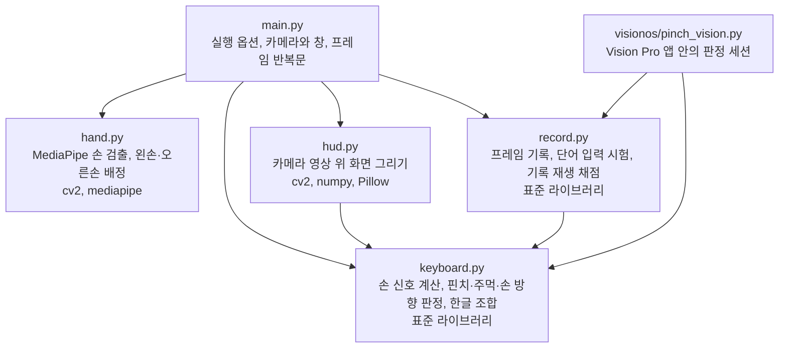
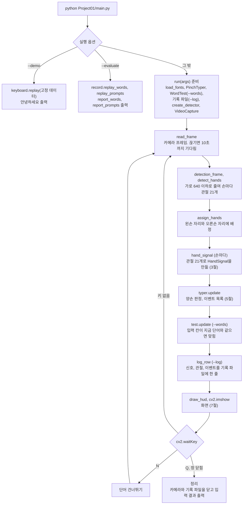
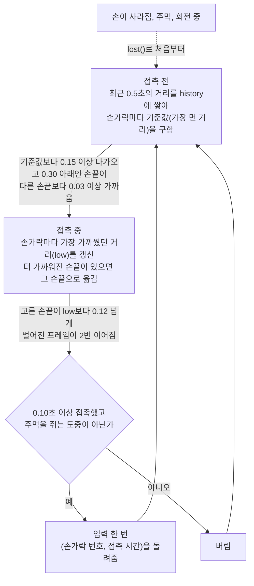
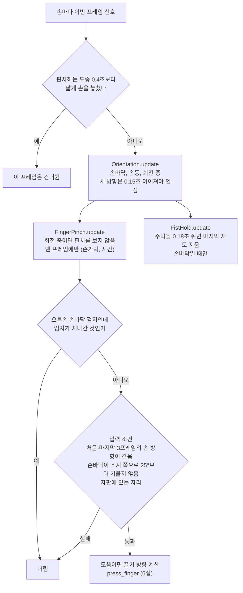
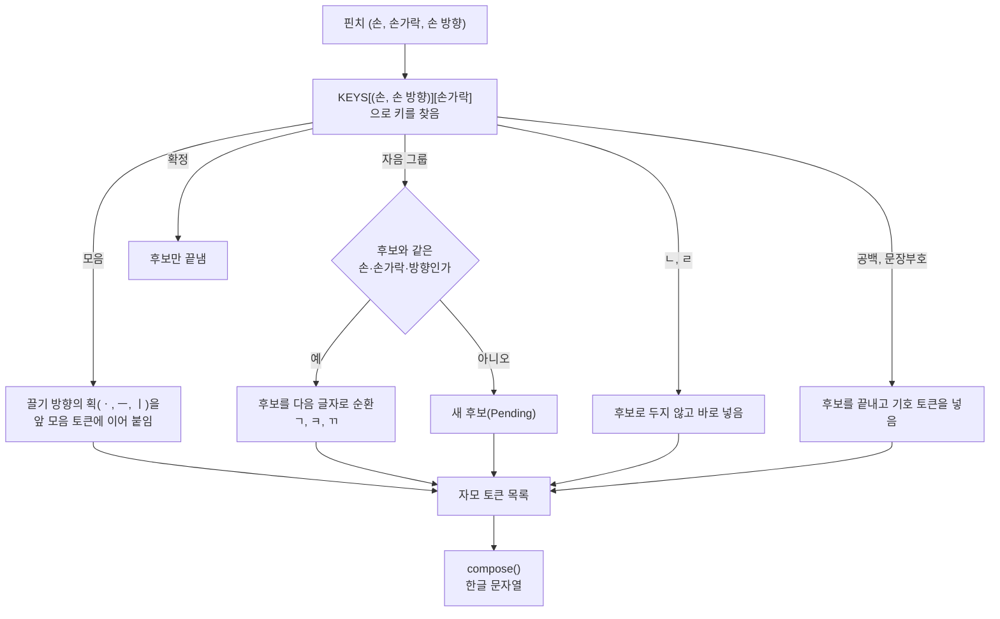
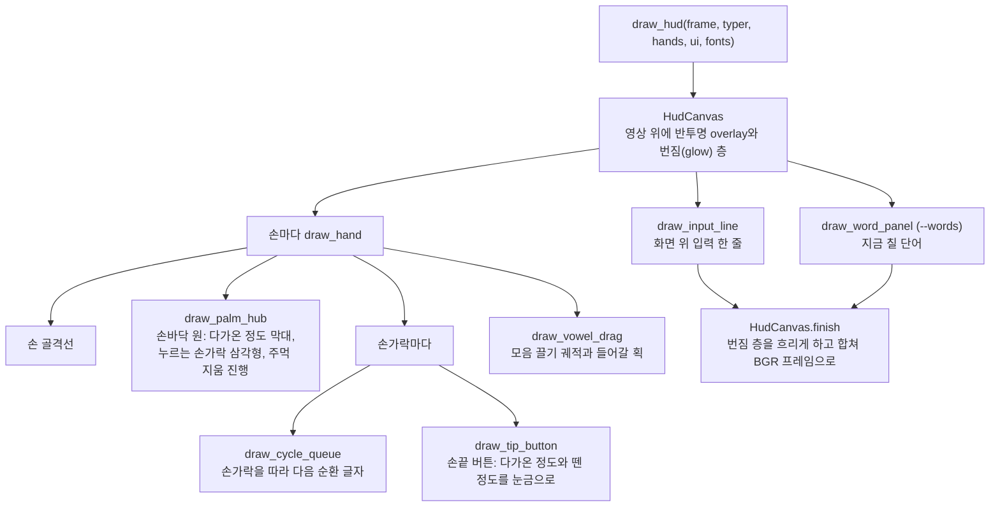
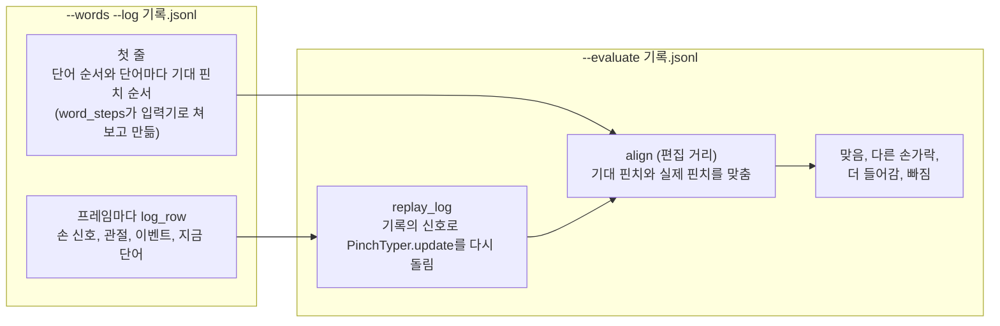
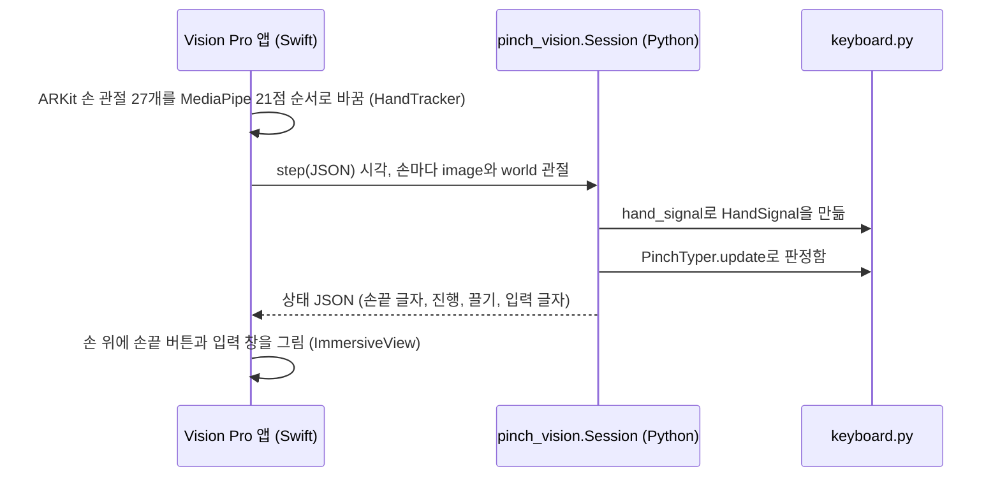

# PinchKeyboard 코드 설명

PinchKeyboard는 카메라로 양손을 찍어, 엄지로 다른 손끝을 집는 동작(핀치)을 천지인 자판의 키로 바꿔 한글을 입력한다. 아래 순서로 읽으면 코드 전체를 따라갈 수 있다.

1. 파일 관계(1절)와 실행 흐름(2절)으로 프로그램이 어떻게 도는지 본다.
2. 손 신호(3절), 핀치 판정(4절), 양손 판정(5절), 한글 조합(6절)에서 핵심 코드를 읽는다.
3. 화면(7절), 기록과 채점(8절), Vision Pro 앱(9절)은 필요할 때 읽는다.
4. 함수 하나가 왜 있고 어디서 불리는지는 10절의 파일별 표에서 찾는다.

## 1. 파일 관계



- `keyboard.py`와 `record.py`는 표준 라이브러리만 import한다. Vision Pro 앱 안의 Python에는 OpenCV와 MediaPipe가 없기 때문이다.
- `hand.py`와 `keyboard.py`는 서로 import하지 않는다. 카메라를 다루는 코드와 판정 코드가 섞이지 않는다.

## 2. 실행 흐름



왼손과 오른손은 MediaPipe 라벨을 따른다. MediaPipe Tasks(1.1.1에서 확인)는 영상에 보이는 그대로의 실제 손을 라벨로 내고, 카메라 앱은 영상을 좌우 반전하지 않으므로 라벨을 그대로 쓴다. 이 라벨이 틀리면 손 방향 부호가 뒤집혀 손바닥과 손등이 바뀐다. 두 손에 같은 라벨이 붙었을 때만 화면 왼쪽 손을 왼손으로 본다(`assign_hands`).

프레임 반복문의 실제 코드다(`main.run`).

```python
frame, gap = read_frame(capture)
if first_frame:
    fh, fw = frame.shape[:2]
    small = detection_frame(frame, DETECT_WIDTH).shape
    requested = "GStreamer 파이프라인" if args.jetson else f"요청 {size[0]}x{size[1]}"
    print(f"카메라 해상도 {fw}x{fh} ({requested}), 손 검출 입력 {small[1]}x{small[0]}", flush=True)
    # 640x480은 960x720으로 키우고, 큰 영상은 화면에 들어오게 줄여 처음 창 크기를 정함
    scale = min(max(960 / fw, 1.0), 1440 / fw, 900 / fh)
    cv2.resizeWindow(WINDOW, round(fw * scale), round(fh * scale))
    first_frame = False
if gap:
    typer.reset()  # 끊긴 동안의 손 상태로 입력하지 않음
now = time.monotonic()
# Continuity Camera가 멈추면 검은 프레임이 들어옴. 2초 넘게 이어지면 한 번만 경고함
if frame[::16, ::16].max() < 8:
    dark_since = dark_since or now
    if now - dark_since > 2.0 and not dark_warned:
        dark_warned = True
        message = "카메라 영상이 검습니다. iPhone을 잠근 채 거치했는지, 다른 앱이 카메라를 쓰는지 확인하세요."
        print(message + " (내장 카메라는 --camera 1)", flush=True)
else:
    dark_since, dark_warned = None, False
h, w = frame.shape[:2]

stamp = max(stamp + 1, int(now * 1000))  # MediaPipe VIDEO 모드는 시각(ms)이 엄격히 늘어나야 함
hands = assign_hands(detect_hands(detector, detection_frame(frame, DETECT_WIDTH), stamp))
# 손바닥 방향은 배정된 자리가 아니라 MediaPipe가 본 라벨로 계산해야 관절 배치와 맞음
signals = {role: hand_signal(hand.label, hand.landmarks, hand.world, w, h)
           for role, hand in hands.items()}
prompt = test.prompt(now) if test else None
if prompt is not None and new_word:
    # 새 단어에서는 직전 단어의 글자를 지우고 쉬는 동안 시작된 접촉을 버림
    typer.ime.clear()
    typer.pending, new_word = None, False
    for state in typer.hands.values():
        state.pinch.lost()
events = typer.update(signals, now)
if test:
    finished = test.update(now, typer.ime.text)
    events += finished
    if finished:
        last_result, new_word = finished[-1], True
if log:
    described = None if prompt is None else {"id": prompt[0], "word": prompt[1]}
    row = log_row(now, hands, signals, events, w, h, described, test is not None)
    log.write(json.dumps(row, ensure_ascii=False) + "\n")
if test and test.done:
    print(test.summary(), flush=True)
    test, ui["word"] = None, None
elif test:
    ui["word"] = word_view(test, test.prompt(now), last_result)

points = {role: [(p.x * w, p.y * h) for p in hand.landmarks] for role, hand in hands.items()}
cv2.imshow(WINDOW, draw_hud(frame, typer, points, ui, fonts))
code = cv2.waitKey(1) & 0xFF
```

## 3. 손 신호: 관절 21개에서 판정에 쓰는 숫자로

MediaPipe는 손마다 관절 21개를 두 가지 좌표로 준다. 영상 좌표(영상 폭·높이에 대한 0~1 비율)와 world 좌표(손 중심 기준 m 단위 3D)다. `hand_signal`은 이 관절로 판정에 쓰는 값만 계산해 `HandSignal`에 담는다. 판정 코드는 관절을 다시 보지 않고 이 값만 쓴다.

| 필드 | 뜻 | 계산에 쓰는 좌표 |
|---|---|---|
| `ratios` | 손가락마다 핀치 거리(엄지 끝에서 끝마디 선분까지의 거리 ÷ 손 크기) | world |
| `curled` | 손가락마다 굽었는지(PIP 관절 각도 130° 이하) | world |
| `flex` | 손가락마다 세 관절의 굽힘 합 | world |
| `pose` | `"open"`, `"closing"`, `"fist"` | 영상 |
| `facing` | 양수면 손바닥, 음수면 손등이 카메라를 향함 | 영상 |
| `roll` | 음수면 소지 쪽이 카메라에 가깝게 기울었음 | 영상 |
| `tips`, `size` | 화면의 엄지 끝·네 손끝 위치와 손 크기(모음 끌기) | 영상 |

관절 번호는 손목이 0이고 엄지 1~4, 검지 5~8, 중지 9~12, 약지 13~16, 소지 17~20이다. 손가락마다 뿌리(MCP), PIP, DIP, 손끝(TIP) 순서다.

핀치 거리는 판정의 기준이 되는 값이다. 손끝 점끼리 재면 끝마디 가운데가 닿아도 거리가 남으므로 끝마디 선분까지 재고, 손 크기로 나눠 사람과 카메라 거리에 따른 차이를 없앤다.

```python
def pinch_ratios(world):
    """손가락마다 엄지 끝에서 끝마디까지의 거리를 손 크기로 나눈 값을 구하는 함수"""
    # 손끝 점끼리 재면 끝마디 가운데가 닿아도 거리가 남으므로 끝마디 선분까지 잼
    # 손 크기로 나눠 사람과 카메라 거리에 따른 차이를 없앰
    scale = max(math.dist(xyz(world[WRIST]), xyz(world[MIDDLE_MCP])), 1e-6)
    thumb = xyz(world[THUMB_TIP])
    ratios = []
    for a, b in DISTAL_SEGMENTS:
        # 엄지 끝을 끝마디 선분 위로 수직 투영한 점까지 잼. 투영 비율 t는 선분 안(0~1)으로 자름
        start, end = xyz(world[a]), xyz(world[b])
        ab = [y - x for x, y in zip(start, end)]
        length = sum(v * v for v in ab)
        t = 0.0 if length < 1e-12 else max(0.0, min(1.0, sum((p - x) * v for p, x, v in zip(thumb, start, ab)) / length))
        ratios.append(math.dist(thumb, [x + t * v for x, v in zip(start, ab)]) / scale)
    return tuple(ratios)
```

손 방향은 손목에서 검지 뿌리와 소지 뿌리로 가는 두 벡터의 외적 부호로 정한다. 왼손은 오른손의 거울상이라 부호를 뒤집는다.

```python
def palm_facing(landmarks, label, width=1.0, height=1.0):
    """손바닥이 카메라를 향한 정도를 -1에서 1 사이 값으로 구하는 함수"""
    # 손목에서 검지 뿌리와 소지 뿌리로 가는 두 벡터의 외적임. 양수면 손바닥, 음수면 손등이 카메라를 향함
    # 왼손은 오른손의 거울상이라 부호가 반대이므로 뒤집음
    wrist = landmarks[WRIST]
    a = ((landmarks[INDEX_MCP].x - wrist.x) * width, (landmarks[INDEX_MCP].y - wrist.y) * height)
    b = ((landmarks[PINKY_MCP].x - wrist.x) * width, (landmarks[PINKY_MCP].y - wrist.y) * height)
    norm = math.hypot(*a) * math.hypot(*b)
    if norm < 1e-12:
        return 0.0
    value = -(a[0] * b[1] - a[1] * b[0]) / norm
    if label == "Left":
        value = -value
    return value
```

## 4. 핀치 판정 (`FingerPinch`, 손 하나)

쉬는 자세에서도 엄지는 검지 옆에 있어 거리가 0.11~0.28이고, 실제 핀치의 가장 가까운 거리(0.00~0.24)와 겹친다. 그래서 거리 하나로 판정하지 않고 "최근 0.5초 동안의 자기 값보다 0.15 이상 다가온 손끝"만 후보로 본다.



접촉 시작 판정이다(`FingerPinch._start_contact`). 방금 뗀 손가락은 덜 벌린 채 다시 핀치하므로 1초 안이면 0.08만 다가와도 후보에 넣는다.

```python
def _start_contact(self, signal, now):
    ratios = signal.ratios
    self.history = [(t, row) for t, row in self.history if now - t <= PINCH_WINDOW] + [(now, ratios)]
    earlier = [flex for t, flex in self.flexes if now - t <= FLEX_BASE]
    if signal.flex is not None:
        self.flexes = [(t, flex) for t, flex in self.flexes if now - t <= FLEX_BASE] + [(now, signal.flex)]
    base = tuple(max(row[j] for _, row in self.history) for j in range(4))
    candidates = self._candidates(base, ratios)
    if self.last_tap is not None and now - self.last_tap[1] <= REPRESS_WINDOW:
        again = self.last_tap[0]
        if again not in candidates and base[again] - ratios[again] >= REPRESS_DROP and ratios[again] <= PINCH_ENTER:
            candidates = sorted(candidates + [again], key=ratios.__getitem__)
    if not candidates:
        return
    best = candidates[0]
    if min(ratios[j] for j in range(4) if j != best) - ratios[best] < PINCH_MARGIN:
        return
    self.active, self.since, self.spoiled, self.opened = best, now, False, 0
    self.base, self.low = base, list(ratios)
    if signal.flex is not None:
        earlier = earlier or [signal.flex]
        self.flex_base = tuple(sum(f[j] for f in earlier) / len(earlier) for j in range(4))
        self.flex_top = list(signal.flex)
    self._check(signal)
```

접촉 중 판정과 떼기 판정이다(`FingerPinch._update_contact`).

```python
def _update_contact(self, signal, now):
    ratios = signal.ratios
    self.low = [min(a, b) for a, b in zip(self.low, ratios)]
    if self.flex_top is not None and signal.flex is not None:
        self.flex_top = [max(a, b) for a, b in zip(self.flex_top, signal.flex)]
    candidates = self._candidates(self.base, self.low)
    # 더 가까이 온 손끝으로 옮김. 떼는 중에는 엄지가 옆 손가락으로 미끄러진 것이므로 옮기지 않음
    if candidates and self.low[self.active] - self.low[candidates[0]] >= PINCH_MARGIN and self.opened == 0:
        self.active = candidates[0]
    # 얕게 다가왔다 벌어지는 손끝이면 지금 닿아 있는 더 가까운 손끝으로 옮김
    if ratios[self.active] > self.release_level() and self.low[self.active] > PINCH_SHALLOW:
        closer = [j for j in candidates if j != self.active and ratios[j] <= PINCH_ENTER
                  and ratios[self.active] - ratios[j] >= PINCH_MARGIN]
        if closer:
            self.active = min(closer, key=ratios.__getitem__)
    self._check(signal)
    if ratios[self.active] <= self.release_level():
        self.opened = 0
        return None
    self.opened += 1
    if self.opened < RELEASE_FRAMES:
        return None
    spoiled, short = self.spoiled, now - self.since < PINCH_MIN_CONTACT
    tap = self._emit(now)
    # 접촉을 끝냄. 다음 핀치가 뗀 뒤의 거리를 기준으로 삼도록 기준값 기록도 비움
    self.active = self.since = None
    self.history, self.flexes = [], []
    self.flex_base = self.flex_top = None
    self.spoiled, self.low, self.opened = False, [1.0] * 4, 0
    if spoiled or short:
        self.undo_tap()
        return None
    return tap
```

## 5. 양손 판정 (`PinchTyper.update`)

손마다 판정기 세 개(손 방향 `Orientation`, 핀치 `FingerPinch`, 주먹 `FistHold`)를 돌리고, 입력 조건을 지난 핀치만 키로 바꾼다.



```python
def update(self, signals, now):
    """한 프레임의 양손 신호를 판정하고 이번 프레임의 이벤트 목록을 돌려주는 메서드"""
    events, self.pinches = [], []  # 이벤트는 ("input", 글자), ("commit", None), ("delete", None) 세 가지임
    for label, hand in self.hands.items():
        hand.signal = signals.get(label)
        if hand.signal is None and hand.pinch.active is not None and hand.seen is not None \
                and now - hand.seen <= HAND_GAP:
            continue
        if hand.signal is not None:
            hand.seen = now
        hand.orientation.update(None if hand.signal is None else hand.signal.facing, now)
        signal, state = hand.signal, hand.orientation.state
        # 손등 핀치는 다른 손가락이 자연스럽게 굽으므로 SPOIL_CURLED를 쓰지 않음
        hand.pinch.spoil_curled = "back" not in (state, self.frame_face(signal, state))
        tap = hand.pinch.update(signal if state in FACES else None, now)
        if tap is not None and tap[0] == 0 and label == "Right" and state == "palm" and hand.pinch.index_sweep():
            hand.pinch.undo_tap()
            tap = None
        if signal is not None and (tap is not None or hand.pinch.active is not None):
            hand.held.append(signal)
        steady = hidden = False
        if tap is not None and state in FACES:
            # 접촉의 처음과 마지막 STEADY_FRAMES 프레임에서 손 방향 값의 중앙값이 모두 뗄 때의 방향이어야 함
            sign = 1 if state == "palm" else -1
            facings = [held.facing for held in hand.held]
            steady = bool(facings) and all(sign * statistics.median(part) >= FACING_THRESHOLD
                                           for part in (facings[:STEADY_FRAMES], facings[-STEADY_FRAMES:]))
            # 손바닥이 소지 쪽으로 OCCLUDED_ROLL보다 기운 접촉은 엄지가 가려졌으므로 버림
            hidden = state == "palm" and bool(hand.held) and \
                statistics.median(held.roll for held in hand.held) <= OCCLUDED_ROLL
        if steady and not hidden and KEYS[(label, state)][tap[0]] is not None:
            self.pinches.append((label, tap[0], state))
            drag = None
            if KEYS[(label, state)][tap[0]] == "VOWEL":
                # 뗄 때 엄지만 벌어지는 마지막 프레임은 끈 거리에서 뺌
                held = hand.held[:-RELEASE_FRAMES] if len(hand.held) > RELEASE_FRAMES else hand.held
                drag = self.drag_of_path(*self.pinch_path(held, tap[0]))
            events += self.press_finger(label, tap[0], state, drag)
        if tap is not None or hand.pinch.active is None:
            hand.held = []
        if signal is None:
            hand.fist.lost()
        elif hand.fist.update(signal.pose, now, relaxed=not FingerPinch.closed_pose(signal)) and state == "palm":
            events += self.make_fist()
    return events
```

## 6. 핀치에서 한글까지



| 손과 방향 | 검지 | 중지 | 약지 | 소지 |
|---|---|---|---|---|
| 왼손 손바닥 | ㅂㅍㅃ | ㄹ | ㅅㅎㅆ | ㅈㅊㅉ |
| 오른손 손바닥 | ㄱㅋㄲ | ㄴ | ㄷㅌㄸ | ㅇㅁ |
| 왼손 손등 | 모음 | 공백 | 확정 | . , ? ! 줄바꿈 |
| 오른손 손등 | 확정 또는 공백 | 없음 | 없음 | 없음 |

"안"을 칠 때의 토큰 변화를 예로 들면 다음과 같다.

| 핀치 | 토큰 | 화면 |
|---|---|---|
| 오른손 소지 | `[C ㅇ]` | ㅇ |
| 모음 버튼을 세로로 끌기(ㅣ) | `[C ㅇ][V i]` | 이 |
| 모음 버튼을 그대로 떼기(ㆍ) | `[C ㅇ][V i.]` | 아 (i와 .을 이어 붙이면 ㅏ) |
| 오른손 중지 | `[C ㅇ][V i.][C ㄴ]` | 안 (모음 뒤 자음은 받침) |

키를 입력기에 넣는 코드다(`PinchTyper._press`).

```python
def _press(self, hand, finger, face, drag):
    key = KEYS[(hand, face)][finger]
    if key is None:
        return []
    if key == "COMMIT_SPACE":
        key = "COMMIT" if self.pending is not None else "SPACE"
    if key == "VOWEL":
        atom = DRAG_STROKES[drag]
        self.pending = None
        tokens = self.ime.tokens
        # 앞 모음에 획을 이어 붙여 모음이 되면 붙이고(ㅣ에 ㆍ를 붙이면 ㅏ), 아니면 새 모음으로 넣음
        if tokens and tokens[-1].kind == "V" and tokens[-1].value + atom in VOWELS:
            tokens[-1].value += atom
        else:
            tokens.append(Token("V", atom))
        return [("input", VOWELS[atom])]
    if key == "COMMIT":
        self.pending = None
        return [("commit", None)]
    if key == "SPACE":
        self.pending = None
        self.ime.put_symbol(" ")
        return [("input", " ")]
    if not is_group_key(key):  # ㄴ·ㄹ은 후보로 두지 않고 바로 넣음
        self.pending = None
        self.ime.put_consonant(CONSONANTS[key])
        return [("input", CONSONANTS[key])]
    pending = self.pending
    if pending is not None and (pending.hand, pending.finger, pending.face) == (hand, finger, face):
        group = group_of(key)
        label = group[pending.count % len(group)]
        self._put(key, label, replace=pending.label)
        pending.count, pending.label = pending.count + 1, label
        return [("input", label)]
    label = group_of(key)[0]
    self._put(key, label)
    self.pending = Pending(key, hand, finger, face, 1, label)
    return [("input", label)]
```

토큰을 한글 음절로 조합하는 코드다(`compose`). 받침 뒤에 모음이 오면 받침을 다음 글자의 초성으로 옮긴다(각 + ㅏ = 가가).

```python
def compose(tokens):
    """자모 토큰을 한글 음절로 조합하는 함수"""
    output = []
    initial = medial = final = ""

    def flush():
        nonlocal initial, medial, final
        if initial and medial:  # 유니코드 음절 코드는 0xAC00 + (초성×21 + 중성)×28 + 종성임
            code = 0xAC00 + (INITIALS.index(initial) * 21 + MEDIALS.index(medial)) * 28
            output.append(chr(code + FINALS.index(final)))
        else:
            output.append(initial or medial)
        initial = medial = final = ""

    for token in tokens:
        value = token.value
        if token.kind == "C":
            if initial and medial and not final and value in FINALS:
                final = value
            elif initial and medial and final + value in FINAL_PAIRS:
                final = FINAL_PAIRS[final + value]
            else:
                flush()
                initial = value
        elif token.kind == "V":
            vowel = VOWELS[value]
            if vowel not in MEDIALS:  # 아직 조합 중인 아래아는 낱자로 보여 줌
                flush()
                output.append(vowel)
            elif initial and medial and final:  # 받침 뒤에 모음이 오면 받침을 다음 글자의 초성으로 옮김(각 + ㅏ = 가가)
                final, carried = SPLIT_FINALS.get(final, ("", final))
                flush()
                initial, medial = carried, vowel
            elif initial and not medial:
                medial = vowel
            else:
                flush()
                medial = vowel
        else:
            flush()
            output.append(value)
    flush()
    return "".join(output)
```

## 7. 화면 그리기 (`hud.draw_hud`)

화면은 판정하지 않고 `PinchTyper`의 상태를 읽어 그리기만 한다. 크기는 모두 640x480 기준 값에 화면 배율을 곱해 Jetson과 Mac에서 같은 비율로 보인다.



## 8. 기록과 채점 (`record.py`)

판정값을 고칠 때는 같은 기록을 지금 판정으로 다시 재생해 결과를 비교한다.



## 9. Vision Pro 앱 (`visionos/`)

시야 근처에 카메라를 고정할 수 없어 1인칭 시점 판정을 시험하려고 만든 앱이다. 판정은 Swift로 다시 쓰지 않고 앱 안의 Python이 `keyboard.py`, `record.py`를 그대로 돌린다.



빌드 단계 "Install Python"(`PinchKeyboard.xcodeproj`)이 `pinch_vision.py`, `keyboard.py`, `record.py`, 고정 데이터를 앱 번들에 복사한다.

## 10. 파일별 import와 함수

### `main.py`

| import | 이유 |
|---|---|
| `argparse` | 실행 옵션(`--camera`, `--jetson`, `--demo`, `--words`, `--log`, `--evaluate`)을 읽는다. |
| `json` | 고정 데이터(`fixtures/pinch-typer-keys.json`)를 읽고 기록 파일에 한 줄씩 쓴다. |
| `pathlib.Path` | 모델·고정 데이터·기록 폴더 경로를 `main.py` 위치 기준으로 만든다. |
| `sys` | `sys.platform`으로 macOS인지 확인해 카메라 해상도 기본값을 정한다. |
| `time` | 프레임 시각(`time.monotonic`)과 단어 시험 기록 파일 이름의 날짜(`time.strftime`)를 만든다. |
| `cv2` | 카메라 열기, 프레임 읽기, 좌우 반전, 창 띄우기, 키 입력. |
| `hand`, `hud`, `keyboard`, `record` | 프로젝트의 나머지 네 파일. `keyboard`에서는 `PinchTyper`, `hand_signal`, `replay`를 쓴다. |

| 함수 | 하는 일과 존재 이유 | 호출 위치 |
|---|---|---|
| `read_frame` | 프레임을 읽고, 끊기면 10초까지 기다린다. iPhone Continuity Camera는 기기를 움직이면 잠시 멈추기 때문이다. 끊겼던 시간을 돌려줘 `run`이 판정 상태를 비우게 한다. | `run` |
| `word_view` | 단어 입력 시험 안내 패널의 제목, 설명, 색을 만든다. | `run` |
| `run` | 카메라를 열고 프레임 반복문을 돈다. 손 검출, 판정, 기록, 화면, 단축키를 이 순서로 처리한다. 끝날 때 카메라와 기록 파일을 닫고 입력 결과를 출력한다. | `main` |
| `main` | 실행 옵션을 읽고 `--demo`, `--evaluate`, 카메라 입력기 가운데 하나를 시작한다. | 파일을 직접 실행할 때 |

### `hand.py`

| import | 이유 |
|---|---|
| `typing.Any`, `typing.NamedTuple` | `Detection`을 필드 이름이 있는 튜플로 만든다. |
| `cv2` | BGR을 RGB로 바꾸고(`cvtColor`), 검출 입력을 줄인다(`resize`). |
| `mediapipe`, `mediapipe.tasks.python`, `mediapipe.tasks.python.vision` | 손 관절 검출기(`HandLandmarker`). 실습 `practice/hand_detection_fingers.py`와 같은 import이다. |

| 이름 | 하는 일과 존재 이유 | 호출 위치 |
|---|---|---|
| `Detection` | 손 하나의 검출 결과(라벨, 영상 관절, world 관절)를 묶는 클래스. | `detect_hands`가 만들고 `main.run`, `record.log_row`가 읽음 |
| `create_detector` | VIDEO 모드 검출기를 만든다. 모델 파일이 없으면 경로를 알려 주는 오류를 낸다. | `main.run` |
| `detect_hands` | 프레임에서 손을 찾아 `Detection` 목록을 만든다. 좌우 반전 영상이면 라벨을 뒤집는다. | `main.run` |
| `detection_frame` | 검출 입력을 가로 640 이하로 줄인다. 화면 해상도와 상관없이 Jetson 640x480 시연과 검출 시간이 같아진다. | `main.run` |
| `assign_hands` | 검출한 손을 왼손·오른손 자리에 배정한다. 두 손에 같은 라벨이 붙었을 때만 화면 왼쪽 손을 왼손으로 본다. | `main.run` |

### `keyboard.py`

| import | 이유 |
|---|---|
| `dataclasses.dataclass` | `HandSignal`, `Token`, `Pending`의 필드와 기본값을 선언만으로 만든다. |
| `math` | 관절 거리와 각도(`math.dist`, `math.hypot`, `math.acos`, `math.atan2`, `math.degrees`), 모음 끌기 거리. |
| `statistics` | 접촉 동안의 손 방향 값, 기울기, 손 크기의 중앙값(`statistics.median`). 한 프레임 튄 값에 흔들리지 않게 평균 대신 중앙값을 쓴다. |

| 이름 | 하는 일과 존재 이유 | 호출 위치 |
|---|---|---|
| `xyz` | 관절 하나를 (x, y, z) 튜플로 바꾼다. z가 없는 관절은 0으로 본다. | `pinch_ratios`, `finger_flex`, `hand_signal` |
| `joint_angle` | 세 점이 만드는 관절 각도. | `finger_flex`, `hand_signal` |
| `pose_from_image` | 손 자세를 편 손, 접는 중, 주먹 가운데 하나로 정한다. 실습 practice 코드의 관절 각도 방식에 손끝이 뻗은 거리를 더했다. | `hand_signal` |
| `finger_flex` | 손가락마다 세 관절의 굽힘 합. 검지 겹침 규칙이 어느 손가락이 더 굽었는지 볼 때 쓴다. | `hand_signal`, `record.signal_from_log` |
| `palm_roll` | 손이 엄지 쪽이나 소지 쪽으로 기운 각도. 엄지가 가려지는 자세를 찾는다. | `hand_signal`, `record.signal_from_log` |
| `palm_facing` | 손바닥이 카메라를 향한 정도(-1~1). 손바닥 자판과 손등 자판을 가른다. | `hand_signal` |
| `HandSignal` | 판정에 쓰는 손 하나의 신호를 담는 클래스. | `hand_signal`, `record.signal_from_log`가 만들고 `PinchTyper`가 읽음 |
| `pinch_ratios` | 손가락마다 핀치 거리(엄지 끝에서 끝마디까지의 거리 ÷ 손 크기). 손 크기로 나눠 사람과 카메라 거리에 따른 차이를 없앤다. | `hand_signal` |
| `image_tips` | 화면 좌표의 엄지 끝과 네 손끝 위치, 손 크기. 모음 끌기 방향을 잰다. | `hand_signal`, `record.signal_from_log` |
| `hand_signal` | 한 손의 관절로 `HandSignal`을 만든다. | `main.run`, `visionos/pinch_vision.py`의 `Session.step` |
| `Token` | 입력된 자모 하나를 나타내는 클래스. | `CheonjiinIME`의 `put_*` 메서드 |
| `compose` | 자모 토큰을 유니코드 한글 음절로 조합한다. 받침 뒤에 모음이 오면 받침을 다음 글자 초성으로 옮긴다. | `CheonjiinIME.text`, `CheonjiinIME.delete_char` |
| `compose` 안의 `flush` | 조합 중인 글자를 출력에 내보낸다. 초성·중성·종성 세 변수를 바꿔야 해서 `nonlocal`을 쓴다. | `compose` |
| `CheonjiinIME` | 자모 토큰을 쌓아 두고 조합 결과를 돌려주는 입력기. | `PinchTyper.__init__` |
| `CheonjiinIME.text` | 지금까지의 입력을 조합한 문자열. | `hud.draw_input_line`, `main.run`, `record.word_steps` |
| `CheonjiinIME.put_consonant` | 자음을 넣는다. 순환 중이면 마지막 자음을 바꾼다. | `PinchTyper._press`, `PinchTyper._put` |
| `CheonjiinIME.put_symbol` | 공백·문장부호·줄바꿈을 넣는다. 순환 중이면 마지막 기호를 바꾼다. | `PinchTyper._press`, `PinchTyper._put` |
| `CheonjiinIME.delete_char` | 보이는 마지막 자모 하나를 지운다. | `PinchTyper.make_fist` |
| `CheonjiinIME.clear` | 입력을 모두 지운다. | `main.run`(단어 시험의 새 단어), `Session` |
| `group_of` | 키가 순환하는 글자 목록. | `cycle_queue`, `PinchTyper._press`, `visionos/pinch_vision.py`의 `Session.state` |
| `is_group_key` | 다시 핀치하면 순환하는 키인지 판별한다. | `cycle_queue`, `PinchTyper._press` |
| `key_label` | 손끝에 보여 줄 키 이름. | `cycle_queue`, `visionos/pinch_vision.py`의 `Session.state`(Vision Pro 자판 지도) |
| `cycle_queue` | 손끝에 보여 줄 글자 목록. 지금 핀치하면 나올 글자가 맨 앞이다. | `hud.draw_hand` |
| `FistHold` | 주먹을 0.18초 쥐었는지 판정하고, 계속 쥐면 0.5초마다 다시 알린다. 손을 편 뒤에만 센다. | `HandState.__init__`; `update`·`lost`는 `PinchTyper.update`, `PinchTyper.reset` |
| `Orientation` | 손바닥, 손등, 회전 중을 판정한다. 새 방향은 0.15초 이어져야 인정한다. | `HandState.__init__`; `update`·`lost`는 `PinchTyper.update`, `PinchTyper.reset` |
| `FingerPinch` | 손 하나의 핀치를 판정한다(4절). | `HandState.__init__`; `update`는 `PinchTyper.update` |
| `FingerPinch.lost` | 판정 상태를 모두 지운다. | `FingerPinch.update`, `PinchTyper.reset`, `main.run`, `record.replay_log`, `Session._clear_input` |
| `FingerPinch.closed_pose` | 주먹 자세인지 판별한다. | `FingerPinch.update`, `PinchTyper.update` |
| `FingerPinch.release_level` | 이 거리보다 벌리면 뗀 것으로 보는 값. | `release_progress`, `_update_contact` |
| `FingerPinch.release_progress` | 뗀 정도 0~1. 손끝 버튼의 눈금을 켠다. | `hud.draw_tip_button` |
| `FingerPinch.progress` | 손가락마다 다가온 정도 0~1. 손끝 버튼과 손바닥 원의 막대 길이를 정한다. | `hud.draw_hand` |
| `FingerPinch._candidates` | 기준값보다 충분히 다가온 손가락을 가까운 순으로 고른다. | `_start_contact`, `_update_contact` |
| `FingerPinch._index_overlap` | 엄지 옆면이 검지를 함께 눌러 검지로 잡힌 접촉을 더 굽은 손가락으로 바꾼다. 정답 접촉 90개에서 맞은 수가 78개에서 83개로 늘었다. | `_emit` |
| `FingerPinch.index_sweep` | 방금 뗀 검지 접촉이 엄지가 검지를 지나간 것인지 판별한다. | `PinchTyper.update`(오른손 손바닥 검지만) |
| `FingerPinch.undo_tap` | 방금 낸 입력을 없던 것으로 하고 직전 입력 기록을 되돌린다. | `_update_contact`, `PinchTyper.update` |
| `FingerPinch.update` | 프레임 하나를 판정한다. | `PinchTyper.update` |
| `FingerPinch._start_contact` | 접촉 전 기준값을 쌓고 접촉 시작을 본다(4절). | `FingerPinch.update` |
| `FingerPinch._update_contact` | 접촉 중 손끝 옮기기와 떼기를 본다(4절). | `FingerPinch.update` |
| `FingerPinch._check` | 주먹을 쥐는 도중인 접촉을 버릴 것으로 표시한다. | `_start_contact`, `_update_contact` |
| `FingerPinch._emit` | 입력 하나를 만들고 검지 지나감 판정에 쓸 정보를 남긴다. | `_update_contact` |
| `Pending` | 아직 확정하지 않은 후보 글자. 같은 손가락을 다시 핀치했는지 비교하는 데 쓴다. | `PinchTyper._press` |
| `HandState` | 손 하나의 판정기 세 개와 이번 접촉 동안의 신호를 묶는다. | `PinchTyper.__init__` |
| `PinchTyper` | 양손 신호를 판정해 한글을 입력한다. | `main.run`, `keyboard.replay`, `record.word_steps`, `record.replay_log` |
| `PinchTyper.face` | 그 손의 지금 방향. 판정 전이나 회전 중이면 None. | `cycle_queue`, `drag_view`, `Session.state` |
| `PinchTyper.press_finger` | 핀치 한 번을 키로 처리하고 손바닥 가운데 입력 표시(`echo`)를 갱신한다. | `PinchTyper.update`, `keyboard.replay`, `record.word_steps` |
| `PinchTyper._press` | 키 종류(모음, 확정, 공백, ㄴ·ㄹ, 순환 그룹)에 따라 입력기에 넣는다. | `press_finger` |
| `PinchTyper._put` | 후보 글자를 자음이나 기호로 넣는다. | `_press` |
| `PinchTyper.make_fist` | 주먹 지움을 처리한다. | `PinchTyper.update`, `keyboard.replay` |
| `PinchTyper.pinch_path` | 접촉 동안의 핀치 지점과 손 크기 중앙값. | `PinchTyper.update`, `drag_view` |
| `PinchTyper.drag_of_path` | 핀치 지점의 이동으로 모음 끌기 방향을 정한다. | `PinchTyper.update`, `drag_view` |
| `PinchTyper.drag_view` | 모음을 핀치하는 중인 손의 끌기 궤적과 방향. | `hud.draw_hand` |
| `PinchTyper.frame_face` | 이번 프레임 값만으로 정한 손 방향. 뒤집자마자 핀치한 손등 모음을 버리지 않게 한다. | `PinchTyper.update` |
| `PinchTyper.reset` | 양손의 판정 상태를 지운다. | `main.run`(일시정지, 도움말, 카메라 끊김) |
| `PinchTyper.update` | 한 프레임의 양손을 손 방향, 핀치, 입력 조건, 주먹 순서로 판정한다. | `main.run`, `record.replay_log` |
| `replay` | 핀치·주먹 단계 목록을 차례로 입력한다. 카메라 없이 자판과 조합 규칙을 확인한다. | `main.main`(`--demo`), 테스트 |

### `hud.py`

| import | 이유 |
|---|---|
| `functools.lru_cache` | 같은 글꼴 크기, 글자 폭, 글자 이미지를 매 프레임 다시 만들지 않게 캐시한다. |
| `math` | 원 둘레의 눈금 위치(`math.sin`, `math.cos`, `math.radians`), 방향 각도(`math.atan2`), 거리(`math.dist`, `math.hypot`). |
| `pathlib.Path` | 한글 글꼴 파일이 있는지 확인한다. |
| `time` | 애니메이션 시각(`time.monotonic`). |
| `cv2`, `numpy` | Pillow 이미지와 OpenCV BGR 프레임 사이 변환. |
| `PIL.Image`, `PIL.ImageDraw`, `PIL.ImageFilter`, `PIL.ImageFont` | 한글 글자, 반투명 선과 면, 번짐 효과를 그린다. |
| `keyboard` | 관절 번호와 자판 정보. |

| 이름 | 하는 일과 존재 이유 | 호출 위치 |
|---|---|---|
| `load_fonts` | Ubuntu·Jetson·Windows·macOS의 설치 경로에서 한글 글꼴을 찾아 세 크기로 불러온다. 호출하는 곳은 `main.run` 하나지만, `main.py`가 Pillow와 글꼴 경로를 몰라도 되도록 `hud.py`에 둔다. | `main.run`, 테스트 |
| `hud_font` | 글꼴의 다른 크기 버전. 손 크기에 따라 손끝 글자 크기가 바뀐다. | `HudCanvas.__init__`, `draw_palm_hub`, `draw_cycle_queue`, `draw_tip_button`, `draw_vowel_drag` |
| `hud_text_width` | 글자열의 폭. 패널 크기와 정렬을 정한다. | `ellipsize_left`, `draw_tip_button`, `draw_input_line`, `draw_word_panel` |
| `hud_text_sprite` | 글자 하나를 작은 RGBA 이미지로 그린다. 호출하는 곳은 하나지만 `lru_cache`로 캐시하려면 함수여야 해서 따로 둔다. | `HudCanvas.write` |
| `ellipsize_left` | 입력 줄이 화면보다 길면 앞부분을 "…"로 줄인다. 마지막 글자가 보여야 하기 때문이다. | `draw_input_line` |
| `HudCanvas` | 프레임 위에 반투명 오버레이와 번짐 층을 두고 그리는 판. 모든 크기에 640x480 기준 배율을 곱해 Jetson과 Mac에서 같은 비율로 보인다. | `draw_hud` |
| `HudCanvas.write` | 글자를 놓는다. | 그리기 함수 대부분, `write` |
| `HudCanvas.polar` | 중심에서 각도와 반지름으로 점 위치를 구한다. | `ticks`, `pointer`, `draw_palm_hub` |
| `HudCanvas._line_width` | 선 두께 기본값. | `hairline_circle`, `ticks`, `dashed_circle`, `arc`, `panel` |
| `HudCanvas.hairline_circle` | 어두운 테두리를 깐 가는 원. | `draw_cycle_queue`, `draw_vowel_drag` |
| `HudCanvas.ticks` | 원 둘레의 눈금. 진행을 켜진 눈금 수로 보여 준다. | `draw_palm_hub`, `draw_tip_button`, `draw_vowel_drag` |
| `HudCanvas.dashed_circle` | 파선 원. | `draw_palm_hub`, `draw_vowel_drag` |
| `HudCanvas.pointer` | 방향을 가리키는 작은 삼각형. | `draw_palm_hub`, `draw_vowel_drag` |
| `HudCanvas._box` | 원의 경계 상자. | `arc`, `band`, `clear_circle` |
| `HudCanvas.arc` | 일부만 그린 원. | `draw_palm_hub` |
| `HudCanvas.band` | 두꺼운 반투명 호. | `draw_palm_hub` |
| `HudCanvas.glow_line` | 번짐을 더한 선. | `draw_vowel_drag`, `draw_input_line` |
| `HudCanvas.clear_circle` | 버튼 둘레를 비워 앞서 그린 요소가 버튼을 가리지 않게 한다. | `draw_cycle_queue`, `draw_tip_button` |
| `HudCanvas.panel` | 어두운 면과 가는 테두리의 둥근 사각형 패널. Pillow 12.3이 소수 좌표에서 ValueError를 내는 경우를 막으려고 좌표를 정수로 맞춘다. | `draw_input_line`, `draw_word_panel` |
| `HudCanvas.finish` | 번짐 층과 오버레이를 합성해 BGR 프레임으로 돌려준다. | `draw_hud` |
| `write` | 외곽선 여부를 정해 `HudCanvas.write`를 부른다. | 그리기 함수 대부분 |
| `faded`, `with_alpha` | 색의 불투명도를 바꾼다. | 그리기 함수 여러 곳 |
| `bearing` | 중심에서 점으로 가는 방향 각도. | `draw_palm_hub` |
| `toward` | 손바닥 가운데와 제자리 사이의 위치. 주먹을 쥘 때 버튼이 모이는 애니메이션에 쓴다. | `draw_hand`, `draw_cycle_queue` |
| `finger_path_point` | 손가락 관절을 따라가는 경로 위의 점. 순환 대기 글자를 놓는다. | `draw_cycle_queue` |
| `tip_home` | 손끝 바로 바깥의 버튼 자리. | `draw_hand` |
| `spread_motion` | 손끝 버튼이 펼쳐진 정도. | `draw_hand` |
| `cycle_motion` | 순환할 때 대기 글자가 올라오는 애니메이션의 진행. | `draw_cycle_queue` |
| `echo_look`, `echo_view` | 입력 직후 손바닥 가운데에 그 글자를 띄우는 애니메이션. | `draw_hand` |
| `draw_palm_hub` | 손바닥 원형 표시(다가옴 막대, 누르는 손가락 삼각형, 주먹 지움 진행). | `draw_hand` |
| `draw_cycle_queue` | 손가락을 따라 순환 대기 글자를 그린다. | `draw_hand` |
| `draw_tip_button` | 손끝 버튼을 그린다. | `draw_hand` |
| `draw_vowel_drag` | 모음 끌기의 지나온 길과 지금 떼면 들어갈 획. | `draw_hand` |
| `draw_hand` | 손 하나의 요소를 모두 그린다. | `draw_hud` |
| `draw_input_line` | 화면 위 입력 한 줄. | `draw_hud` |
| `draw_word_panel` | 단어 입력 시험 안내. | `draw_hud` |
| `draw_hud` | 한 프레임의 화면 전체를 그린다. | `main.run` |

### `record.py`

| import | 이유 |
|---|---|
| `json` | 기록 파일을 한 줄씩 읽는다. |
| `random` | 단어 입력 시험의 단어 순서를 섞는다. |
| `types.SimpleNamespace` | 기록에 남긴 좌표 목록을 x, y, z 속성이 있는 관절 객체로 되돌린다. `hand.py`의 함수가 MediaPipe 관절처럼 `.x`, `.y`, `.z`로 읽기 때문이다. |
| `keyboard` | 신호 계산 함수, 자판, 입력기. |

| 이름 | 하는 일과 존재 이유 | 호출 위치 |
|---|---|---|
| `log_row` | 프레임 하나의 신호, 관절, 이벤트를 기록 한 줄로 만든다. 판정을 고친 뒤 같은 기록을 다시 재생해 비교하려고 관절 좌표까지 남긴다. | `main.run` |
| `log_row` 안의 `points` | 좌표를 반올림한 목록으로 바꾼다. | `log_row` |
| `signal_from_log` | 기록 한 줄의 손을 `HandSignal`로 되돌린다. | `replay_log` |
| `read_config` | 기록 첫 줄의 시험 설정을 읽는다. 정답이 있는 기록인지 가른다. | `main.main`, `replay_words` |
| `jamo_of` | 한글 음절을 치는 순서의 자모로 나눈다. | `word_steps` |
| `word_steps` | 단어를 치는 기대 핀치 단계를 만들고, 실제 입력기로 쳐서 같은 단어가 나오는지 확인한다. | `WordTest.__init__`, 테스트 |
| `word_steps` 안의 `press` | 핀치 한 번을 입력기에 넣고 단계 목록에 남긴다. | `word_steps` |
| `WordTest` | 단어를 하나씩 내고 맞힘과 건너뜀을 센다. 기록 첫 줄에 단어마다의 기대 핀치 순서를 남겨 채점의 정답으로 쓴다. | `main.run`(`--words`) |
| `WordTest.done` | 모든 단어를 끝냈는지. | `main.run`, `WordTest.prompt` |
| `WordTest.prompt` | 지금 낼 단어. 단어를 맞힌 뒤 0.6초 쉬는 동안은 None. | `main.run`, `update`, `skip` |
| `WordTest.update` | 입력 칸이 지금 단어와 같아졌으면 맞힘으로 넘긴다. | `main.run` |
| `WordTest.skip` | N 키로 지금 단어를 건너뛴다. | `main.run` |
| `WordTest._finish` | 결과를 남기고 다음 단어로 넘긴다. | `update`, `skip` |
| `WordTest.summary` | 맞힘·건너뜀 수 요약. | `main.run` |
| `WordTest.config` | 기록 첫 줄의 설정. | `main.run` |
| `key_name` | (손, 손가락, 방향)을 "오른손 손등 검지" 같은 이름으로 바꾼다. | `report_words`, `report_prompts` |
| `replay_log` | 기록을 지금 판정으로 다시 재생한다. 앱과 같게 새 단어에서 직전 접촉을 버린다. | `replay_words`, `replay_prompts` |
| `replay_words` | 단어 기록을 재생해 단어마다 기대 키와 실제 키를 모은다. | `main.main`(`--evaluate`) |
| `replay_prompts` | 손가락 차례 기록(예전 정답 기록 도구로 남긴 `collect-*.jsonl`)을 재생해 차례마다 실제 입력을 모은다. | `main.main`(`--evaluate`) |
| `replay_words`·`replay_prompts` 안의 `collect` | 프레임마다 인정된 핀치를 단어(차례) 결과에 더한다. 바깥 함수의 결과 dict에 쌓아야 해서 중첩 함수로 둔다. | `replay_log` |
| `align` | 기대 키와 실제 키를 편집 거리로 맞춰 맞음, 다른 손가락, 더 들어감, 빠짐으로 나눈다. | `report_words` |
| `report_words` | 단어 기록의 채점 결과 글. | `main.main` |
| `report_prompts` | 손가락 차례 기록의 채점 결과 글. | `main.main` |

### `visionos/pinch_vision.py`

Vision Pro 앱의 Swift 코드(`visionos/PinchKeyboard/`)가 ARKit 손 관절을 MediaPipe 21점 순서로 바꿔 프레임마다 JSON으로 넘기고, 이 파일의 `Session`이 판정한 결과를 JSON으로 돌려받는다. 빌드 단계 "Install Python"(`PinchKeyboard.xcodeproj/project.pbxproj`)이 이 파일과 `keyboard.py`, `record.py`, `fixtures/pinch-typer-keys.json`을 앱 번들 `app/`에 복사한다.

| import | 이유 |
|---|---|
| `json` | Swift와 주고받는 상태를 JSON 문자열로 바꾸고, 기록 파일을 한 줄씩 쓴다. |
| `pathlib.Path` | 기록 폴더와 판정 파일 위치. |
| `sys` | 판정 파일이 있는 폴더를 import 경로에 넣는다(`sys.path.insert`). 기기에서는 같은 폴더, Mac에서는 한 단계 위(`Project01/`)이다. 내장 Python 버전도 `sys.version`으로 알린다. |
| `time` | 기록 파일 이름의 날짜. |
| `types.SimpleNamespace` | Swift가 넘긴 [x, y, z] 목록을 `keyboard.py` 함수가 읽는 관절 객체로 바꾼다. |
| `keyboard`, `record` | 카메라 앱과 같은 판정, 조합, 단어 입력 시험. |

| 이름 | 하는 일과 존재 이유 | 호출 위치 |
|---|---|---|
| `Session` | 앱이 실행되는 동안 하나만 두는 판정 세션. | `PinchKeyboard/PythonHost.c`(앱 시작 때 만듦) |
| `Session.step` | 프레임 하나를 판정하고 화면 상태를 돌려준다. | Swift(`PythonEngine.swift`) |
| `Session._clear_input` | 입력 칸, 후보, 진행 중인 접촉을 비운다. | `step`, `command`(next), `set_mode` |
| `Session._finished` | 단어 하나가 끝났을 때 결과와 걸린 시간을 남긴다. | `step`, `command`(skip) |
| `Session.set_mode` | 자유 입력과 단어 입력을 바꾼다. | `command`(mode) |
| `Session.word_state` | 단어 입력의 진행 상태(지금 단어, 맞은 글자 수, 평균 시간). | `state` |
| `Session.state` | 화면에 필요한 상태(손마다 방향, 손끝 버튼, 끌기, 입력 글자). 카메라 앱의 `hud.draw_hud`가 그리는 것과 같은 정보다. | `step`, `command` |
| `Session.command` | 앱의 버튼과 모드 명령을 처리한다. | Swift(`PythonEngine.swift`) |
| `Session.start_log`, `Session.stop_log` | 기록 파일을 열고 닫는다. 새 기록을 시작할 때 최근 20개만 남긴다(1분에 약 8MB). | `command`, `set_mode` |
| `Session._write` | 프레임 하나를 `record.log_row`와 같은 필드로 기록한다. 그래서 `main.py --evaluate`가 Vision Pro 기록도 그대로 채점한다. | `step` |
| `Session._write` 안의 `rounded` | 좌표를 반올림한다. | `_write` |

## 11. 실습 범위를 넘는 코드

수업 실습(`00`~`02` 노트북, `practice/`, `261010/`, `261017/`)에서 쓴 것은 `def` 함수, `for`·`if`·`while`, 리스트 컴프리헨션, `enumerate`·`zip`, dict, `json`·`yaml`, `with open`, `pathlib.Path`, `max(..., key=cv2.contourArea)`, NumPy 기초 연산, OpenCV 영상 처리·카메라·`putText`·`line`·`circle`, MediaPipe `HandLandmarker.detect`(IMAGE 모드)이다. 아래 항목은 이 범위를 넘지만 사용자 승인(2026-10-24)을 받아 그대로 쓴다.

### 라이브러리와 기능

| 항목 | 쓴 곳 | 이유 |
|---|---|---|
| Pillow | `hud.py` 전체 | `cv2.putText`는 한글을 그리지 못한다. 손끝 자음, 입력 줄, 안내 문구가 모두 한글이다. 반투명 선·면과 번짐 효과도 Pillow의 RGBA 합성과 `GaussianBlur`로 그린다. |
| MediaPipe VIDEO 모드(`RunningMode.VIDEO`, `detect_for_video`, 확신도 옵션 0.6) | `hand.create_detector`, `hand.detect_hands` | 앞 프레임의 손 위치를 이어서 추적해 IMAGE 모드보다 빠르고 관절 값이 덜 흔들린다. 대신 프레임마다 넘기는 시각(ms)이 엄격히 늘어나야 해서 `main.run`이 `stamp = max(stamp + 1, int(now * 1000))`로 만든다. |
| `argparse` | `main.main` | 카메라 번호, Jetson 카메라, 시연·단어 시험·기록·채점 모드를 실행할 때 고른다. Mac(iPhone 카메라)과 Jetson(USB 카메라)을 같은 파일로 실행해야 한다. |
| `functools.lru_cache` | `hud.hud_font`, `hud.hud_text_width`, `hud.hud_text_sprite` | 한 프레임에 글자를 수십 번 그린다. 같은 글자 이미지를 다시 만들지 않아 프레임마다 그리는 시간을 줄인다. 화면 결과는 캐시가 없어도 같다. |
| `time` | `main.run`, `main.read_frame`, `hud.draw_hud` | 핀치 접촉 시간, 주먹 유지 시간, 손 방향 유지 시간, 애니메이션을 모두 초 단위 시각으로 잰다. |
| `random` | `record.WordTest.__init__` | 단어 입력 시험의 단어 순서를 매번 섞어 순서를 외워 치지 않게 한다. |
| `sys` | `main.run`, `visionos/pinch_vision.py` | `pinch_vision.py`는 판정 파일 폴더를 import 경로에 넣는다. `main.run`은 macOS에서만 카메라 해상도를 1280x720으로 요청한다. Jetson USB 카메라에 720p를 요청하면 fps가 크게 떨어지는 경우가 있다. |
| `math` | `keyboard.py`, `hud.py` | 실습은 각도를 NumPy로 계산하지만, 여기서는 점 하나·관절 하나 단위로 계산하므로 배열을 만들지 않는 `math`가 짧다. |
| `statistics.median` | `keyboard.PinchTyper.pinch_path`, `steady`, `hidden` | 접촉 동안의 값 가운데 한 프레임 튄 값에 흔들리지 않는 대표값이 필요하다. |
| `types.SimpleNamespace` | `record.signal_from_log`, `visionos/pinch_vision.points` | 기록 파일과 Swift가 넘긴 좌표 목록을 `.x`, `.y`, `.z`로 읽을 수 있는 객체로 바꾼다. |
| `dataclasses.dataclass` | `keyboard.HandSignal`, `keyboard.Token`, `keyboard.Pending` | 필드가 많은 값 묶음을 `__init__` 없이 선언한다. |
| `typing.NamedTuple`, `typing.Any` | `hand.Detection` | 검출 결과를 필드 이름으로 읽는다(`hand.label`, `hand.landmarks`). |

### 구문

| 항목 | 쓴 곳 | 이유 |
|---|---|---|
| `sys.path.insert`와 그 뒤의 import(`# noqa: E402`) | `visionos/pinch_vision.py` | 기기 번들과 Mac에서 판정 파일 위치가 달라, 경로를 넣은 다음에 import해야 한다. 파일 맨 위에서 하는 import이고 함수 안 import는 아니다. |
| 클래스와 메서드 | `keyboard.py`, `hand.py`, `hud.py`, `record.py`, `visionos/pinch_vision.py` | 손마다 판정 상태(기준값 기록, 접촉 중인 손가락, 주먹 유지 시각)를 프레임 사이에 유지해야 한다. |
| `@property` | `CheonjiinIME.text`, `WordTest.done` | 저장한 값이 아니라 매번 계산하는 값을 속성처럼 읽는다. |
| `@staticmethod` | `FingerPinch.closed_pose`, `_candidates`, `PinchTyper.pinch_path`, `drag_of_path`, `steady`, `frame_face`, `hidden`, `HudCanvas.polar`, `_box` | 객체 상태를 쓰지 않는 계산을 관련 클래스 안에 둔다. |
| 중첩 함수와 `nonlocal` | `keyboard.compose`의 `flush`, `record.log_row`의 `points`, `record.word_steps`의 `press`, `record.replay_words`·`replay_prompts`의 `collect`, `pinch_vision.Session._write`의 `rounded` | 바깥 함수의 변수(조합 중인 글자, 화면 상태, 결과 dict)를 함께 바꿔야 하는 짧은 처리다. `compose.flush`는 바깥 변수에 다시 대입하므로 `nonlocal`이 필요하다. |
| `lambda`, `sorted(key=)`, `max(key=)` | `hand.assign_hands`, `keyboard.FingerPinch._candidates`, `_start_contact`, `PinchTyper.drag_of_path`, `drag_view`, `record.report_words`, `report_prompts` | 화면 왼쪽 손 고르기, 가까운 손가락 순으로 정렬, 가장 멀리 간 이동 고르기. |
| `next(...)` | `hud.load_fonts`, `record.word_steps` | 후보 가운데 조건에 맞는 첫 항목(설치된 글꼴, 자음이 든 그룹 키)을 고른다. |
| `getattr(point, "z", 0.0)` | `keyboard.xyz`, `keyboard.pose_from_image` | z 좌표가 없는 관절 객체(테스트의 2D 점)도 받는다. |

### try-except

| 쓴 곳 | 잡는 예외 | 이유 |
|---|---|---|
| `main.run`의 창 닫힘 확인 | `cv2.error` | 일부 GTK·Wayland 환경(Jetson)은 창 표시 여부 조회를 지원하지 않아 예외를 낸다. 그때는 창이 닫히지 않은 것으로 보고 Q로 끝낸다. |
| `main.main`의 `run` 호출 | `RuntimeError`, `OSError`, `ValueError` | 카메라를 열 수 없음, 모델·글꼴 파일 없음 같은 오류를 트레이스백 없이 한 줄 문구로 보여 준다. |
| `main.run`의 `try-finally` | 없음(정리만 함) | 오류로 끝나도 카메라와 기록 파일을 닫고 그때까지의 입력 결과를 출력한다. |
