# Project01: PinchKeyboard - 카메라 손동작 인식 기반의 한글 키보드

PinchKeyboard는 카메라로 두 손을 추적해, 엄지로 손끝을 핀치하면 한글이 입력되는 입력기입니다. MediaPipe Hand Landmarker로 손 관절 21개를 추적하고, 엄지와 각 손끝 사이 거리가 얼마나 줄었는지로 어느 손가락을 핀치했는지 판단합니다. 손바닥이 카메라를 향하면 자음, 손을 뒤집어 손등이 보이면 모음과 편집 키를 칩니다.

키 배치는 휴대폰 천지인 입력에서 아이디어를 얻었습니다. 같은 키를 반복해 자음을 고르고 모음은 ㆍ ㅡ ㅣ 세 획을 조합하는 방식이라, 손가락 10개만으로 한글 자모 40개를 모두 칠 수 있습니다.

목표 기기는 패스스루 VR(카메라 영상 위에 가상 화면을 겹쳐 보는 기기)입니다. 그래서 카메라가 눈 위치에서 손을 내려다보는 1인칭 배치를 기준으로 만들었습니다.

**단어 입력 시연**

https://github.com/user-attachments/assets/de5a2699-6fd5-4d8c-9abb-942ea28216d4

**주먹으로 지우기 시연**

https://github.com/user-attachments/assets/b0a4bb92-470f-400b-8aa0-d6bf73dacc56

*Vision Pro 시험 앱 화면을 녹화했습니다.*

## 파일 구조

```
Project01/
├── main.py         실행 파일: 실행 옵션, 카메라와 창, 프레임 반복문, 단축키, 시연(--demo), 채점(--evaluate)
├── hand.py         MediaPipe 손 검출, 왼손·오른손 배정, 손 관절에서 손 신호(HandSignal) 계산
├── keyboard.py     천지인 한글 조합, 자판 배치, 손 방향·주먹·핀치 판정, 양손 입력기(PinchTyper)
├── hud.py          카메라 영상 위 화면(손끝 버튼, 손바닥 원형 표시, 입력 줄, 도움말)
├── record.py       프레임 기록(--log), 단어 입력 시험(--words), 기록 재생 채점
├── tests/          단위 테스트(카메라 없이 실행)
└── fixtures/       고정 데이터: 키 입력 시퀀스와 정답(pinch-typer-keys.json), 실제 손 관절(handedness.json)
```

기록 파일은 `Project01/data/`에 쌓이고, 저장소에는 올리지 않습니다.

### 모듈 사이 관계

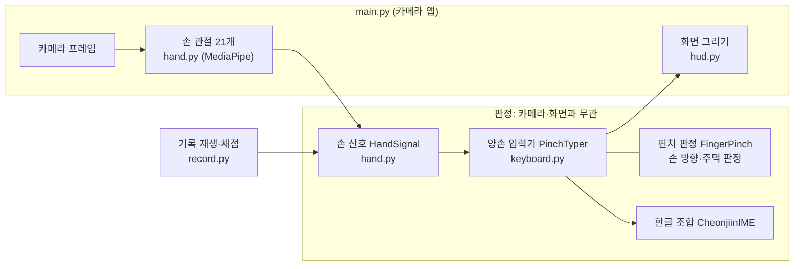

판정 코드(`keyboard.py`)는 손 신호만 입력으로 받습니다. 덕분에 카메라 앱, 기록 재생, 테스트가 모두 같은 코드를 씁니다.

## 실행 방식

### 준비

- Python 3.10 이상. 필요한 패키지는 `opencv-python`, `numpy`, `mediapipe`, `Pillow`입니다(개발 환경: Python 3.10.20, OpenCV 5.0.0, NumPy 2.2.6, MediaPipe 1.1.1, Pillow 12.3.0).
- MediaPipe는 수업 노트북처럼 의존성 없이 설치합니다. 의존성까지 설치하면 `opencv-contrib-python`이 따라 들어와 기존 OpenCV와 충돌합니다.
  ```bash
  python -m pip install --no-deps mediapipe
  python -m pip install absl-py flatbuffers sounddevice certifi
  ```
- 손 검출 모델 `src/models/MediaPipe/hand_landmarker.task`(수업 노트북에서 받은 파일)는 저장소에 들어 있습니다. 다른 모델은 `--model`로 지정합니다.
- 한글 글꼴은 Noto CJK(Ubuntu·Jetson: `fonts-noto-cjk`), 나눔고딕, 맑은 고딕, Apple SD Gothic Neo 중 설치된 것을 찾아 씁니다. 없으면 `--font /경로/글꼴.ttf`로 지정합니다.

### 실행 명령

저장소 루트(`Vision-LLM-202035152`)에서 실행합니다.

```bash
python Project01/main.py --demo                      # 카메라 없이 고정 데이터 재생 → "안녕하세요" 출력
python Project01/main.py --camera 0                  # 카메라 번호로 실행(macOS + iPhone 연결 시 0번이 iPhone)
python Project01/main.py --pipeline usb              # Jetson USB 카메라(GStreamer 640×480 30fps)
python Project01/main.py --camera 0 --words          # 단어 입력 시험(기록: Project01/data/words-날짜-시각.jsonl)
python Project01/main.py --camera 0 --log Project01/data/free.jsonl   # 프레임별 손 신호 기록
```

| 옵션 | 내용 |
| --- | --- |
| `--camera N` / `--pipeline 문자열` | 카메라 번호 / GStreamer 파이프라인(`usb`는 Jetson `/dev/video0` 설정) |
| `--resolution` | 카메라 해상도. 기본 `auto`는 macOS 1280×720, 그 밖(Jetson) 640×480 |
| `--detect-width` | 손 검출에 넣는 영상의 최대 가로 크기(기본 640). 화면은 원래 해상도로 그린다 |
| `--mirror` | 좌우 반전(카메라가 사람을 마주 보는 셀카 배치일 때) |
| `--model`, `--font` | 손 검출 모델, 한글 글꼴 경로 |
| `--log 파일` | 프레임마다 손 신호·관절·입력 이벤트를 jsonl로 기록 |
| `--words` | 단어 입력 시험. 단어를 하나씩 보여 주고, 입력 칸이 그 단어가 되면 다음 단어로 넘어간다 |
| `--evaluate 기록 [-v]` | 정답이 있는 기록을 지금 판정으로 다시 재생해 맞음·오입력·빠짐을 센다. `-v`면 단어(차례)마다 결과 |

### 키보드 자판

손 방향에 따라 키가 바뀝니다. 손바닥 자세는 손등을 책상이나 무릎에 올려 두면 편합니다.

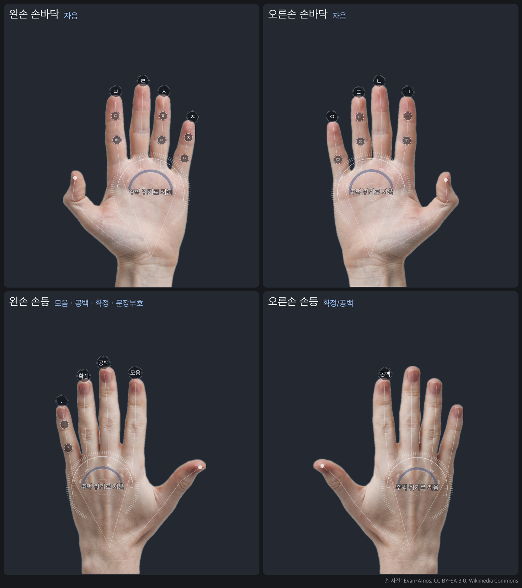

*1인칭 시점에서 본 자판. 손끝 버튼의 글자가 그 손가락을 핀치했을 때 들어가는 글자이고, 손가락을 따라 놓인 작은 원은 같은 손가락을 다시 핀치할 때 차례로 올라오는 글자입니다(ㅂ → ㅍ → ㅃ).*

| | 검지 | 중지 | 약지 | 소지 |
| --- | --- | --- | --- | --- |
| 왼손 손바닥 | ㅂ→ㅍ→ㅃ | ㄹ | ㅅ→ㅎ→ㅆ | ㅈ→ㅊ→ㅉ |
| 오른손 손바닥 | ㄱ→ㅋ→ㄲ | ㄴ | ㄷ→ㅌ→ㄸ | ㅇ→ㅁ |
| 왼손 손등 | 모음 | 공백 | 확정 | . → , → ? → ! → 줄바꿈 |
| 오른손 손등 | 확정/공백 | - | - | - |

- **자음**: 같은 손가락을 다시 핀치하면 그룹 안에서 돌아갑니다(ㄱ → ㅋ → ㄲ). 다른 키를 핀치하면 앞 글자는 자동으로 확정됩니다. ㄴ·ㄹ은 글자가 하나뿐이라 돌지 않습니다.
- **모음(왼손 손등 검지)**: 핀치하고 그대로 떼면 ㆍ, 핀치한 채 가로로 끌면 ㅡ, 세로로 끌면 ㅣ입니다. 손 크기의 0.25배(약 2.3cm) 넘게 움직여야 끈 것으로 칩니다.
- **오른손 손등 검지**: 확정 전 글자가 있으면 확정, 없으면 공백. `까까`처럼 같은 손가락 자음이 이어질 때 씁니다.
- **주먹(손바닥 방향)**: 마지막 자모 하나를 지웁니다(감 → 가 → ㄱ). 쥐고 있으면 0.5초마다 하나씩 더 지웁니다.
- 예: `안녕` = ㅇ(오른손 소지) · 왼손을 뒤집어 모음 ㅣ(세로 끌기) ㆍ · ㄴ(오른손 중지) · ㄴ · 모음 ㆍ ㆍ ㅣ · ㅇ

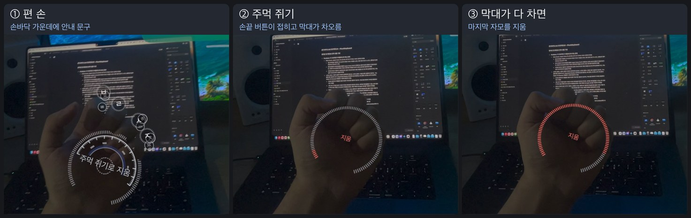

*주먹을 쥐면 손끝 버튼이 접히고 바깥 막대가 빨갛게 찹니다. 다 차면 지워집니다.*

### 화면

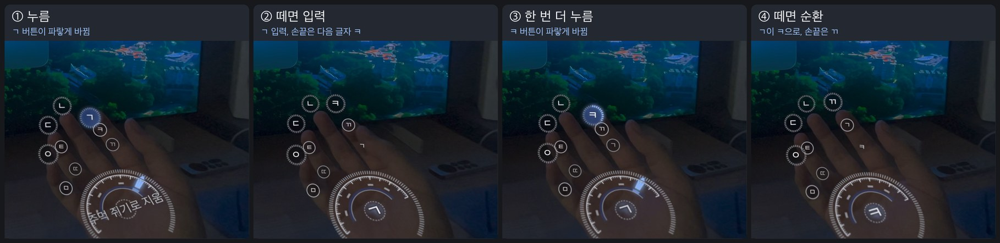

*오른손 검지로 ㄱ을 넣고, 한 번 더 핀치해 ㅋ으로 바꾸는 0.6초. ① 엄지가 닿으면 버튼이 파랗게 바뀝니다. ② 떼면 ㄱ이 입력되고, 손끝에는 다음 차례인 ㅋ이 올라옵니다. ③④ 한 번 더 핀치했다 떼면 ㄱ이 ㅋ으로 바뀌고 손끝에는 ㄲ이 옵니다.*

- 버튼 둘레의 눈금은 엄지가 다가온 만큼 흰색으로, 누르는 동안에는 뗀 만큼 파랑으로 찹니다.
- 손바닥 가운데 원에는 손가락마다 얼마나 다가왔는지가 막대로 나오고, 방금 입력한 글자가 잠깐 떴다 사라집니다.
- 화면 위쪽에는 입력한 글과 지금 돌고 있는 자음 그룹이 뜹니다.

| 키 | 기능 |
| --- | --- |
| `H` | 도움말 |
| `K` | 화면 아래 자판 지도 |
| `P` | 일시정지 |
| `C` / `X` | 입력한 글 복사 / 전체 지우기 |
| `F` | 전체 화면 |
| `N` | (`--words`) 지금 단어 건너뛰기 |
| `Q` / `Esc` | 종료(입력한 글은 터미널에 출력) |

### 처리 과정 (한 프레임)

1. 카메라 프레임을 읽고, `--mirror`면 좌우를 뒤집습니다(`main.py`).
2. 가로 640px 이하로 줄여 RGB로 바꾼 뒤 MediaPipe VIDEO 모드(`detect_for_video`)에 넣습니다. 손마다 이미지 좌표와 world 좌표(m)로 관절 21개가 나옵니다(`hand.py`).
3. 손마다 신호를 계산합니다(`hand.py`).
   - 핀치 거리: 엄지 끝에서 손가락 끝마디 선분(DIP→TIP)까지의 거리를 손 크기(손목~중지 뿌리)로 나눈 값. 점이 아니라 선분까지 재기 때문에 끝마디 어디에 닿아도 기준이 같습니다.
   - 손 방향: 손목·검지 뿌리·소지 뿌리로 만든 2D 외적의 부호(손바닥 +, 손등 −)
   - 그 밖에 자세(편 손·주먹), 기울기, 손가락 굽힘
4. `PinchTyper.update`(`keyboard.py`)가 손 방향과 핀치를 판정하고(`FingerPinch`), 입력으로 인정한 핀치를 키로 바꿔 한글 조합기에 넘깁니다.
5. `hud.py`가 판정 상태를 영상 위에 그립니다.

### 테스트와 평가

```bash
cd Project01
python -m unittest discover -s tests -t .                # 단위 테스트 65개, 카메라 없이 실행
python main.py --evaluate data/words-*.jsonl -v          # --words로 남긴 기록을 지금 판정으로 다시 재생
```

| 테스트 | 검증 내용 |
| --- | --- |
| `test_keyboard.py` | 모음 21개, 받침 이동, 겹받침, 지움, 주먹 유지, 손 방향, 핀치 판정(뗄 때 1회, 빠른 반복, 한 프레임 튐, 옆 손가락 함께 가까워짐, 주먹 중 무시), 고정 데이터 재생, 모음 끌기, 손 뒤집기·엄지 가림 무시, 검지 겹침·지나감, 손등 키, 순환 대기열 |
| `test_hand.py` | 좌우 라벨, 손 배정, 검출 입력 크기, 자세·방향·기울기, 핀치 거리 |
| `test_hud.py` | 화면 애니메이션(펼침·순환·입력 표시), 둥근 사각형, 빈 프레임에 화면 그리기 |
| `test_record.py` | 단어 60개 모두 기대 키 순서로 칠 수 있는지, 단어 시험 흐름, 기록 한 줄 재생, 키 순서 맞추기 |
| `test_main.py` | 해상도 옵션, 단어 안내 문구 |

`test_hud.py`의 화면 테스트는 한글 글꼴이 있어야 돌아갑니다.

## 창의성 및 확장성

### Problem: 이 프로젝트가 해결하고자 하는 문제

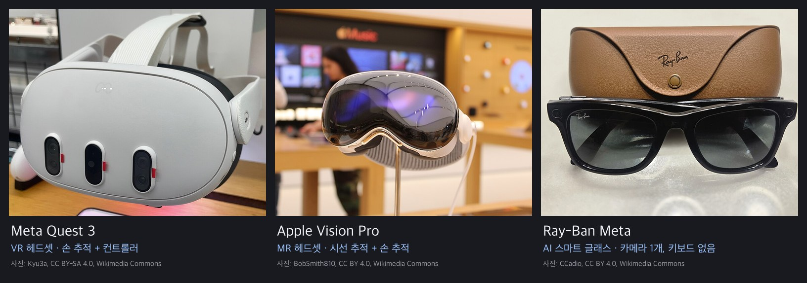

*왼쪽부터 Meta Quest 3, Apple Vision Pro, Ray-Ban Meta.*

**패스스루 VR 기기에서 키보드 입력의 어려움**

| Meta Quest: 손 추적으로 허공의 키 누르기 | Apple Vision Pro: 공중에 띄운 키보드 |
| --- | --- |
| 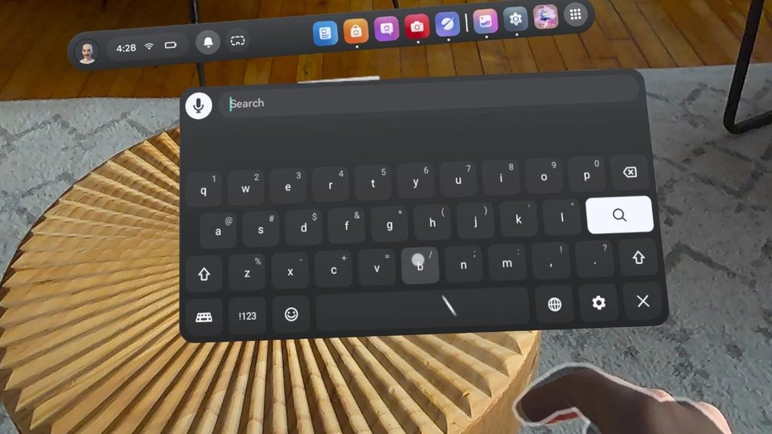 | 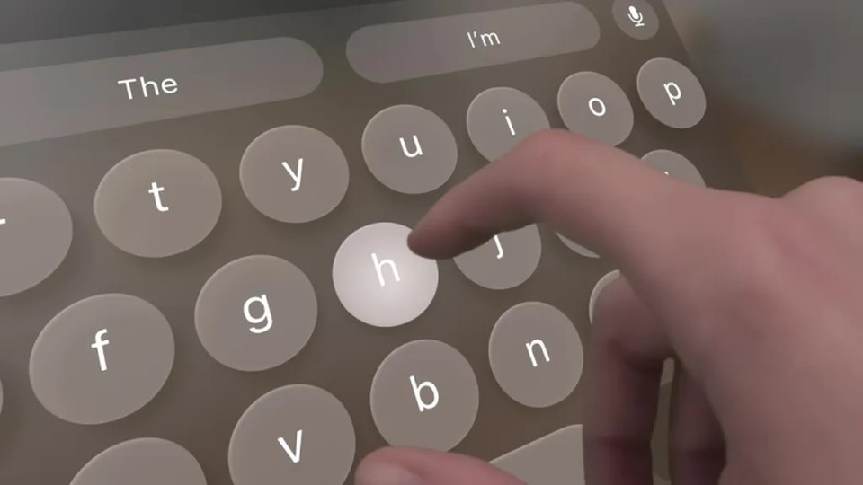 |

*공중에 띄운 키보드를 손으로 하나씩 누르는 방식. 이미지 출처: 왼쪽 [Gizmodo](https://gizmodo.com/app/uploads/2026/02/typing-quest.jpg), 오른쪽 [KMUG](https://kmug.com/wp-content/uploads/2024/03/apple-vision-pro-virtual-keyboard2-768x432.jpg).*

- 손 추적으로 공중의 키보드를 누르는 방식은 느리고 부정확합니다. Meta Quest 3 기본 가상 키보드를 검지로 누르면 분당 19.7단어에 수정하지 않은 오류율이 8.0%인데, 물리 키보드 평균(16만 8천 명 기준 분당 51.56단어)의 절반에도 못 미칩니다.
- Apple Vision Pro는 키를 바라보고 엄지와 검지를 맞붙이는 방식, 즉 시선 추적과 손가락 탭을 합친 입력을 기본으로 씁니다. 써 보니 익숙해지면 손으로 직접 누르는 것보다 빨랐습니다. 그래도 공중의 버튼을 하나씩 골라 누른다는 점은 같습니다.
- 아무리 익숙해져도 매번 버튼을 보며 한 자씩 쳐야 하니, 속도에는 한계가 있습니다.

**스마트 글래스 시장의 성장과 새로운 입력 체계의 필요성**

- 스마트 글래스 시장은 빠르게 크고 있습니다. 2025년 AI 글래스 출하량은 870만 대로 전년보다 322% 늘었고, 그중 8.4%가 디스플레이를 단 모델이었습니다. 렌즈에 AR(Augmented Reality) 화면을 띄우는 Meta Ray-Ban Display, 패스스루 VR 글래스인 Meta VR Glasses도 나왔습니다.
- 이런 기기에는 물리 키보드가 없고, 대개 키보드를 들고 다니기 어려운 곳에서 씁니다.
- 가볍고 휴대하기 쉬워야 하니 센서도 제한됩니다. Meta Ray-Ban Display만 해도 약 69g에 12MP 카메라 1개, 한쪽 렌즈 디스플레이가 전부입니다. LiDAR나 이중 카메라 같은 깊이 센서는 기대하기 어렵습니다.
- 결국 카메라 영상만으로 믿을 만한 정확도를 내고, 익숙해지면 물리 키보드나 터치 키보드에 견줄 만큼 빠른 입력 방식이 필요합니다. 지금 거론되는 대안들은 저마다 한계가 있습니다.

| 대안 | 한계 |
| --- | --- |
| 음성 인식 입력 | 주변에 사람이 있거나 공공장소에서는 쓰기 어렵습니다. 사생활과 소음 문제는 VR 텍스트 입력 연구에서도 지적됐습니다. |
| 스마트폰 연동 입력 | 입력을 외부 기기에 의존해야 합니다. |
| 손목 근전도(EMG) 밴드 | Meta Neural Band로 이미 상용화됐습니다(2025년 Ray-Ban Display와 함께 출시). 다만 손목에 장치를 따로 차야 합니다. |
| 뇌-컴퓨터 인터페이스(BCI) | 아직 연구와 실증 단계라 소비자 제품에 쓰기엔 이릅니다. |

### Background: 프로젝트 관련 배경

**Motivation: 한글 천지인 입력기**

| 피처폰 키패드 | 스마트폰 천지인 키보드 |
| --- | --- |
| 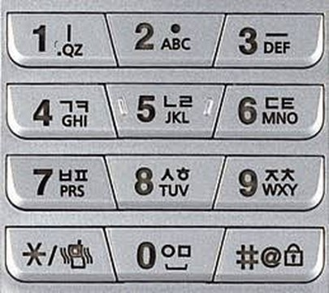 | 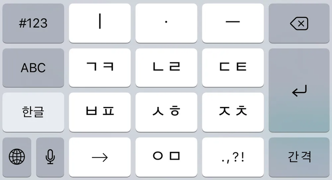 |

천지인은 피처폰 시절부터 써 온 한글 입력 방식입니다. 4×3 키패드의 적은 키로 한글을 다 칠 수 있습니다.

- ㆍ(아래아), ㅡ, ㅣ 세 키로 모음 21개를 모두 만듭니다(ㅣ + ㆍ = ㅏ). 키가 모자란 환경에 잘 맞습니다.
- ㄱ/ㅋ/ㄲ처럼 소리가 비슷한 자음을 한 키에 묶고, 같은 키를 반복해 고릅니다.

한 손 한 면에 쓸 수 있는 버튼은 손가락 4개로, 휴대폰 키패드보다도 적습니다. PinchKeyboard는 천지인의 이 두 규칙을 가져왔고, 다른 점은 다음과 같습니다.

| | 천지인 | PinchKeyboard |
| --- | --- | --- |
| 키 | 휴대폰 키패드 12개 | 손가락 버튼: 양손 손바닥 8개(자음), 손등 5개(모음·공백·확정·문장부호, 확정/공백) |
| ㄴ·ㄹ | 한 키(ㄴ → ㄹ 순환) | 손가락 하나씩 따로(순환 없음) |
| 모음 | 획마다 키 하나(ㆍ ㅡ ㅣ 3개) | 모음 버튼 하나를 핀치한 채 끄는 방향으로 획을 고름(그대로 ㆍ, 가로 ㅡ, 세로 ㅣ) |
| 지움 | 지움 키 | 주먹 쥐기 |
| 자판 전환 | 없음 | 손바닥 / 손등 방향 |

**수업에서 배운 컴퓨터 비전 기법과 MediaPipe Hand Landmarker**

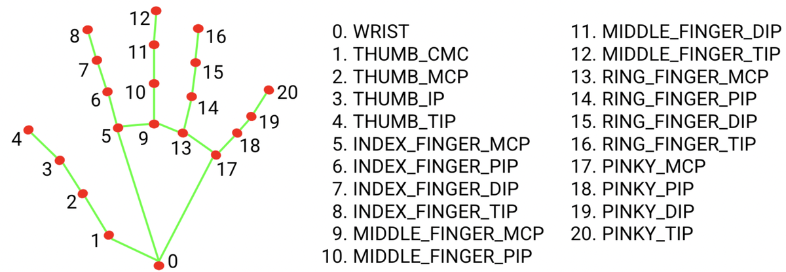

- MediaPipe Hand Landmarker로 두 손의 관절 21개를 추적합니다(수업 M. MediaPipe 실시간 신체 인식).
- 저주파/고주파 분리를 이용한 잔차 추출(Residual Extraction)을 시간 축의 핀치 거리에 적용해, 손끝이 다가왔는지 판단합니다(Discussion 2).

### Objective: 컴퓨터 비전 기술을 활용하여 카메라 손동작 인식 기반의 한글 키보드 개발

- 단일 카메라 센서만을 활용하여 한글 자모 40개(기본 자모 24개 + 겹자모 16개)를 전부 입력할 수 있는 입력기 개발
- 핀치, 드래그 등의 핸드 제스처를 적극적으로 활용하여, 손가락 10개만으로 원활한 한글 입력이 가능한 입력기 개발
- 사용자가 직관적으로 사용할 수 있는 UI 및 시각 피드백 제공

### Method: PinchKeyboard, 카메라 손동작 인식 기반의 한글 키보드

**핵심 동작 방식**

- **핀치 = 버튼**: 엄지와 맞닿는 손가락 4개가 버튼입니다. 보지 않아도 손 감각으로 어느 손가락인지 알 수 있고, 허공을 누를 때와 달리 손끝이 닿는 촉감도 있습니다.
- **손 뒤집기 = 자판 전환**: 손바닥과 손등에 자판을 따로 둬서 손가락 4개 × 양손 × 2면으로 키를 늘렸습니다. 자음은 손바닥, 모음과 편집 키는 손등에 있습니다.
- **끌기 = 모음 획**: 모음 버튼 하나를 어느 방향으로 끄느냐로 ㆍ ㅡ ㅣ를 고릅니다(아래 "핵심 설계").
- **주먹 = 지움**: 핀치와 헷갈릴 일이 없고, 쥐고 있으면 계속 지워집니다.
- **손 위 시각 피드백**: 손끝마다 다음 글자, 엄지가 다가온 정도, 떼기 진행을 손 위에 바로 그립니다. 어떻게 판정되고 있는지 보면서 동작을 고칠 수 있습니다.

**핵심 설계: 모음 제스처 버튼**

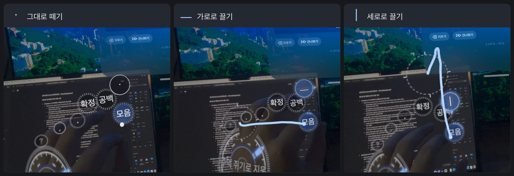

천지인은 ㆍ ㅡ ㅣ에 키를 하나씩, 모두 세 개를 씁니다. PinchKeyboard는 이걸 **버튼 하나**로 합쳤습니다. 버튼을 핀치한 채 손을 움직인 방향이 곧 획이 됩니다.

- 획 모양대로 움직이면 됩니다. ㅡ는 가로로, ㅣ는 세로로 긋고, ㆍ는 점 찍듯 그대로 뗍니다. 동작과 획을 따로 외울 필요가 없습니다. '아'라면 ㅇ(오른손 소지)을 치고 세로로 끌었다가(ㅣ) 그대로 떼면(ㆍ) 됩니다.
- 모음 키가 하나로 줄면서 자음에 쓸 손가락이 늘었습니다. 처음에는 모음 세 개를 왼손 손바닥 세 손가락에 두는 바람에, ㅂ·ㅅ·ㅈ 그룹과 문장부호를 오른손 손등의 쉬프트 키 뒤로 보내야 했습니다. 모음을 왼손 손등 검지 하나로 옮기고 나서야 양손 손바닥 여덟 손가락을 모두 자음에 쓰고 ㄴ·ㄹ도 따로 나눌 수 있었습니다. 자음은 손바닥, 모음과 편집은 손등이라는 규칙도 이때 생겼습니다.
- 떼기 전에 결과가 보입니다. 핀치하는 동안 지나온 길과 끌기 기준 원, 지금 떼면 들어갈 획이 손 위에 뜨므로, 방향이 틀렸으면 떼기 전에 고치면 됩니다.
- 핀치한 지점(엄지 끝과 검지 끝의 가운데)이 손 크기의 0.25배(약 2.3cm)를 넘게 움직이면 끈 것으로 보고, 가로와 세로 중 더 많이 움직인 쪽을 고릅니다. 손을 떼는 순간 엄지만 벌어지는 마지막 몇 프레임은 세지 않아서, 떼는 동작이 끌기로 잘못 잡히지 않습니다.

**구현 과정**

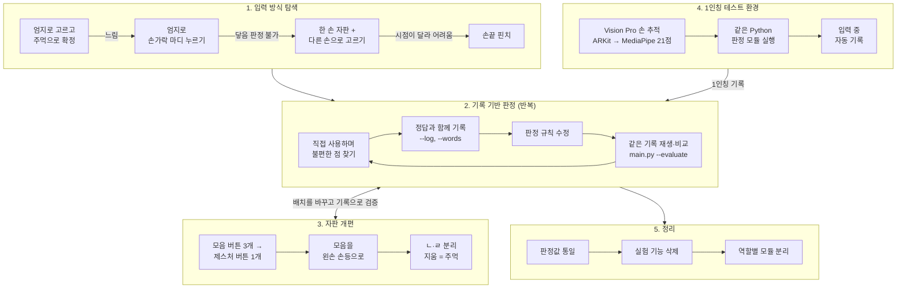

처음 시도한 세 가지 입력 방식은 모두 실패했습니다(Discussion 1). 손끝 핀치로 정한 뒤로는 직접 써 보며 불편한 점을 찾고, 정답과 함께 기록하고, 규칙을 고친 다음 같은 기록으로 다시 확인하는 과정을 계속 반복했습니다. 자판 배치도 이 과정에서 여러 번 바뀌었습니다.

1인칭 시점 테스트에는 Apple Vision Pro를 썼습니다. 카메라를 눈 근처에 고정할 방법이 없었기 때문입니다. Vision Pro가 잡은 손 관절을 MediaPipe 21점 순서로 바꿔 넘기면, 앱에 넣은 Python이 `Project01/`의 판정 모듈을 그대로 돌립니다. 손을 뒤집자마자 친 모음이 빠지던 문제, 주먹을 연달아 쥘 때 두 번째 지움이 안 되던 문제는 이 앱의 기록으로 찾아 고쳤습니다. 과제의 본체는 카메라 앱(`main.py`)이고 Vision Pro 앱은 개발·테스트용 PoC입니다. Swift로 된 손 추적·화면 부분은 AI 도구로 작성했습니다(`main` 브랜치의 `Project01/visionos/`).

마지막으로 두 앱의 판정값을 하나로 맞추고, 실험 기능을 지우고, 코드를 역할별 모듈로 나눴습니다.

### Discussion: 프로젝트 개발 과정에서 겪은 어려움과 깨달음

**1. 깊이를 알 수 없는 단안 카메라로 접촉 여부를 직접 판정하기 어려움**

| 시도한 방식 | 결과 |
| --- | --- |
| 엄지로 고른 키를 주먹으로 확정(첫 버전, 커밋 `767a19f`) | 글자마다 손을 폈다 쥐어야 해서 너무 느렸습니다. |
| 엄지로 손가락 마디 12곳을 누르면 입력(커밋 `87fa4b9`) | 카메라 한 대로는 엄지가 마디에 닿았는지 알 수 없어, 실제 카메라로는 입력이 되지 않았습니다. |
| 한 손을 자판으로 펴고 다른 손으로 핀치해 고르기(커밋 `7c33646`) | 입력은 됐지만, 카메라가 맞은편에 있으면 눈으로 보는 손과 화면이 달라 조작하기 어려웠습니다. |

카메라 한 대로는 깊이를 잴 수 없으니, 엄지가 손가락에 '닿았는지'를 직접 판단하는 방식은 처음부터 무리였습니다. 그래서 닿았는지 대신 엄지 끝과 손끝 사이가 얼마나 가까워졌는지를 보는 손끝 핀치로 바꿨습니다(커밋 `85d6f05`). 센서가 못 재는 걸 억지로 판정하기보다, 잘 재는 값에 맞춰 동작을 바꾸는 편이 나았습니다. 손이 기울어 엄지가 가려지는 자세는 지금도 판단할 수 없어서, 그 자세에서는 입력을 받지 않고 화면에 안내만 띄웁니다.

**2. 핀치 동작 인식에서는 절대 거리보다 거리 변화량이 더 신뢰할 만함**

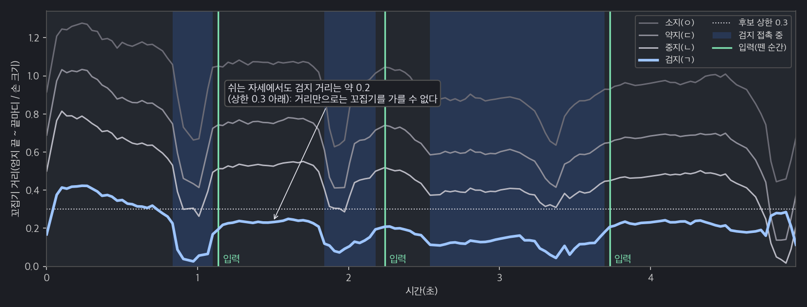

*오른손 검지를 세 번 핀치한 기록(ㄱ → ㅋ → ㄲ). 쉬고 있을 때도 검지 거리가 0.2 안팎이라 후보 상한 0.3보다 낮습니다. 파란 구간이 접촉으로 판정된 구간, 초록 선이 입력된 순간입니다.*

처음엔 거리가 일정 값 아래로 내려가면 핀치한 걸로 봤습니다. 그런데 기록을 보니 쉬고 있을 때의 검지 거리(0.11~0.28)와 실제로 핀치했을 때의 최저 거리(0.00~0.24)가 겹쳤습니다. 엄지가 원래 검지 옆에 놓여 있으니 당연한 일이었습니다. 고정값으로는 둘을 가를 수 없었습니다.

그래서 수업에서 배운 저주파/고주파 분리(원본 − 흐린 원본 = 고주파)를 공간이 아닌 시간 축에 적용했습니다. 손가락마다 최근 0.5초의 최대 거리를 천천히 변하는 기준값(저주파)으로 두고, 기준값에서 지금 거리를 뺀 값(고주파)이 0.15를 넘는 손가락만 후보로 봅니다. 원래 가까이 있던 손가락은 다가온 게 아니니 후보가 되지 않습니다. 뗄 때도 2프레임 연속으로 벌어져야 인정해서, 한 프레임만 튀는 값은 버립니다.

**3. 키 오입력은 주로 사람의 습관에서 발생함**

오입력 장면을 영상으로 다시 보면, MediaPipe는 손을 제대로 잡았는데 사람이 실제로 엉뚱한 접촉을 만든 경우가 계속 나왔습니다. 오른손 엄지는 다른 손가락으로 오가면서 쉬던 자리인 검지 옆을 그대로 지나갔고, 손을 뒤집거나 주먹을 쥐는 도중에도 손끝에 닿았습니다. 이런 습관을 기록에서 하나씩 찾아 규칙으로 막았습니다.

| 기록에서 찾은 습관 | 규칙(`keyboard.py`) |
| --- | --- |
| 중지를 핀치하면 약지 끝마디도 함께 가까워집니다. | 가장 가까운 후보가 다른 손가락보다 0.03 이상 가까울 때만 접촉을 시작합니다. 접촉 중에 더 가까워진 손가락이 있으면 그쪽으로 옮깁니다(약지로 가는 길에 검지를 지나가도 약지). |
| 손끝이 스치기만 해도 거리가 내려갑니다. | 손끝을 **뗄 때** 입력합니다. 가장 가까웠던 거리보다 0.12 이상 벌어진 프레임이 2번 이어져야 하고, 0.10초보다 짧은 접촉은 버립니다(실제 핀치는 모두 0.13초 이상). |
| 손을 뒤집는 도중에 엄지가 손끝 옆을 지나갑니다. | 접촉의 처음 3프레임과 마지막 3프레임의 손 방향이 모두 같아야 입력합니다. 손을 뒤집으며 뗀 핀치 5개 중 4개를 막았습니다. |
| 소지 쪽이 카메라에 가깝게 기울면 엄지가 가려집니다(기운 차례 8개 중 7개 오입력). | 손바닥 핀치 동안 기울기가 −25° 이하이면 입력하지 않고, 화면에 "엄지 쪽을 카메라로 돌려 주세요"를 띄웁니다. |
| 엄지가 검지 옆에서 쉬다가 중지·약지를 핀치하면 검지 값도 같이 내려옵니다. | 검지로 판정된 접촉에서 다른 손가락 거리가 검지 +0.05 안이고 그 손가락이 10° 이상 더 굽었으면 그 손가락으로 바꿉니다(정답이 있는 접촉 90개에서 맞음 78 → 83개). |
| 오른손 엄지가 다른 손가락으로 오가며 검지를 지나갑니다(영상 확인). | 오른손 손바닥 검지는 다른 손가락을 뗀 뒤 0.25초 안에 시작했거나 검지가 5° 넘게 굽지 않았으면 버립니다(자유 입력에서 지움이 뒤따른 검지 오입력 9 → 5개). |
| 주먹을 쥐는 도중 엄지가 손끝에 닿습니다. | 손바닥에서 다른 세 손가락이 굽은 접촉은 버리고, 주먹 자세 동안은 핀치를 보지 않습니다. |

모델 성능만으로는 정확도가 올라가지 않았습니다. 사람이 손을 실제로 어떻게 움직이는지 기록으로 봐야 했습니다. 판정값은 모든 사람에게 같은 고정값이며, 사용자별 보정은 없습니다.

### Limitation: 아직 해결되지 않은 문제들

1. **영어 및 숫자 입력기 개발 필요**: 지금은 한글 자모와 문장부호(. , ? ! 줄바꿈)만 칠 수 있습니다.
2. **야간/저조도 환경에서의 입력 성능 저하**: 기록 영상을 어둡게 만들어 다시 검출하니 손 검출률이 78.5%로 떨어졌고, 잡음까지 섞으면 75.2%였습니다. 정답이 있는 38차례 중 맞게 들어간 횟수도 31에서 22로 줄었습니다. CLAHE로 대비를 높여 봤지만 검출률은 그대로였습니다(아래 "CLAHE 전처리 실험").
3. **판정값의 일반화**: 판정값을 제 손으로 남긴 기록으로 정해서, 다른 사람의 손 크기나 타이핑 습관에서는 확인하지 못했습니다.

### Conclusion: 프로젝트 성과

**개발 결과**

- 카메라 한 대와 MediaPipe 손 관절만으로 한글 자모 40개와 문장부호를 모두 입력할 수 있습니다. 동작은 핀치, 손 뒤집기, 끌기, 주먹 쥐기 네 가지이고 양손 열 손가락을 다 씁니다.
- 카메라로 남긴 정답 기록(손가락 차례 기록 7개, 117차례)을 지금 판정으로 다시 돌리면, 첫 입력이 맞은 차례가 100차례(85.5%)입니다. 다른 손가락으로 잘못 들어간 입력은 4번뿐이고, 틀린 경우는 대부분 입력이 아예 안 된 경우(15차례)였습니다.
- 판정 코드를 카메라와 분리해 둔 덕에 Vision Pro 손 추적에서도 같은 코드가 그대로 돌았습니다. 판정과 한글 조합은 카메라 없이 도는 단위 테스트 65개로 검증합니다.

**기대효과**

- 키보드를 들고 다니기 어렵고 깊이 센서도 없는 스마트 글래스에서, 카메라 하나로 한글을 입력하는 방법이 될 수 있습니다.
- 화면의 키를 하나씩 찾지 않고 손 감각으로 치기 때문에, 익숙해질수록 빨라질 수 있습니다.
- 판정 모듈은 손 관절만 받으므로 다른 기기의 손 추적에도 쉽게 옮길 수 있습니다(Vision Pro 사례).

**앞으로 확장할 수 있는 것**

- 다른 프로그램에 글자를 보내는 OS 입력기 연결. 지금은 화면에 보여 주고 복사(`C`)하는 데까지만 됩니다.
- 손 모양 데이터가 더 쌓이면 규칙 대신 학습 모델(손 신호 → 손가락 분류)로 판정을 바꿔 비교해 볼 수 있습니다.

### Contribution: AI 활용과 본인 기여도

**본인 기여**: 프로젝트 기획 및 concept 수립, 개발 방향성 설정, 입력기 테스트 및 평가, 개선 방안 수립을 진행했습니다. 문자 입력기(키보드)는 HCI(Human-Computer Interaction) 관점에서 실제 사람의 동작에 맞추어 좋은 정확도를 보이는지, 적응한 이후에 빠르게 입력할 수 있는지, 학습 곡선의 기울기가 너무 가파르지는 않은지 등 '사람이 사용할 때 편한지'가 가장 중요하기 때문에, 입력기를 실제로 사용하며 테스트하고, 어느 지점에서 불편함이 발생하는지 포착하고, 개선 방안을 도출하는 과정이 주된 개발 과정이었습니다. 사람 손의 한정된 동작 내에서 키 배치를 어떻게 할 것인지, 모델이 해당 동작을 제대로 인식할 수 있는지를 고민하고, 다양한 키 배치 실험부터 최종 키 배치 확정, 입력기 완성까지를 진행하였습니다.

프로젝트 기획과 계획 수립 및 프로젝트 형상 관리, 실제 사용자 관점에서의 피드백과 평가 등 에이전트 기반 개발(Agent-Driven Development)에서 사람이 맡아야 하는 부분에 주의를 기울였습니다. 또한, 강사님께서 말씀하신 바와 같이 에이전트 기반의 개발을 수행하더라도 작성한 코드의 책임은 사람에게 있기 때문에, 프로젝트 개발 완료 이후 구현된 코드와 작동 방식을 이해하기 위해 노력을 기울였습니다.

**AI 활용**: 소스 코드 개발, 로그 데이터 분석, 사람이 제안한 개선안의 구현, 그리고 코드 모듈화 및 리팩토링을 수행했습니다. 특히 본 프로젝트에서의 주된 테스트 환경인 VisionOS Swift 환경에서 Python 기반의 코드가 원활하게 작동하도록 포팅하는 데에 적극적으로 활용했습니다.


## 기타 참고 사항

### README 그림

- 자판 그림은 Wikimedia Commons의 [Human-Hands-Front-Back.jpg](https://commons.wikimedia.org/wiki/File:Human-Hands-Front-Back.jpg)(Evan-Amos, CC BY-SA 3.0)에서 손바닥과 손등을 잘라 쓰고, 좌우를 뒤집어 반대 손을 만들었습니다. 네 손 모두 MediaPipe로 검출한 뒤 앱의 화면 코드(`hud.py`)로 버튼을 그렸고, 원본 라이선스에 따라 CC BY-SA 3.0입니다.
- 핀치·주먹·모음 제스처 그림은 Vision Pro 시연 영상에서 잘라 냈습니다.
- 핀치 거리 그래프는 `--words` 기록을 지금 판정으로 다시 돌려 그렸습니다.
- 시연 영상은 Vision Pro 화면 녹화(1920×1080 HEVC)를 1280×720 H.264로 줄이고 소리를 뺐습니다.
- 손 방향 판정 고정 데이터(`fixtures/handedness.json`)에는 MediaPipe 공식 테스트 이미지 `right_hands.jpg`(https://storage.googleapis.com/mediapipe-assets/right_hands.jpg, [google-ai-edge/mediapipe](https://github.com/google-ai-edge/mediapipe) 테스트 자산, Apache-2.0)를 썼습니다.

### 작업 중 겪은 문제

- **왼손·오른손 라벨**: MediaPipe Tasks는 영상에 보이는 실제 손을 라벨로 줍니다. 그래서 영상을 좌우 반전했을 때만 라벨을 뒤집습니다(`hand.py`의 `detect_hands`). 두 손이 같은 라벨로 잡히면 화면 위치로 나눕니다.
- **해상도와 속도**: 검출에는 가로 640px 이하로 줄인 영상을 넣고, 화면은 원래 해상도로 그립니다. 관절이 0~1 비율 좌표로 나오니 그대로 쓰면 되고, 검출 조건도 Jetson 640×480 시연과 같아집니다.
- **카메라 끊김**: iPhone(Continuity Camera)을 움직이면 영상이 잠깐 멈춥니다. 최대 10초까지 기다렸다 이어 가고, 끊긴 동안의 손 상태로는 입력하지 않습니다. 검은 화면만 들어오면 안내를 띄웁니다.

### 수업 내용과 연결

| 수업 내용 | 적용 |
| --- | --- |
| 영상 입출력, GStreamer | 카메라 번호 / Jetson GStreamer 파이프라인으로 열기(`main.py`) |
| 이미지 조정 | 좌우 반전(`--mirror`), 검출 입력 크기 조정(`cv2.resize`, `INTER_AREA`) |
| 색공간 변환 | MediaPipe 입력용 BGR → RGB |
| 신체 인식·객체 추적 | MediaPipe Hand Landmarker VIDEO 모드(`detect_for_video`)로 두 손 관절 추적 |
| 결과 표현 | 관절 사이 거리·외적·각도로 동작 판정, 영상 위 HUD와 한글 출력 |
| 저역·고역 통과 필터(Residual Extraction) | 핀치 기준값: 최근 0.5초 최대 거리(저주파)와 지금 거리의 차이(고주파)로 판정(Discussion 2) |
| 대비 향상(LAB L 채널 CLAHE) | 손 검출 전처리로 비교 실험을 했지만 검출이 나아지지 않아 넣지 않았습니다(아래 "CLAHE 전처리 실험"). |

수업에서 다룬 기법 중 다음은 쓰지 않았습니다.

- Canny·Sobel 에지 검출, 특징점 추출: 판정을 MediaPipe 관절 좌표로 하니 화소 단위의 에지나 특징점은 쓸 데가 없었습니다.
- Kalman 필터: 핀치 거리를 부드럽게 만들면 0.13초 남짓한 짧은 핀치가 늦게 잡히고, 다가온 폭도 줄어듭니다. 예전 손등 마우스 모드에서 커서 떨림을 잡는 데 썼다가 그 모드와 함께 지웠습니다(커밋 `544c399`).

MediaPipe VIDEO 모드와 `detect_for_video` 사용법은 [공식 Python 안내](https://ai.google.dev/edge/mediapipe/solutions/vision/hand_landmarker/python)를 따랐습니다.

### CLAHE 전처리 실험

과제 2에서 CLAHE로 대비를 높이자 색 분할이 좋아졌으니, 손 검출 전에 걸면 검출과 판정도 나아질지 기록 영상으로 확인했습니다.

- 기록 때 함께 저장한 영상 6개(1280×720, 15,506프레임)를 앱과 같은 과정으로 다시 검출했습니다. CLAHE는 축소한 검출 입력의 L 채널에만 걸었고, 값은 과제 2와 같습니다(`clipLimit=3.0`, `tileGridSize=(8, 8)`).
- 어두운 조건은 화소값을 0.35배 하고 감마 1.8을 적용해 만들었습니다(평균 밝기 91~133 → 8~14). 여기에 표준편차 4의 가우시안 잡음을 더한 조건도 따로 두었습니다.
- 손 검출률은 정상 밝기에서 다시 검출한 손(11,872개) 중 같은 프레임에서 같은 손을 다시 찾은 비율, 관절 떨림은 손을 편 채 쉬는 구간에서 프레임 간 핀치 거리 변화의 중앙값, 판정은 정답 기록 2개(38차례)의 첫 입력 맞음 수입니다.

| 조건 | 손 검출률 | 관절 떨림 | 판정(첫 입력 맞음 / 38) |
| --- | --- | --- | --- |
| 정상 | 100% (기준) | 0.0128 | 31 |
| 정상 + CLAHE | 95.8% | 0.0150 | 30 |
| 어둡게 | 78.5% | 0.0115 | 22 |
| 어둡게 + CLAHE | 78.0% | 0.0136 | 26 |
| 어둡게 + 잡음 | 75.2% | 0.0149 | 18 |
| 어둡게 + 잡음 + CLAHE | 68.0% | 0.0166 | 20 |

- 정상 밝기에서는 CLAHE를 걸면 오히려 검출률이 떨어지고 떨림이 늘었습니다. 어두운 조건에서도 검출률은 나아지지 않았고, 잡음이 섞이면 75.2%에서 68.0%로 더 떨어졌습니다.
- 어두운 조건의 판정은 22에서 26으로 늘었지만 38차례 중 4차례 차이에, 검출률은 그대로라 넣지 않았습니다. CLAHE 한 번에 걸리는 시간은 640×360 입력에서 약 1.0ms였습니다.
- 다시 검출한 결과는 기록과 99.1% 같은 손을 찾았지만, 저장 영상의 압축 때문에 핀치 거리가 조금씩 달라져 판정이 37/38에서 31/38로 내려갔습니다. 그래서 판정은 다시 검출한 조건끼리만 비교했습니다.
- 밝기를 낮추고 잡음을 더하는 것만으로는, 어두운 방에서 노출이 길어지며 생기는 움직임 흐림까지 재현하지 못합니다.
