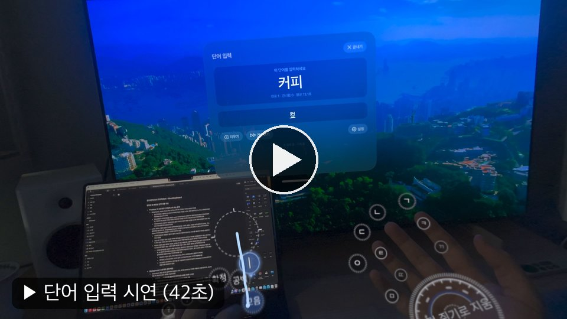
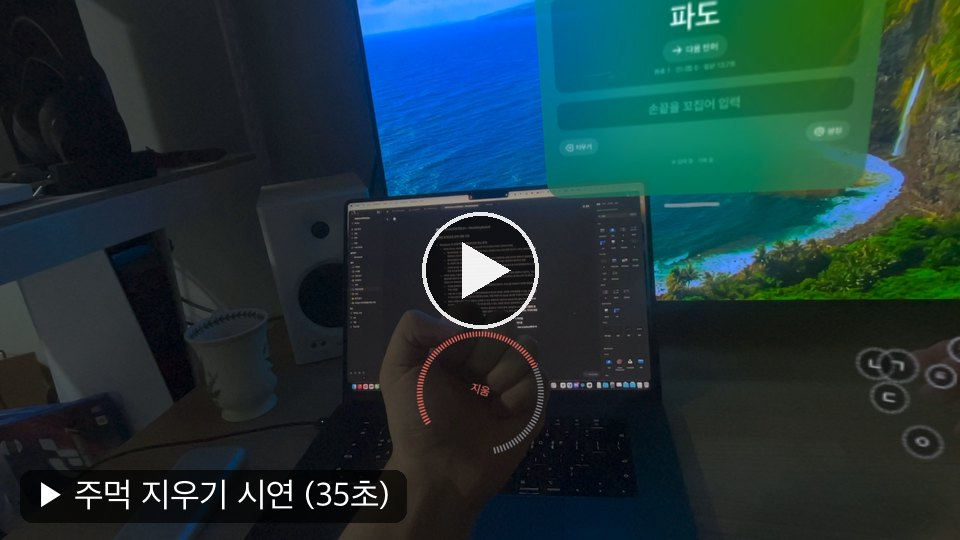
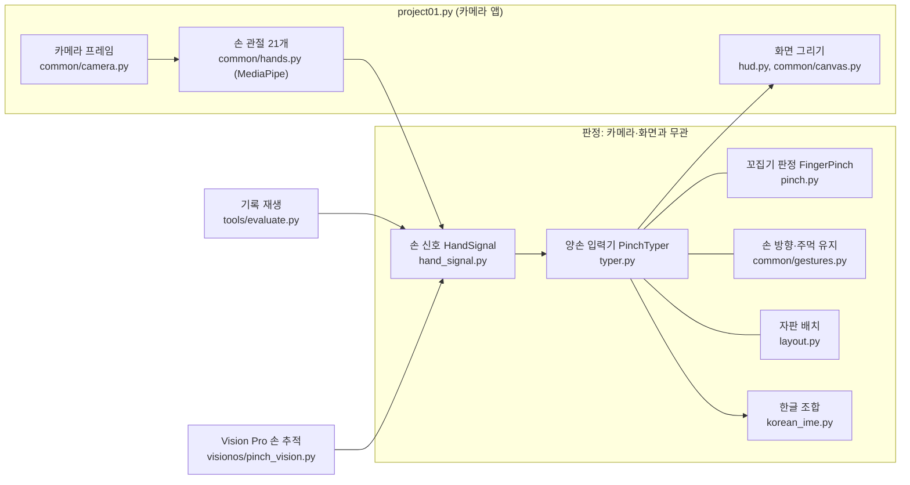

# Project01: PinchKeyboard - 카메라 손동작 인식 기반의 한글 키보드

PinchKeyboard는 카메라로 두 손을 추적해, 엄지로 손끝을 꼬집으면 한글이 입력되는 입력기입니다. MediaPipe Hand Landmarker로 손 관절 21개를 추적하고, 엄지와 각 손끝 사이 거리 변화량으로 어느 손가락을 꼬집었는지 판정합니다. 손바닥이 카메라를 향하면 자음 자판, 손을 뒤집어 손등이 보이면 모음·편집 자판이 됩니다.

휴대폰 한글 입력 방식인 천지인에서 착안한 키 배치 및 구성을 채택했습니다.(아래 "창의성 및 확장성" 참고) 같은 키를 반복해 자음 그룹 안에서 고르는 방식과 모음을 ㆍ ㅡ ㅣ 세 획으로 조합하는 방식을 통해 손가락 10개만으로 한글 자모 40개를 모두 입력할 수 있도록 했습니다.

패스스루 VR(카메라 영상 위에 가상 화면을 겹쳐 보는 기기)에서 키보드 없이 글을 입력하는 것을 목표로 하며, 따라서 카메라를 눈 위치에 두고 손을 내려다보는 1인칭 배치를 기준으로 합니다.

| 단어 입력 | 주먹으로 지우기 |
| --- | --- |
| [](docs/videos/demo-words.mp4) | [](docs/videos/demo-delete.mp4) |

*PinchKeyboard 시연 영상(그림을 누르면 영상이 열립니다). Vision Pro 시험 앱(`visionos/`)에서 화면을 녹화했습니다.*

## 파일 구조

```
Project01/
├── project01.py        메인 실행 파일: 카메라 → 손 검출 → 판정 → 화면, 단축키
├── hand_signal.py      손 관절 21개 → 판정에 쓰는 손 신호(HandSignal)
├── pinch.py            손 하나의 꼬집기 판정(FingerPinch): 어느 손끝을 꼬집었다 뗐는가
├── typer.py            양손 입력기(PinchTyper): 손 방향·꼬집기·주먹 → 자판 키 → 한글 조합
├── layout.py           자판 배치, 키 이름, 순환 대기열, 모음 끌기 규칙
├── korean_ime.py       한글 조합기(CheonjiinIME): 자음 순환, 천지인 획 조합, 받침
├── hud.py              카메라 영상 위 화면(손끝 버튼, 손바닥 원형 표시, 입력 줄, 도움말)
├── common/             카메라 입력기 공통 모듈
│   ├── landmarks.py      MediaPipe 관절 번호, 좌표 변환, 점-선분 거리
│   ├── pose.py           편 손·주먹 판정, 손바닥/손등 방향, 기울기, 손가락 굽힘
│   ├── gestures.py       시간에 따른 판정기: 주먹 유지(FistHold), 손 방향(Orientation)
│   ├── hands.py          MediaPipe 손 검출, 왼손·오른손 배정
│   ├── camera.py         카메라 열기(번호 / Jetson GStreamer), 해상도, 창, fps
│   ├── canvas.py         선·눈금·호·글자를 그리는 HUD 캔버스(Pillow)
│   ├── cli.py            공통 실행 옵션(--camera, --pipeline, --model, --font)
│   └── synthetic.py      테스트용 합성 손
├── tools/              본체와 떨어진 기록·평가 도구
│   ├── word_test.py      단어 입력 시험(--words): 짧은 단어 60개를 하나씩 내고 맞힘을 센다
│   ├── recording.py      프레임 기록(--log) 한 줄 쓰기와 다시 읽기
│   └── evaluate.py       정답이 있는 기록을 지금 판정으로 다시 재생해 맞음·오입력·빠짐을 센다
├── tests/              단위 테스트(카메라 없이 실행)
├── fixtures/           고정 데이터: 키 입력 시퀀스와 정답(pinch-typer-keys.json), 실제 손 관절(handedness.json)
└── visionos/           확장: Vision Pro 시험 앱(PinchKeyboard). 아래 "창의성 및 확장성" 참고
```

- 손 검출 모델: 저장소 공용 폴더의 `src/models/MediaPipe/hand_landmarker.task`(수업 노트북에서 받은 파일)를 씁니다.
- 기록 파일은 `Project01/data/`에 저장되며 저장소에 포함하지 않습니다(`.gitignore`).

### 모듈 사이 관계



판정(`hand_signal` → `pinch` → `typer` → `korean_ime`)은 카메라와 화면을 모르고 손 신호만 받습니다. 그래서 같은 판정 코드를 기록 재생(`tools/evaluate.py`), 테스트, Vision Pro 앱이 그대로 씁니다. OpenCV·MediaPipe·Pillow는 그 패키지가 필요한 함수 안에서만 불러오므로, 판정 코드와 `--demo`는 이 패키지들 없이도 돕니다.

## 실행 방식 (필수)

### 준비

- Python 3.10 이상, 패키지: `opencv-python`, `numpy`, `mediapipe`, `Pillow` (개발 환경: Python 3.10.20, OpenCV 5.0.0, NumPy 2.2.6, MediaPipe 1.1.1, Pillow 12.3.0)
- MediaPipe는 수업 노트북처럼 의존성 없이 설치합니다. 의존성을 함께 설치하면 `opencv-contrib-python`이 따라 들어와 기존 OpenCV와 충돌합니다.
  ```bash
  python -m pip install --no-deps mediapipe
  python -m pip install absl-py flatbuffers sounddevice certifi
  ```
- 손 검출 모델 `src/models/MediaPipe/hand_landmarker.task`가 저장소에 들어 있습니다. 다른 위치의 모델은 `--model`로 지정합니다.
- 한글 글꼴은 Noto CJK(Ubuntu·Jetson: `fonts-noto-cjk`), 나눔고딕, 맑은 고딕, Apple SD Gothic Neo의 일반 설치 경로에서 찾습니다. 없으면 `--font /경로/글꼴.ttf`를 지정합니다.

### 실행 명령

저장소 루트(`Vision-LLM-202035152`)에서 실행합니다.

```bash
python Project01/project01.py --demo                 # 카메라 없이 고정 데이터 재생 → "안녕하세요" 출력
python Project01/project01.py --camera 0             # 카메라 번호로 실행(macOS + iPhone 연결 시 0번이 iPhone)
python Project01/project01.py --pipeline usb         # Jetson USB 카메라(GStreamer 640×480 30fps)
python Project01/project01.py --camera 0 --words     # 단어 입력 시험(기록: Project01/data/words-날짜-시각.jsonl)
python Project01/project01.py --camera 0 --log Project01/data/free.jsonl   # 프레임별 손 신호 기록
```

| 옵션 | 내용 |
| --- | --- |
| `--camera N` / `--pipeline 문자열` | 카메라 번호 / GStreamer 파이프라인(`usb`는 Jetson `/dev/video0` 설정) |
| `--resolution` | 카메라 해상도. 기본 `auto`는 macOS 1280×720, 그 밖(Jetson) 640×480 |
| `--detect-width` | 손 검출에 넣는 영상의 최대 가로 크기(기본 640). 화면은 원래 해상도로 그린다 |
| `--mirror` | 좌우 반전(카메라가 사람을 마주 보는 셀카 배치일 때) |
| `--model`, `--font` | 손 검출 모델, 한글 글꼴 경로 |
| `--log 파일` | 프레임마다 손 신호·관절·입력 이벤트를 jsonl로 기록 |
| `--words` | 단어 입력 시험. 단어를 하나씩 보여 주고, 입력 칸이 그 단어가 되면 다음 단어로 넘어간다 |

### 키보드 자판

손 방향마다 다른 키가 놓입니다. 손바닥 자세는 손등을 책상이나 무릎에 대고 손바닥을 위로 두면 편합니다.


*1인칭 시점(눈에서 손을 내려다봄)의 자판. 손끝의 원형 버튼이 그 손가락을 꼬집으면 입력될 글자이고, 손가락을 따라 놓인 작은 원은 같은 손가락을 다시 꼬집을 때 차례로 올라오는 글자입니다(ㅂ → ㅍ → ㅃ). 실제 손 사진을 MediaPipe로 검출하고, 그 위에 앱의 화면 코드(`hud.py`)로 손끝 버튼을 그렸습니다(손 사진: Evan-Amos, CC BY-SA 3.0, Wikimedia Commons).*

| | 검지 | 중지 | 약지 | 소지 |
| --- | --- | --- | --- | --- |
| 왼손 손바닥 | ㅂ→ㅍ→ㅃ | ㄹ | ㅅ→ㅎ→ㅆ | ㅈ→ㅊ→ㅉ |
| 오른손 손바닥 | ㄱ→ㅋ→ㄲ | ㄴ | ㄷ→ㅌ→ㄸ | ㅇ→ㅁ |
| 왼손 손등 | 모음 | 공백 | 확정 | . → , → ? → ! → 줄바꿈 |
| 오른손 손등 | 확정/공백 | - | - | - |

- **자음**: 같은 손가락을 다시 꼬집으면 그룹 안에서 순환합니다(ㄱ → ㅋ → ㄲ). 다른 키를 꼬집으면 앞 글자가 자동으로 확정됩니다. ㄴ·ㄹ은 글자가 하나라 순환하지 않습니다.
- **모음(왼손 손등 검지)**: 꼬집고 그대로 떼면 ㆍ, 꼬집은 채 손을 가로로 끌면 ㅡ, 세로로 끌면 ㅣ입니다(천지인의 세 획). 꼬집은 지점이 손 크기(손목~중지 뿌리)의 0.25배(약 2.3cm) 넘게 움직이면 끈 것으로 봅니다.
- **오른손 손등 검지**: 확정 전 글자가 있으면 확정, 없으면 공백. `까까`처럼 같은 손가락 자음이 이어질 때 씁니다.
- **주먹(양손, 손바닥 방향)**: 마지막 자모 하나를 지웁니다(감 → 가 → ㄱ). 쥐고 있으면 0.5초마다 계속 지웁니다.
- 예: `안녕` = ㅇ(오른손 소지) · 왼손을 뒤집어 모음 ㅣ(세로 끌기) ㆍ · ㄴ(오른손 중지) · ㄴ · 모음 ㆍ ㆍ ㅣ · ㅇ


*주먹으로 지우기(Vision Pro 시험 앱의 지우기 시연 영상에서 자른 장면). 주먹을 쥐면 손끝 버튼이 손바닥 가운데로 접히고, 바깥 막대가 빨갛게 차오릅니다. 막대가 다 차면 마지막 자모 하나를 지우고, 계속 쥐고 있으면 0.5초마다 하나씩 더 지웁니다. 모음 끌기 장면은 아래 "핵심 설계: 모음 제스처 버튼"에 있습니다.*

### 화면


*오른손 검지로 ㄱ을 입력하고 한 번 더 꼬집어 ㅋ으로 바꾸는 과정입니다(Vision Pro 시험 앱의 단어 입력 시연 영상에서 0.6초 동안 자른 장면). ① 엄지가 검지에 닿으면 손끝 버튼이 파랗게 바뀝니다. ② 떼면 ㄱ이 입력되어 손바닥 가운데에 잠깐 뜨고, 손끝 글자는 다음 순환 글자 ㅋ으로 바뀝니다. ③ 한 번 더 누르고 ④ 떼면 ㄱ이 ㅋ으로 바뀌고 손끝은 ㄲ이 됩니다. 순환을 기다리는 글자는 손가락 마디를 따라 놓입니다.*

- 손끝 바로 바깥의 원형 버튼에 **다음에 꼬집으면 입력될 글자**가 뜹니다. 엄지가 다가온 정도만큼 버튼 둘레 눈금이 흰색으로, 누르는 동안에는 떼기 진행만큼 파랑으로 켜집니다.
- 순환하는 키는 나머지 글자가 손가락 마디를 따라 기다리고, 꼬집을 때마다 한 칸씩 손끝으로 올라옵니다.
- 손바닥 가운데 원: 손가락 방향마다 다가온 정도를 나타내는 막대, 누르는 손가락을 가리키는 삼각형, 주먹 지움 진행만큼 빨갛게 켜지는 바깥 막대. 입력된 글자가 잠깐 크게 떴다 사라집니다. 주먹을 쥐면 손끝 버튼이 손바닥 가운데로 접혔다가, 손을 펴면 다시 펼쳐집니다.
- 모음을 꼬집는 동안 꼬집은 지점이 지나온 길, 끌기 기준 원, 지금 떼면 들어갈 획이 뜹니다.
- 화면 위에는 입력한 글 한 줄과 순환 중인 그룹이 뜹니다.

| 키 | 기능 |
| --- | --- |
| `H` | 도움말 |
| `K` | 화면 아래 자판 지도 |
| `P` | 일시정지 |
| `C` / `X` | 입력한 글 복사 / 전체 지우기 |
| `F` | 전체 화면 |
| `N` | (`--words`) 지금 단어 건너뛰기 |
| `Q` / `Esc` | 종료(입력한 글은 터미널에 출력) |

### 처리 과정 (한 프레임)

1. 카메라 프레임을 읽습니다(`common/camera.py`). `--mirror`면 좌우 반전합니다.
2. 가로 640px 이하로 줄인 영상(`cv2.resize`, `INTER_AREA`)을 RGB로 바꿔 MediaPipe VIDEO 모드(`detect_for_video`)에 넣고, 손마다 이미지 좌표와 world 좌표(m) 관절 21개를 받습니다(`common/hands.py`).
3. 손마다 신호를 계산합니다(`hand_signal.py`).
   - 꼬집기 거리: 엄지 끝 ~ 손가락 끝마디 선분(DIP→TIP) 거리 / 손목~중지 뿌리 길이(world 좌표). 손끝 점이 아니라 선분까지 재므로 끝마디 어디에 닿아도 같은 기준입니다.
   - 손 방향: 손목·검지 뿌리·소지 뿌리가 이루는 2D 외적의 부호(손바닥 +, 손등 −).
   - 자세(편 손·주먹), 기울기(이미지 상대 깊이 z), 손가락 굽힘(관절 각도).
4. `PinchTyper.update`(`typer.py`)가 손 방향을 정하고, 손가락마다 꼬집기를 판정하고(`pinch.py`), 입력으로 인정한 꼬집기를 자판 키로 바꿔 한글 조합기에 넣습니다.
5. `hud.py`가 판정 상태를 읽어 영상 위에 그리고, 창에 표시합니다.

### 테스트와 평가

```bash
cd Project01
python -m unittest discover -s tests -t .                # 단위 테스트 90개, 카메라 없이 실행
python tools/evaluate.py data/words-*.jsonl -v           # --words로 남긴 기록을 지금 판정으로 다시 재생
```

| 테스트 | 검증 내용 |
| --- | --- |
| `test_pinch.py` | 꼬집기 판정: 뗄 때 1회, 빠른 반복, 한 프레임 튐, 옆 손가락 함께 가까워짐, 주먹 중 무시 |
| `test_typer.py` | 고정 데이터 재생, 프레임 신호로 입력, 모음 끌기, 손 뒤집기·엄지 가림 무시, 검지 겹침·지나감, 손등 키, 주먹 지움, 순환 대기열 |
| `test_korean_ime.py` | 모음 21개, 자음 순환, 받침 이동, 겹받침, 지움 |
| `test_tools.py` | 단어 60개 모두 기대 키 순서로 칠 수 있는지, 단어 시험 흐름, 기록 한 줄 재생, 키 순서 맞추기 |
| `test_app.py` | 화면 애니메이션(펼침·순환·입력 표시), 손 방향 라벨, 빈 프레임에 화면 그리기 |
| `test_common.py` | 창 닫힘, 주먹 유지, 자세·방향·기울기, 손 배정, 해상도 |
| `test_vision_session.py` | Vision Pro 판정 세션(합성 손으로 입력·주먹·모음 끌기·단어 모드·기록) |

`test_app.py`의 화면 테스트는 한글 글꼴이 있어야 합니다.

## 창의성 및 확장성

### Problem: 이 프로젝트가 해결하고자 하는 문제


*왼쪽부터 Meta Quest 3, Apple Vision Pro, Ray-Ban Meta. *

**패스스루 VR 기기에서 키보드 입력의 어려움**

| Meta Quest: 손 추적으로 허공의 키 누르기 | Apple Vision Pro: 공중에 띄운 키보드 |
| --- | --- |
|  |  |

*VR 공간에 띄운 키보드를 손으로 하나씩 누르는 입력 방식. 이미지 출처: 왼쪽 [Gizmodo](https://gizmodo.com/app/uploads/2026/02/typing-quest.jpg), 오른쪽 [KMUG](https://kmug.com/wp-content/uploads/2024/03/apple-vision-pro-virtual-keyboard2-768x432.jpg).*

- 손 추적으로 VR 공간에 띄운 키보드를 누르는 방식은 느리고 정확도가 낮습니다. Meta Quest 3의 공식 가상 키보드를 허공에서 검지로 누르면 분당 19.7단어, 수정하지 않은 오류율 8.0%였습니다. 물리 키보드 사용자 16만 8천 명의 평균 분당 51.56단어에 크게 못 미칩니다.
- Apple Vision Pro는 시선 추적과 손가락 탭을 결합한 입력(키를 바라보고 엄지와 검지를 맞붙임)을 기본 입력 방식으로 채택했습니다. 직접 사용해 본 결과, 익숙해지면 키를 손으로 직접 누르는 방식보다 빨랐습니다. 그러나 이 방식도 VR 공간에 띄운 키보드의 버튼을 하나씩 고르는 방식에서 벗어나지 못했습니다.
- 이런 방식은 숙련되더라도 물리 키보드와 달리 매번 버튼을 보고 한 자씩 입력해야 하므로, 입력 속도에 한계가 있습니다.

**스마트 글래스 시장의 성장과 새로운 입력 체계의 필요성**

- 스마트 글래스 시장은 빠르게 커지고 있습니다. 2025년 AI 글래스 출하량은 870만 대로 전년보다 322% 늘었고, 그중 디스플레이를 넣은 모델이 8.4%였습니다. 디스플레이로 AR(Augmented Reality) 화면을 보여 주는 AR 글래스(Meta Ray-Ban Display)와, 패스스루 VR 글래스(Meta VR Glasses)도 나왔습니다.
- 이런 기기는 물리 키보드를 내장하지 않으며, 키보드를 들고 다니기 어려운 환경에서 주로 쓰입니다.
- 기존 VR 헤드셋과 달리 가벼운 무게와 휴대성을 목표로 하므로, 입력에 쓸 수 있는 센서가 제한됩니다. 예를 들어 Meta Ray-Ban Display는 약 69g에 12MP 카메라 1개와 한쪽 렌즈 디스플레이를 갖추고 있습니다. LiDAR나 이중 카메라 같은 깊이 센서를 기대하기 어렵습니다.
- 따라서 카메라 영상만으로 신뢰할 수 있는 정확도를 내고, 사용자가 익숙해지면 물리 키보드나 터치 키보드에 견줄 속도를 낼 수 있는 새로운 입력 체계가 필요합니다. 지금 제안되는 대안은 각각 한계가 있어, 스마트 글래스의 주 입력 체계로 쓰기 어렵습니다.

| 대안 | 한계 |
| --- | --- |
| 음성 인식 입력 | 주변에 사람이 있는 실외나 공공장소에서 쓰기 어렵습니다. 사생활과 주변 소음 문제는 VR 텍스트 입력 연구에서도 지적되었습니다. |
| 페어링한 스마트폰 입력 | 입력과 조작을 외부 기기에 의존해야 합니다. |
| 손목 근전도(EMG) 밴드 | 손목 근육 신호로 입력하며, Meta Neural Band로 상용화되었습니다(2025년 Ray-Ban Display와 함께 출시, 2026년 손가락 손글씨 입력 얼리 액세스). 그러나 손목에 별도 장치를 착용해야 합니다. |
| 뇌-컴퓨터 인터페이스(BCI) | 연구개발과 기술 실증이 진행 중이지만, 소비자 제품에 쓸 만큼 상용화되지 않았습니다. |

### Background: 프로젝트 관련 배경

**Motivation: 한글 천지인 입력기**

| 피처폰 키패드 | 스마트폰 천지인 키보드 |
| --- | --- |
|  |  |

천지인은 피처폰 시절부터 쓰인 한글 입력 방식으로, 4×3 키패드의 적은 키만으로 한글을 입력합니다.

- ㆍ(아래아), ㅡ, ㅣ 세 키로 한글 모음 21개를 모두 조합합니다(ㅣ + ㆍ = ㅏ). 입력 키가 부족한 환경에서 유리한 방식입니다.
- ㄱ/ㅋ/ㄲ처럼 소리가 변한 자음을 한 키에 묶어, 같은 키를 반복해 고릅니다.

손 한쪽 한 면의 손가락 버튼(4개)은 휴대폰 키패드(12개)보다도 적습니다. PinchKeyboard는 이 두 규칙을 가져왔고, 천지인과 다른 점은 다음과 같습니다.

| | 천지인 | PinchKeyboard |
| --- | --- | --- |
| 키 | 휴대폰 키패드 12개 | 손가락 버튼: 양손 손바닥 8개(자음), 손등 5개(모음·공백·확정·문장부호, 확정/공백) |
| ㄴ·ㄹ | 한 키(ㄴ → ㄹ 순환) | 손가락 하나씩 따로(순환 없음) |
| 모음 | 획마다 키 하나(ㆍ ㅡ ㅣ 3개) | 모음 버튼 하나를 꼬집은 채 끄는 방향으로 획을 고름(그대로 ㆍ, 가로 ㅡ, 세로 ㅣ) |
| 지움 | 지움 키 | 주먹 쥐기 |
| 자판 전환 | 없음 | 손바닥 / 손등 방향 |

**수업에서 배운 컴퓨터 비전 기법과 MediaPipe Hand Landmarker**


*MediaPipe Hand Landmarker가 내는 손 관절 21개. PinchKeyboard는 엄지 끝(4)에서 각 손가락 끝마디 선분(7–8, 11–12, 15–16, 19–20)까지의 거리로 꼬집기를 재고, 손목(0)~중지 뿌리(9) 길이로 손 크기를 정하고, 손목·검지 뿌리·소지 뿌리(0, 5, 17)로 손바닥/손등 방향을 정합니다. 이미지 출처: [Google AI Edge, Hand landmarks detection guide](https://developers.google.com/edge/mediapipe/solutions/vision/hand_landmarker)(CC BY 4.0).*

- MediaPipe Hand Landmarker로 두 손의 관절 21개를 추적합니다(수업 M. MediaPipe 실시간 신체 인식).
- 저주파/고주파 분리를 통한 잔차 추출(Residual Extraction)을 시간 축의 꼬집기 거리에 적용해, 손끝이 다가왔는지 판정합니다(아래 Discussion 2).

### Objective: 컴퓨터 비전 기술을 활용하여 카메라 손동작 인식 기반의 한글 키보드 개발

- 단일 카메라 센서만을 활용하여 한글 자모 40개(기본 자모 24개 + 겹자모 16개)를 전부 입력할 수 있는 입력기 개발
- 핀치, 드래그 등의 핸드 제스처를 적극적으로 활용하여, 손가락 10개만으로 원활한 한글 입력이 가능한 입력기 개발
- 사용자가 직관적으로 사용할 수 있는 UI 및 시각 피드백 제공

### Method: PinchKeyboard, 카메라 손동작 인식 기반의 한글 키보드

**핵심 동작 방식**

- **손끝 꼬집기 = 버튼**: 엄지와 맞닿는 손가락 4개가 버튼입니다. 버튼을 보지 않고도 손의 감각으로 어느 손가락인지 알 수 있고, 허공을 누르는 방식과 달리 손끝이 서로 닿는 촉감이 있습니다.
- **손 뒤집기 = 자판 전환**: 손바닥과 손등에 다른 자판을 두어 손가락 4개 × 양손 × 2면으로 키 수를 늘렸습니다. 자음은 손바닥, 모음·편집은 손등입니다(위 "자판" 그림).
- **끌기 = 모음 획**: 천지인의 세 획(ㆍ ㅡ ㅣ)을 "그대로 떼기 / 가로로 끌기 / 세로로 끌기"로 나눠, 모음 21개를 버튼 하나로 입력합니다(아래 "핵심 설계: 모음 제스처 버튼").
- **주먹 = 지움**: 꼬집기와 구분되는 동작이고, 쥐고 있으면 0.5초마다 계속 지웁니다.
- **손 위 시각 피드백**: 손끝마다 다음에 입력될 글자, 엄지가 다가온 정도, 떼기 진행을 손 위에 직접 그립니다(위 "화면" 그림). 사용자는 어느 손가락이 어떻게 판정되는지 보면서 입력 동작을 고칠 수 있습니다.

**핵심 설계: 모음 제스처 버튼**


*Vision Pro 시험 앱의 단어 입력 시연 영상에서 자른 장면입니다. 왼손 손등의 모음 버튼을 꼬집고, 그대로 떼면 ㆍ(왼쪽), 꼬집은 채 가로로 끌면 ㅡ(가운데), 세로로 끌면 ㅣ(오른쪽)가 들어갑니다. 파란 선은 꼬집은 지점이 지나온 길, 파선 원은 끌기 기준, 위쪽 원 안의 글자는 지금 떼면 들어갈 획입니다.*

천지인은 모음 획 ㆍ ㅡ ㅣ에 키를 하나씩, 모두 세 개를 씁니다. PinchKeyboard는 이 세 키를 **버튼 하나**로 합치고, 버튼을 꼬집은 채 손을 움직인 방향으로 획을 고릅니다.

- **획의 모양이 곧 동작입니다.** ㅡ는 가로로 긋고, ㅣ는 세로로 긋고, ㆍ는 점을 찍듯 그대로 뗍니다. 획 모양을 그대로 그리면 되므로 동작과 획의 대응을 따로 외울 필요가 없습니다. 예: 아 = ㅇ(오른손 소지) → ㅣ(세로로 끌기) → ㆍ(그대로 떼기).
- **손가락 두 개를 자음에 돌려줍니다.** 처음에는 모음 버튼 세 개를 왼손 손바닥 세 손가락에 두었고, 그 때문에 ㅂ·ㅅ·ㅈ 그룹과 문장부호를 오른손 손등의 쉬프트 키 뒤에 두어야 했습니다. 모음을 버튼 하나로 합쳐 왼손 손등 검지로 옮기자, 양손 손바닥 여덟 손가락을 모두 자음에 쓰고 ㄴ·ㄹ도 손가락 하나씩 나눌 수 있게 되었습니다. 그래서 자음은 손바닥, 모음·편집은 손등이라는 단순한 규칙이 되었습니다.
- **떼기 전에 결과를 보여 줍니다.** 꼬집는 동안 꼬집은 지점(엄지 끝과 검지 끝의 가운데)이 지나온 길, 끌기 기준 원, 지금 떼면 들어갈 획을 손 위에 그립니다. 잘못 끌었으면 떼기 전에 방향을 고칠 수 있습니다.
- **판정**: 꼬집은 지점이 손 크기(손목~중지 뿌리)의 0.25배(약 2.3cm) 넘게 움직이면 끈 것으로 보고, 가로·세로 중 더 많이 움직인 쪽을 고릅니다. 손끝을 떼는 순간 엄지만 벌어지는 마지막 프레임들은 세지 않아, 떼는 동작이 끌기로 잘못 들어가지 않습니다(`typer.py`, `layout.py`).

**판정 원리**

1. 꼬집기 거리 = 엄지 끝에서 손가락 끝마디 선분까지의 거리 / 손 크기(손목~중지 뿌리). MediaPipe world 좌표(m)로 재므로 손과 카메라 사이 거리에 영향을 덜 받습니다.
2. 손가락마다 최근 0.5초의 최대 거리를 기준값으로 두고, 기준값보다 0.15 이상 다가온 손가락만 후보로 봅니다(Discussion 2).
3. 손끝을 **뗄 때** 입력합니다. 스침과 떨림을 거르기 위해서입니다.
4. 손 방향(손바닥/손등), 자세(주먹), 손 기울기로 그 접촉을 입력으로 인정할지 정합니다(Discussion 3).

**구현 과정**

1. 입력 방식 탐색: 엄지로 고른 키를 주먹으로 확정하는 방식, 엄지로 손가락 마디를 누르는 방식, 한 손을 자판으로 펴고 다른 손으로 고르는 방식을 차례로 시도했습니다. 셋 다 쓰기 어려워, 손끝 꼬집기로 바꿨습니다(Discussion 1).
2. 기록 기반 판정: 안내한 손가락·단어를 치며 프레임별 손 신호와 정답을 기록하고(`--log`, `--words`), 판정을 고칠 때마다 같은 기록을 다시 재생해 비교했습니다(`tools/evaluate.py`).
3. 자판 개편: 모음을 버튼 3개에서 1개 + 끄는 방향으로 줄이고, 모음을 왼손 손등으로 옮기고, ㄴ·ㄹ을 나누고, 지움 키를 주먹으로 바꿨습니다.
4. 1인칭 테스트 환경: 개발 중 카메라를 시야 근처에 고정할 방법이 없어, Apple Vision Pro의 손 추적을 1인칭 카메라 대신 쓰는 시험 앱을 만들었습니다(`visionos/`). Vision Pro가 추적한 손 관절을 MediaPipe 21점 순서로 바꿔 넘기고, 판정은 앱에 넣은 Python이 `Project01/`의 판정 모듈을 그대로 실행합니다. 손을 뒤집고 바로 친 모음이 빠지던 문제와 주먹을 연달아 쥘 때 두 번째 지움이 빠지던 문제를 이 앱의 기록으로 찾아 고쳤습니다. 과제의 본체는 카메라 앱(`project01.py`)이고, 이 앱은 개발·시험용 확장(PoC)입니다. Swift로 작성한 손 추적·화면 부분은 AI 도구로 작성했습니다([visionos/README.md](visionos/README.md)).
5. 정리: 카메라 앱과 Vision Pro 앱의 판정값을 하나로 통일하고, 실험 기능을 지우고, 코드를 역할별 모듈로 나눴습니다.

**모듈 구조**

위 "모듈 사이 관계" 그림처럼 세 층으로 나뉩니다.

- 입력: 카메라 프레임 → MediaPipe 손 관절(`common/camera.py`, `common/hands.py`)
- 판정: 손 신호 → 꼬집기·손 방향·주먹 → 자판 키 → 한글 조합(`hand_signal.py`, `pinch.py`, `typer.py`, `layout.py`, `korean_ime.py`). 카메라와 화면을 모르고 손 신호만 받으므로, 카메라 앱·기록 재생·테스트·Vision Pro 앱이 같은 코드를 씁니다.
- 표시: 판정 상태를 읽어 손 위에 그림(`hud.py`, `common/canvas.py`)

### Discussion: 프로젝트 개발 과정에서 겪은 어려움과 깨달음

**1. 깊이를 알 수 없는 단안 카메라로 접촉 여부를 직접 판정하기 어려움**

| 시도한 방식 | 결과 |
| --- | --- |
| 엄지로 고른 키를 주먹으로 확정(첫 버전, 커밋 `767a19f`) | 글자마다 손을 폈다 쥐어야 해서 입력이 매우 느렸습니다. |
| 엄지로 손가락 마디 12곳을 누르면 입력(커밋 `87fa4b9`) | 카메라 한 대로는 엄지가 마디에 닿았는지 깊이를 알 수 없어, 실제 카메라 시험에서 입력되지 않았습니다. |
| 한 손을 자판으로 펴고 다른 손으로 꼬집어 고르기(커밋 `7c33646`) | 입력은 되었지만, 카메라가 맞은편에 있으면 사용자 시점과 화면이 달라 조작하기 어려웠습니다. |

카메라 한 대는 깊이를 직접 재지 못하므로, 엄지가 손가락에 "닿았는지"를 판정하는 방식은 실패했습니다. 그래서 닿음 자체가 아니라, 엄지 끝과 손끝 사이 거리가 얼마나 줄었는지를 판정하는 손끝 꼬집기로 바꿨습니다(커밋 `85d6f05`). 센서가 직접 주지 못하는 정보에 기대지 말고, 센서가 안정적으로 주는 신호에 맞춰 입력 동작을 설계해야 한다는 것을 배웠습니다. 손이 기울어 엄지가 가려지는 자세는 지금도 판정할 수 없어, 그 자세의 입력은 받지 않고 화면에 안내합니다.

**2. 핀치 동작 인식에서는 절대 거리보다 거리 변화량이 더 신뢰할 만함**


*실제 기록(오른손 검지를 세 번 꼬집어 ㄱ → ㅋ → ㄲ)의 손가락별 꼬집기 거리입니다. 쉬는 동안에도 검지 거리는 약 0.2로 후보 상한 0.3보다 낮아, 거리 하나만 보면 계속 꼬집은 상태로 판정됩니다. 그래서 "자기 최근 값보다 다가왔는가"로 접촉을 정하고(파란 구간), 손끝을 뗀 순간(초록 선)에 입력합니다.*

처음에는 거리가 일정 값 아래로 내려가면 꼬집은 것으로 보았습니다. 그러나 정답 기록을 보니 쉬는 자세의 검지 거리(0.11~0.28)가 실제 꼬집기의 최저 거리(0.00~0.24)와 겹쳐, 어떤 고정값으로도 둘을 가를 수 없었습니다. 엄지가 쉬는 자리가 원래 검지 옆이기 때문입니다.

그래서 수업에서 배운 저주파/고주파 분리(잔차 추출: 원본 − 흐린 원본 = 고주파)를 공간 대신 시간 축에 적용했습니다. 손가락마다 최근 0.5초의 최대 거리를 천천히 바뀌는 기준값(저주파 성분)으로 두고, 기준값에서 지금 거리를 뺀 값(고주파 성분)이 0.15 이상인 손가락만 후보로 봅니다. 원래 가까운 손가락은 다가오지 않았으므로 후보가 되지 않습니다. 떼기는 2프레임 연속으로 벌어져야 인정해, 한 프레임만 튀는 값(고주파 잡음)을 버립니다.

**3. 키 오입력은 주로 사람의 습관에서 발생함**

오입력 사례를 영상과 함께 다시 보면, MediaPipe가 손을 제대로 인식했는데도 사람이 실제로 의도하지 않은 접촉을 만든 경우가 반복해서 나왔습니다. 오른손 엄지는 다른 손가락으로 오가며 쉬는 자리인 검지 옆을 실제로 지나갔고, 손을 뒤집거나 주먹을 쥐는 도중에도 엄지가 손끝에 닿았습니다. 이런 습관을 기록에서 하나씩 찾아 규칙으로 막았습니다.

| 기록에서 찾은 습관 | 규칙(`pinch.py`, `typer.py`) |
| --- | --- |
| 중지를 꼬집으면 약지 끝마디도 함께 가까워집니다. | 가장 가까운 후보가 다른 손가락보다 0.03 이상 가까울 때만 접촉을 시작합니다. 접촉 중 더 가까워진 손가락이 있으면 그 손가락으로 옮깁니다(약지로 가는 길에 검지를 지나가도 약지). |
| 손끝이 스치기만 해도 거리가 내려갑니다. | 손끝을 **뗄 때** 입력합니다. 가장 가까웠던 거리보다 0.12 이상 벌어진 프레임이 2번 이어져야 하고, 0.10초보다 짧은 접촉은 버립니다(실제 꼬집기는 모두 0.13초 이상). |
| 손을 뒤집는 도중에 엄지가 손끝 옆을 지나갑니다. | 접촉의 처음 3프레임과 마지막 3프레임의 손 방향이 모두 같은 방향이어야 입력합니다. 손을 뒤집으며 뗀 꼬집기 5개 중 4개를 막았습니다. |
| 소지 쪽이 카메라에 가깝게 기울면 엄지가 가려집니다(기운 차례 8개 중 7개 오입력). | 손바닥 꼬집기 동안 기울기가 −25° 이하이면 입력하지 않고, 화면에 "엄지 쪽을 카메라로 돌려 주세요"를 띄웁니다. |
| 엄지가 검지 옆에서 쉬다가 중지·약지를 꼬집으면 검지 값도 함께 내려옵니다. | 검지로 판정된 접촉에서 다른 손가락 거리가 검지 +0.05 안이고 그 손가락이 10° 이상 더 굽었으면 그 손가락으로 바꿉니다(정답이 있는 접촉 90개에서 맞음 78 → 83개). |
| 오른손 엄지가 다른 손가락으로 오가며 검지를 지나갑니다(영상 확인). | 오른손 손바닥 검지 입력은 다른 손가락을 뗀 뒤 0.25초 안에 시작했거나 검지가 5° 넘게 굽지 않았으면 버립니다(자유 입력에서 지움이 따라온 검지 오입력 9 → 5개). |
| 주먹을 쥐는 도중 엄지가 손끝에 닿습니다. | 손바닥에서 다른 세 손가락이 굽은 접촉은 버리고, 주먹 자세 동안은 꼬집기를 보지 않습니다. |

입력기의 정확도는 인식 모델만으로 정해지지 않고, 실제 사람이 손을 어떻게 움직이는지를 기록으로 보아야 나아진다는 것을 배웠습니다. 판정값은 모든 사람에게 같은 고정값이고 사용자별 보정 단계는 없습니다.

### Limitation: 아직 해결되지 않은 문제들

1. **영어 및 숫자 입력기 개발 필요**: 지금 자판은 한글 자모와 문장부호(. , ? ! 줄바꿈)만 입력합니다.
2. **야간/저조도 환경에서의 입력 성능 저하**: 기록 영상을 어둡게 만들어 다시 검출하니 손 검출률이 78.5%로 떨어졌고, 잡음까지 더하면 75.2%였습니다. 정답이 있는 38차례의 판정도 31 → 22차례로 줄었습니다. 수업에서 배운 CLAHE로 대비를 높여 보았지만 검출률은 나아지지 않았습니다(아래 "CLAHE 전처리 실험").
3. **입력 속도 미측정**: 분당 글자 수를 아직 재지 않아, Problem에서 비교한 가상 키보드보다 빠른지는 확인하지 못했습니다.
4. **판정값의 일반화**: 판정값은 제 손으로 남긴 기록으로 정했습니다. 다른 사람의 손 크기와 습관에서는 따로 확인하지 않았습니다.
5. **검지 꼬집기의 판정 여유**: 검지는 쉬는 자세에서도 엄지와 가까워 꼬집을 때 움직이는 폭이 작습니다. 영상 압축 정도의 관절 차이만으로 38차례 중 6차례가 입력되지 않았고, 그중 5차례는 검지의 다가온 폭이나 벌린 폭이 판정값(0.15, 0.12) 근처였습니다.
6. **카메라 배치 전제**: 카메라 한 대로는 엄지가 손에 가려지는 자세를 판정할 수 없어, 카메라는 손 바로 위나 엄지 쪽에 두어야 합니다. 시연에서는 Vision Pro와 비슷한 위치·시야각(눈 근처에서 손을 내려다봄)을 전제로 합니다.

### Conclusion: 프로젝트 성과

**개발 결과**

- 카메라 한 대와 MediaPipe 손 관절만으로 한글 자모 40개와 문장부호를 모두 입력하는 입력기를 만들었습니다. 쓰는 동작은 꼬집기, 손 뒤집기, 끌기, 주먹 쥐기 네 가지이고 양손 손가락 10개를 모두 씁니다.
- 카메라로 남긴 정답 기록(손가락 차례 기록 7개, 117차례)을 지금 판정으로 다시 재생하면, 첫 입력이 안내한 손가락과 맞은 차례가 100차례(85.5%)였습니다. 다른 손가락으로 들어간 입력은 4번이었고, 빠진 경우(입력 없음)가 15차례로 대부분을 차지했습니다.
- 판정 코드가 카메라와 분리되어 있어, 같은 코드가 Vision Pro의 손 추적에서도 그대로 동작합니다. 판정과 한글 조합은 카메라 없이 도는 단위 테스트 90개로 검증합니다.

**기대효과**

- 키보드를 들고 다니기 어렵고 깊이 센서가 없는 스마트 글래스에서, 카메라 하나로 한글을 입력하는 방법을 제시합니다.
- 화면의 키를 하나씩 보고 고르는 대신 손의 감각으로 입력하므로, 숙련될수록 입력 속도가 오를 여지가 있습니다(Limitation 3에 따라 측정 필요).
- 판정 모듈이 손 관절 입력만 받으므로, 다른 기기의 손 추적에도 같은 방식으로 이식할 수 있습니다(Vision Pro 사례).

**앞으로 확장할 수 있는 것**

- 다른 프로그램에 글자를 보내는 OS 입력기 연결(지금은 화면 표시와 복사(`C`)까지만 합니다).
- 기록이 더 모이면 규칙 대신 학습 모델(손 신호 → 손가락 분류)로 판정을 바꿔 비교할 수 있습니다. 기록 형식과 재생 도구는 이미 있습니다.
- 외곽선으로 접촉 확인: 엄지와 손끝이 닿으면 손 윤곽 안에 닫힌 구멍(엄지와 손가락이 만든 고리)이 생깁니다. 피부색 분할(LAB/HSV) → Opening/Closing → `cv2.findContours(..., cv2.RETR_CCOMP, ...)`의 계층에서 안쪽 외곽선(구멍)이 생기는지 보면, 깊이를 추정하지 않고 2D 영상만으로 닿았는지 확인하는 단서가 됩니다(Discussion 1의 약점 보완). 지금 넣지 않은 이유는 피부색 분할이 조명과 배경에 약하고, 손등·옆면 자세에서는 고리가 카메라에 보이지 않기 때문입니다.

### Contribution: AI 활용과 본인 기여도

**본인 기여**: 프로젝트 기획 및 concept 수립, 개발 방향성 설정, 입력기 테스트 및 평가, 개선 방안 수립을 진행했습니다. 문자 입력기(키보드)는 HCI(Human-Computer Interface) 관점에서 실제 사람의 동작에 맞추어 좋은 정확도를 보이는지, 적응한 이후에 빠르게 입력할 수 있는지, 학습 곡선의 계조가 너무 가파르지는 않은지 등 '사람이 사용할 때 편한지'가 가장 중요하기 때문에, 입력기를 실제로 사용하며 테스트하고, 어느 지점에서 불편함이 발생하는지 포착하고, 개선 방안을 도출하는 과정이 주된 개발 과정이었습니다. 사람 손의 한정된 동작 내에서 키 배치를 어떻게 할 것인지, 모델이 해당 동작을 제대로 인식할 수 있는지를 고민하고, 다양한 키 배치 실험부터 최종 키 배치 확정, 입력기 완성까지를 진행하였습니다.

프로젝트 기획과 계획 수립 및 프로젝트 형상 관리, 실제 사용자 관점에서의 피드백과 평가 등 에이전트 기반 개발(Agent-Driven Development)에서 사람이 맡아야 하는 부분에 주의를 기울였습니다. 또한, 강사님께서 말씀주셨던 바와 같이 에이전트 기반의 개발을 수행하더라도 작성한 코드의 책임은 사람에게 있기 때문에, 프로젝트 개발 완료 이후 구현된 코드와 작동 방식을 이해하기 위해 노력을 기울였습니다.

**AI 활용**: 소스 코드 개발, 로그 데이터 분석, 사람이 제안한 개선안의 구현, 그리고 코드 모듈화 및 리팩토링을 수행했습니다. 특히 본 프로젝트에서의 주된 테스트 환경인 VisionOS Swift 환경에서 Python 기반의 코드가 원활하게 작동하도록 포팅하는 데에 적극적으로 활용했습니다.

### 참고 자료

1. P. Streli, M. Richardson, F. Botros, S. Ma, R. Wang, C. Holz. "TouchInsight: Uncertainty-aware Rapid Touch and Text Input for Mixed Reality from Egocentric Vision." UIST 2024. [arXiv:2410.05940](https://arxiv.org/abs/2410.05940) (Quest 3, Meta XR Core SDK Virtual Keyboard 허공 입력 조건)
2. V. Dhakal, A. M. Feit, P. O. Kristensson, A. Oulasvirta. "Observations on Typing from 136 Million Keystrokes." CHI 2018. [PDF](https://www.pokristensson.com/pubs/DhakalEtAlCHI2018.pdf)
3. Apple. "Type on Apple Vision Pro." [Apple Vision Pro 사용 설명서](https://support.apple.com/guide/apple-vision-pro/tana14220eef/visionos)
4. Omdia. "Global AI glasses shipments reach 8.7 million units…" 2026-03. [보도자료](https://omdia.tech.informa.com/pr/2026/mar/global-ai-glasses-shipments-reach-8point7-million-units-with-mainland-china-emerging-as-the-fastest-growing-market)
5. Tom's Guide. "Meta Ray-Ban Display glasses announced — release date, price, features, neural link band and more." [기사](https://www.tomsguide.com/computing/smart-glasses/meta-ray-ban-display-glasses-features-neural-link-price-and-availability)
6. UploadVR. "Meta VR Glasses Officially Announced, Shipping Spring 2027 For $1300." [기사](https://www.uploadvr.com/meta-vr-glasses-officially-announced-connect-2026/)
7. J. J. Dudley, H. Benko, D. Wigdor, P. O. Kristensson. "Performance Envelopes of Virtual Keyboard Text Input Strategies in Virtual Reality." ISMAR 2019. [PDF](https://www.pokristensson.com/pubs/DudleyEtAlISMAR2019.pdf)
8. Meta. "How to use neural handwriting on Meta Ray-Ban Display with Meta Neural Band." [도움말](https://www.meta.com/help/ai-glasses/866944989643926/)

## 기타 참고 사항

### README 그림

- 자판 그림은 Wikimedia Commons의 [Human-Hands-Front-Back.jpg](https://commons.wikimedia.org/wiki/File:Human-Hands-Front-Back.jpg)(Evan-Amos, CC BY-SA 3.0)에서 손바닥과 손등을 하나씩 잘라 쓰고, 좌우 반전해 반대 손을 만들었습니다. 네 칸 모두 MediaPipe로 손을 검출한 결과 위에 앱의 화면 코드(`hud.py`)로 손끝 버튼을 그렸습니다. 이 그림은 원본 라이선스에 따라 CC BY-SA 3.0입니다.
- 꼬집기·주먹·모음 제스처 그림은 Vision Pro 시험 앱의 시연 영상에서 자른 장면입니다.
- 꼬집기 거리 그래프는 기록한 손 관절(`--words` 기록)을 지금 판정으로 다시 재생해 그렸습니다.
- 맨 위 시연 영상은 Vision Pro 시험 앱의 화면 녹화(원본 1920×1080 HEVC)를 1280×720 H.264로 줄이고 소리를 뺀 것입니다.
- 손 방향 판정 고정 데이터(`fixtures/handedness.json`)에는 MediaPipe 손 추적 테스트에 쓰이는 공식 테스트 이미지 `right_hands.jpg`(https://storage.googleapis.com/mediapipe-assets/right_hands.jpg, [google-ai-edge/mediapipe](https://github.com/google-ai-edge/mediapipe) 테스트 자산, 저장소 라이선스 Apache-2.0)를 썼습니다.

### 작업 중 겪은 문제

- **왼손·오른손 라벨**: MediaPipe Tasks는 입력 영상에 보이는 실제 손을 라벨로 냅니다. 영상을 좌우 반전했을 때만 라벨을 뒤집도록 고쳤습니다(`common/hands.py`의 `true_label`). 두 손에 같은 라벨이 붙으면 화면 위치로 나눕니다.
- **해상도와 속도**: 손 검출에는 가로 640px 이하로 줄인 영상을 넣고 화면은 원래 해상도로 그립니다. 관절은 0~1 비율 좌표라 그대로 쓸 수 있고, 검출 조건이 Jetson 640×480 시연과 같아집니다.
- **카메라 끊김**: iPhone(Continuity Camera)을 움직이면 영상이 잠시 멈춥니다. 최대 10초 기다린 뒤 이어서 동작하고, 끊긴 동안의 손 상태로는 입력하지 않습니다. 검은 프레임만 들어오면 안내를 띄웁니다.

### 수업 내용과 연결

| 수업 내용 | 적용 |
| --- | --- |
| 영상 입출력, GStreamer | 카메라 번호 / Jetson GStreamer 파이프라인으로 열기(`common/camera.py`) |
| 이미지 조정 | 좌우 반전(`--mirror`), 검출 입력 크기 조정(`cv2.resize`, `INTER_AREA`) |
| 색공간 변환 | MediaPipe 입력용 BGR → RGB |
| 신체 인식·객체 추적 | MediaPipe Hand Landmarker VIDEO 모드(`detect_for_video`)로 두 손 관절 추적 |
| 결과 표현 | 관절 사이 거리·외적·각도로 동작 판정, 영상 위 HUD와 한글 출력 |
| 저역·고역 통과 필터(Residual Extraction: 원본 − 흐린 원본 = 고주파) | 같은 분리를 공간 대신 시간 축의 꼬집기 거리에 적용(`pinch.py`). 손가락마다 최근 0.5초의 최대 거리를 천천히 바뀌는 기준값(저주파 성분)으로 두고, 기준값에서 지금 거리를 뺀 값(고주파 성분)이 0.15 이상인 손가락만 후보로 봅니다. 쉬는 자세의 검지 거리(약 0.2)가 후보 상한 0.30보다 낮아 거리 값 자체로는 꼬집기를 가를 수 없기 때문입니다. 떼기는 2프레임 연속을 요구해 한 프레임만 튀는 값(고주파 잡음)을 버립니다. |
| 대비 향상(LAB L 채널 CLAHE) | 손 검출 전에 적용하는 전처리로 비교 실험을 했고, 검출이 나아지지 않아 넣지 않았습니다(아래 "CLAHE 전처리 실험"). |

수업에서 다룬 기법 중 다음은 넣지 않았습니다.

- Canny·Sobel 에지 검출, 특징점 추출: 판정은 MediaPipe 관절 좌표로 하므로 화소 단위의 에지나 특징점을 쓸 곳이 없습니다.
- Kalman 필터: 꼬집기 거리를 부드럽게 하면 0.13초 남짓인 짧은 꼬집기의 접촉·떼기 시점이 늦어지고 다가온 폭이 줄어듭니다. 예전 손등 마우스 모드의 커서 떨림 제거에 썼다가, 그 모드를 빼면서 함께 지웠습니다(커밋 `544c399`).

MediaPipe VIDEO 모드와 `detect_for_video`는 [공식 Python 안내](https://ai.google.dev/edge/mediapipe/solutions/vision/hand_landmarker/python)를 따랐습니다.

### CLAHE 전처리 실험

수업에서 CLAHE로 대비를 높이면 색 분할이 나아졌으므로, 손 검출 전에 적용하면 검출과 판정이 나아지는지 기록 영상으로 확인했습니다.

- 영상: 기록할 때 함께 저장한 영상 6개(1280×720, 15,506프레임). 앱과 같은 과정(가로 640으로 축소 → MediaPipe VIDEO 모드 → 손 신호)으로 다시 검출했습니다.
- CLAHE: 축소한 검출 입력에만 적용(BGR → LAB, L 채널에 `clipLimit=3.0`, `tileGridSize=(8, 8)` → BGR). 값은 과제 2와 같습니다.
- 어두운 조건: 화소값을 0.35배 한 뒤 감마 1.8을 적용했습니다(평균 밝기 91~133 → 8~14). 어두운 방에서 생기는 센서 잡음 대신 여기에 표준편차 4의 가우시안 잡음을 더한 조건도 두었습니다.
- 손 검출률: CLAHE 없이 정상 밝기로 다시 검출한 손(11,872개)을 기준으로, 같은 프레임에서 같은 손을 다시 찾은 비율입니다.
- 관절 떨림: 정상 밝기에서 손을 편 채 접촉이 없는 연속 두 프레임의 꼬집기 거리 4개 변화량(절댓값)의 중앙값입니다. 조건마다 검출된 프레임이 달라 같은 밝기 안에서만 비교합니다.
- 판정: 정답이 있는 손가락 차례 기록 2개(38차례)를 다시 검출한 신호로 새로 써서 `tools/evaluate.py`로 평가한 첫 입력 맞음 수입니다.

| 조건 | 손 검출률 | 관절 떨림 | 판정(첫 입력 맞음 / 38) |
| --- | --- | --- | --- |
| 정상 | 100% (기준) | 0.0128 | 31 |
| 정상 + CLAHE | 95.8% | 0.0150 | 30 |
| 어둡게 | 78.5% | 0.0115 | 22 |
| 어둡게 + CLAHE | 78.0% | 0.0136 | 26 |
| 어둡게 + 잡음 | 75.2% | 0.0149 | 18 |
| 어둡게 + 잡음 + CLAHE | 68.0% | 0.0166 | 20 |

- 정상 밝기에서는 CLAHE를 적용하면 검출률이 내려가고 떨림이 늘었습니다. 어둡게 만든 조건에서도 검출률은 나아지지 않았고, 잡음을 더하면 75.2% → 68.0%로 더 내려갔습니다. 잡음이 클수록 차이가 커졌습니다(영상 하나의 600프레임에서 잡음 표준편차 6일 때 검출한 손 556개 → 355개).
- 어두운 조건의 판정은 22 → 26으로 늘었지만 38차례에서 4차례 차이이고 검출률이 나아지지 않아, CLAHE는 넣지 않았습니다. CLAHE 한 번의 처리 시간은 640×360 입력에서 약 1.0ms였습니다.
- 다시 검출한 기준 조건(정상)은 표본 900프레임(영상 2개)에서 손 라벨·손 방향 부호가 기록과 모두 같았고, 전체 11,872개 손 중 11,760개(99.1%)가 기록과 같은 프레임의 같은 손이었습니다. 이미지 관절 좌표 차이는 중앙값 0.001(0~1 정규화 좌표, 영상 하나 전체)이었습니다. 다만 저장 영상의 압축 때문에 꼬집기 거리가 조금씩 달라져(손마다 거리 4개 중 가장 큰 차이의 중앙값 0.008, 영상 하나 전체) 판정은 기록의 37/38에서 31/38이 되었습니다(위 "Limitation" 5). 그래서 판정은 다시 검출한 조건끼리만 비교했습니다.
- 밝기를 낮추고 잡음을 더하는 방식으로는 실제 어두운 방의 노출 시간 증가에 따른 움직임 흐림을 재현하지 못합니다.

### AI 활용과 본인 기여도

위 "창의성 및 확장성 > Contribution: AI 활용과 본인 기여도"에 적었습니다.
